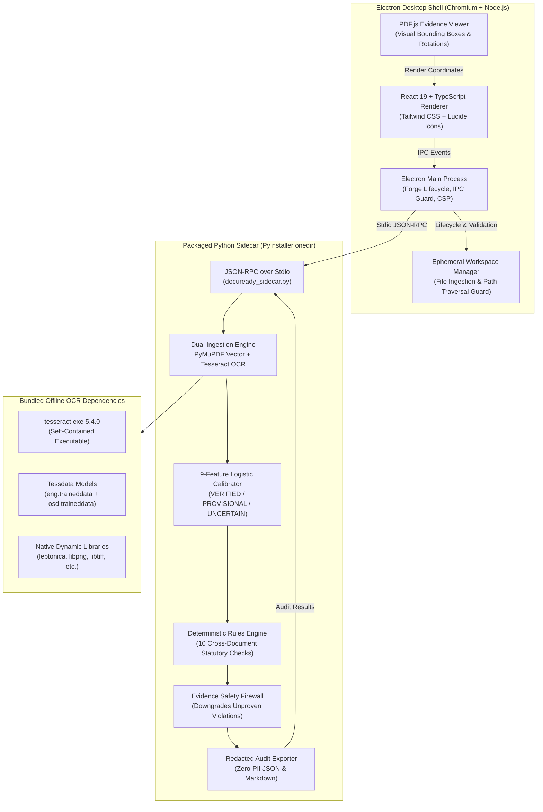

<div align="center">
  
  <h1>DocuReady</h1>
  <p><strong>Deterministic, offline-first pre-flight readiness audit for government scholarship and citizen welfare applications.</strong></p>
</div>

[](https://github.com/Algoryxz/DocuReady/actions/workflows/tests.yml)
[](apps/desktop)
[](tests)
[](LICENSE)
[](docs/02-ARCHITECTURE/SECURITY_AND_PRIVACY.md)
[-blueviolet.svg)](apps/desktop/out/make)

---

## Important Product Distinction

DocuReady exists in two complementary surfaces:

| Surface | Purpose & Architecture | Hosted Location / Access |
| :--- | :--- | :--- |
| **🌐 Informational Web Showcase** | Public-facing product showcase, statutory overview, and interactive architecture guide. **Does not process citizen documents or execute audits.** Zero document data is uploaded or stored. | **[docu-ready-steel.vercel.app/#workflow](https://docu-ready-steel.vercel.app/#workflow)** |
| **💻 Offline Desktop Application** | **The canonical core product deliverable.** Full-featured native Windows desktop app running 100% locally. Bundles the complete Python audit engine sidecar, PDF.js visual evidence viewer, OCR fallback, and cross-document validation pipeline with zero external network connectivity. | **[Download Windows Installer](#windows-desktop-download--installation)** |

---

## About DocuReady

**DocuReady** is a local-first, deterministic applicant-side document audit assistant designed for scholarship and public-benefit applications (such as India's National Scholarship Portal, state post-matric schemes, and social welfare programs). 

Across government portals, over 30% of scholarship applications face rejection, delays, or forfeiture of critical education funds due to simple clerical discrepancies—such as name variations across certificates, date-of-birth format ambiguities (`DD/MM/YYYY` vs. `MM/DD/YYYY`), expired income certificates, or blurry scans.

DocuReady audits multi-document application packets **before submission**, cross-referencing names, dates, categories, validity windows, and financial figures across Income Certificates, Caste Certificates, Domicile Certificates, Marksheets, and Bank Passbooks. Every finding is anchored directly to its source document coordinates with visual bounding box provenance.

> [!NOTE]
> **Advisory Disclaimer:** DocuReady is an offline pre-submission demographic consistency and document readiness linter, not an official government portal. It does not provide legal advice, official statutory certification, or guarantee government scheme acceptance or benefit disbursement. A successful pre-check indicates only that the configured checks passed on the provided files; applicants must always follow official scheme instructions.

---

## Desktop System Architecture

DocuReady is engineered with a secure, offline, multi-tier desktop architecture:



### Architectural Guarantees
1. **Strict Process Isolation:** Renderer runs with `contextIsolation: true`, `nodeIntegration: false`, `sandbox: true`, and `webSecurity: true`.
2. **Strict Content Security Policy (CSP):** `default-src 'self'; script-src 'self'; style-src 'self' 'unsafe-inline'; img-src 'self' data: blob:; connect-src 'self'; font-src 'self' data:; object-src 'none'`.
3. **Stdio JSON-RPC Sidecar Protocol:** The Electron main process communicates with the compiled Python audit engine exclusively via stdin/stdout newline-delimited JSON messages (`health`, `audit_packet`, `validate_document`, `replace_and_reaudit`, `shutdown`).
4. **Zero-PII Redaction:** All diagnostic logs and exported audit reports redact Aadhaar numbers, tax IDs, and sensitive citizen identity attributes.

---

## Windows Desktop Download & Installation

The desktop application has been built, packaged, and verified for Windows 10/11 64-bit systems.

### Release Artifact Manifest

All distributables are located in `apps/desktop/out/make/`:

| Artifact | Type | File Size | SHA-256 Checksum | Purpose |
| :--- | :--- | :--- | :--- | :--- |
| **`DocuReady-0.1.0-Setup.exe`** | Setup Installer | 415.65 MB | `E8326B71C919A203A3099126CB745C1FAC1D84D01BDBD1E442F1432D8578EC01` | Recommended Windows installer with desktop and Start Menu shortcuts. |
| **`DocuReady-win32-x64-0.1.0.zip`** | Portable ZIP | 426.01 MB | `DEE339C290B23A953BF9A86ED94E0EDD1AAEE79C4E5714283C004350A80196C5` | Zero-install standalone archive. Extract and run `DocuReady.exe`. |
| **`DocuReady-0.1.0-full.nupkg`** | NuGet Package | 416.31 MB | `2CC94A5FB06B89E9AD4DBB44ABE17F5A88601DD1A182C62BEC298F534BC220D7` | Squirrel package containing full application payload for updates. |
| **`RELEASES`** | Manifest | 80 bytes | `6DEC1473B7123F7544BDEFEA1B5F8DAB1CBA5D46110FA816EC841666E39CC247` | Squirrel delta/release catalog index. |
| **`DocuReady.exe`** | Executable | 238.47 MB | `79194130F9177F53B5D824DFC8987381C4DE1829DE5C287432EF5D30B0A93FF2` | Main unpacked application binary in `apps/desktop/out/DocuReady-win32-x64/`. |

### Installation Instructions

#### Method 1: Windows Setup Installer (Recommended)
1. Download `DocuReady-0.1.0-Setup.exe` from the release build artifacts or build it locally.
2. Double-click `DocuReady-0.1.0-Setup.exe`.
3. The Squirrel installer automatically installs DocuReady into `%LOCALAPPDATA%\DocuReady`, sets up Start Menu and Desktop shortcuts, and launches the application.
4. To install silently (unattended/enterprise deployment):
   ```cmd
   DocuReady-0.1.0-Setup.exe --silent
   ```

#### Method 2: Portable Standalone ZIP (No Admin Rights Required)
1. Download `DocuReady-win32-x64-0.1.0.zip`.
2. Extract the archive to any local folder (e.g. `C:\DocuReady` or a USB drive).
3. Open the extracted directory and run `DocuReady.exe`.
4. No installation, registry keys, or administrative privileges are required.

### Bundled OCR Runtime Status
- **Self-Contained Tesseract 5.4.0:** DocuReady bundles the complete Tesseract OCR runtime (`tesseract.exe`, English and OSD traineddata models, and all native DLL dependencies) inside `resources/docuready_sidecar/tesseract/`.
- **Zero Host Prerequisites:** The desktop application works immediately out-of-the-box on clean Windows installations without requiring Python, Node.js, or Tesseract on the system `PATH`.
- **System Discovery Fallback:** If needed for custom deployments, DocuReady also supports environment variables (`DOCUREADY_TESSERACT_PATH`, `DOCUREADY_RESOURCES_DIR`) or discovers host-installed Tesseract installations.

---

## Document Consistency & Scheme Requirement Rules Engine

DocuReady evaluates document packets against 10 explicit cross-document checks (with verified statutory citations and state revenue operational heuristics):

| Rule ID | Rule Name | Regulatory / Statutory Basis | Severity |
| :--- | :--- | :--- | :--- |
| **RULE-NAME-01** | Name Consistency | MeitY Demographic Verification Standards 2023 & MoSJE Guidelines §4.2 | `CRITICAL` |
| **RULE-DOB-01** | Date of Birth Consistency | Secondary Education Examination Board Rule 8 & UIDAI Verification Norms | `CRITICAL` |
| **RULE-INC-01** | Statutory Income Ceiling | Centrally Sponsored Post-Matric Scholarship Scheme Guideline 3.1 | `CRITICAL` |
| **RULE-INC-02** | Declared vs. Certified Income | State Scholarship Portal Compliance Guidelines Clause 5.1 | `CRITICAL` |
| **RULE-EXP-01** | Certificate Validity Period | State Revenue Authority Validity Norms (1 Financial Year heuristic) | `CRITICAL` |
| **RULE-CST-01** | Caste Category Consistency | Constitution (Scheduled Castes/Scheduled Tribes) Orders & Scheme Clause 4 | `CRITICAL` |
| **RULE-DOM-01** | Domicile Verification | State Scholarship Rules Clause 2(a) | `CRITICAL` |
| **RULE-DOC-01** | Mandatory Document Checklist | Scheme Mandatory Application Checklist Clause 2.1 | `CRITICAL` |
| **RULE-DOC-02** | Document Legibility & Scan Quality | NSP Upload Guidelines & Information Technology Act 2000 Section 6A | `CRITICAL` |
| **RULE-MRK-01** | Academic Eligibility Cutoff | Scheme Educational Criteria Notification (SC/ST Applicants Exempt) | `CRITICAL` |

### 2. 9-Feature Logistic Confidence Calibrator & Safety Firewall
To prevent unfair rejections caused by degraded scans, low camera resolution, or paper creases, DocuReady classifies evidence confidence into three calibrated states:
- **`VERIFIED` ($P \ge 0.85$):** High certainty; triggers standard rule evaluation.
- **`PROVISIONAL` ($0.60 \le P < 0.85$):** Moderate certainty; emits warnings rather than hard rejections.
- **`UNCERTAIN` ($P < 0.60$):** Unreliable evidence; automatically downgraded by the Evidence Safety Firewall to `MANUAL REVIEW` instead of failing the applicant.

### 3. Visual Bounding Box Provenance & PDF.js Viewer
Every extracted datum retains its physical page number, bounding box coordinates (`[x0, y0, x1, y1]`), and rotation metadata. When a user selects any finding in the desktop UI:
- The PDF.js viewer smoothly navigates to the exact page.
- Renders an interactive highlight box over the source evidence.
- Handles coordinate transformations across $0^\circ$, $90^\circ$, $180^\circ$, and $270^\circ$ viewport rotations.

### 4. Interactive Single-Document Replacement
Applicants can replace a single defective document (e.g. upload a refreshed Income Certificate) and re-audit the entire packet in-memory in under 1 second without re-uploading the entire bundle.

### 5. Domain-Specific Normalizers
- **Aadhaar Verhoeff Checksum:** Mathematically verifies 12-digit Aadhaar numbers against the dihedral group $D_5$ algorithm.
- **Indian Date Normalizer:** Resolves ambiguous date formats (`05/06/2004` vs. `06/05/2004`) using multi-certificate cross-referencing.
- **Indian Currency Parser:** Parses numeric amounts in Lakhs and Crores (`₹2.5 Lakh`, `2,50,000/-`).
- **RBI IFSC Code Verifier:** Validates bank branch routing codes against RBI format specifications.

---

## Developer Quickstart: Building from Source

### Prerequisites
- **Node.js:** v20.x or v22.x LTS (`node -v`)
- **Python:** 3.11, 3.12, 3.13, or 3.14 (64-bit)
- **Git**

### 1. Clone & Set Up Repository
```bash
git clone https://github.com/Algoryxz/DocuReady.git
cd DocuReady

# Create and activate Python virtual environment
python -m venv .venv
.venv\Scripts\activate

# Install Python package with development dependencies
pip install -e ".[all]"

# Install desktop Node dependencies
npm --prefix apps/desktop install
```

### 2. Compile Python Sidecar
```bash
# Build the self-contained sidecar onedir distribution
pyinstaller sidecar/docuready_sidecar.spec --noconfirm
```

### 3. Run Desktop Application in Development Mode
```bash
npm --prefix apps/desktop run start
```

### 4. Package Windows Installers & Portable ZIP
```bash
# Package the application binary
npm --prefix apps/desktop run package

# Build the Squirrel installer (.exe) and portable ZIP (.zip)
npm --prefix apps/desktop run make
```
The distributables will be output to `apps/desktop/out/make/`.

---

## Verification & Test Metrics

DocuReady enforces end-to-end automated testing across all layers:

```bash
# 1. Run Python Audit Engine Test Suite (450 passing tests)
pytest

# 2. Run Desktop Node Test Suite (21 passing tests)
npm --prefix apps/desktop test

# 3. Verify TypeScript Type Safety (0 errors)
npm --prefix apps/desktop run lint:types
```

### Test Suite Summary

| Test Domain | Target Suite | Status | Key Verifications |
| :--- | :--- | :--- | :--- |
| **Python Audit Engine** | `pytest` (452 items) | **450 Passed, 2 Skipped** (100% active) | Golden baselines, statutory rule matrix, date invariance, safety downgrades, zero-network egress invariants, adversarial corrupt document handling. |
| **Desktop Shell & IPC** | `apps/desktop/tests/` | **21 Passed, 0 Failed** | Packaged sidecar execution, health handshake, crash recovery, workspace traversal defense, file magic-byte validation, Content Security Policy, zero-PII diagnostics. |
| **Evidence Math & Viewport** | `apps/desktop/tests/evidence.test.ts` | **Passed** | Bounding box normalization, clamp behavior, viewport transformations across $0^\circ$, $90^\circ$, $180^\circ$, and $270^\circ$ rotations. |
| **TypeScript Type Checking** | `tsc --noEmit` | **0 Errors** | Strict type compliance across main process, preload bridge, and renderer UI. |

---

## Verified Benchmarks

Evaluation performed on reference hardware against the synthetic validation suite:

| Benchmark Suite | Documents | Exact Match Accuracy | Mean Latency per Packet | Execution Pipeline |
| :--- | :--- | :--- | :--- | :--- |
| **Canonical Synthetic Packets** | 48 Documents | 100.0% | 0.38s | Native Vector Extraction |
| **Degraded Physical Scans** | 60 Documents | 91.7% | 1.15s | Vector + Local Tesseract OCR |

*Note: Benchmarks reflect performance on synthetic test datasets under controlled test conditions and do not represent field portal acceptance guarantees.*

---

## Security, Privacy & Compliance

DocuReady is built from the ground up for strict compliance with privacy standards such as India's **Digital Personal Data Protection (DPDP) Act 2023**:

1. **Zero External Network Egress:** The application makes zero outbound HTTP/HTTPS requests. Documents, audit metadata, and citizen identity attributes never leave the local computer.
2. **Ephemeral Document Workspace:** Uploaded files are copied into isolated, temporary per-session directories and completely removed upon session completion or window closure.
3. **Automated Zero-PII Redaction:** Exported JSON and Markdown reports redact sensitive government identifiers (e.g. masking Aadhaar numbers to show only the last 4 digits: `XXXX-XXXX-1234`).
4. **Offline Demographics Verification:** DocuReady functions entirely offline on standard laptops and desktops without cloud dependencies or telemetry beacons.

---

## Licensing & Third-Party Attribution

DocuReady is licensed under the **Apache License 2.0**. See the [LICENSE](LICENSE) file for complete terms and conditions.

### Third-Party Components & Copyleft Disclosures

The application distribution incorporates third-party open-source components with explicit license attribution (detailed in the [NOTICE](NOTICE) file):

- **Tesseract OCR:** Copyright © Google LLC. Licensed under the [Apache License 2.0](https://www.apache.org/licenses/LICENSE-2.0).
- **Leptonica Image Processing Library:** Copyright © Dan Bloomberg. Licensed under the [2-Clause BSD License](http://www.leptonica.org/).
- **PDF.js (`pdfjs-dist`):** Copyright © Mozilla Foundation. Licensed under the [Apache License 2.0](https://www.apache.org/licenses/LICENSE-2.0).
- **React & Lucide React:** Copyright © Meta Platforms, Inc. and Lucide Contributors. Licensed under the [MIT License](https://opensource.org/licenses/MIT).
- **PyMuPDF (`fitz`):** Copyright © Artifex Software, Inc. PyMuPDF is licensed under the GNU Affero General Public License v3 (**AGPLv3**). 
  - *Licensing Notice:* For enterprise deployments requiring strictly permissive licensing, DocuReady provides an architectural abstraction layer (`src/docuready/ingest/`) designed for seamless drop-in integration with the Apache-2.0 licensed **PDFium** backend (`pypdfium2`), eliminating AGPLv3 copyleft exposure where required.

Copyright © 2026 HackNation DocuReady Authors (Algoryxz).
