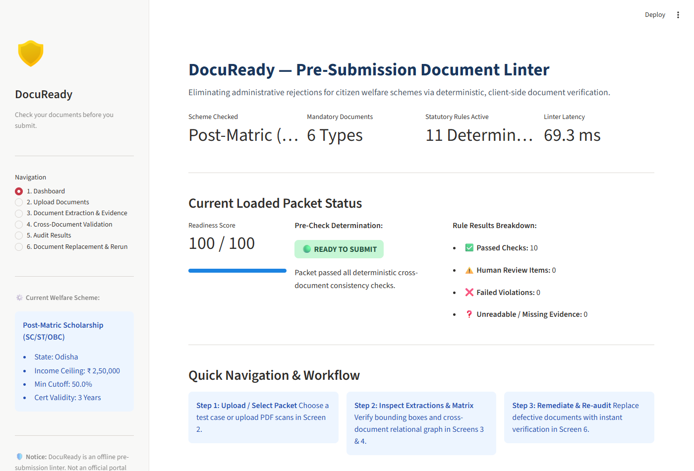
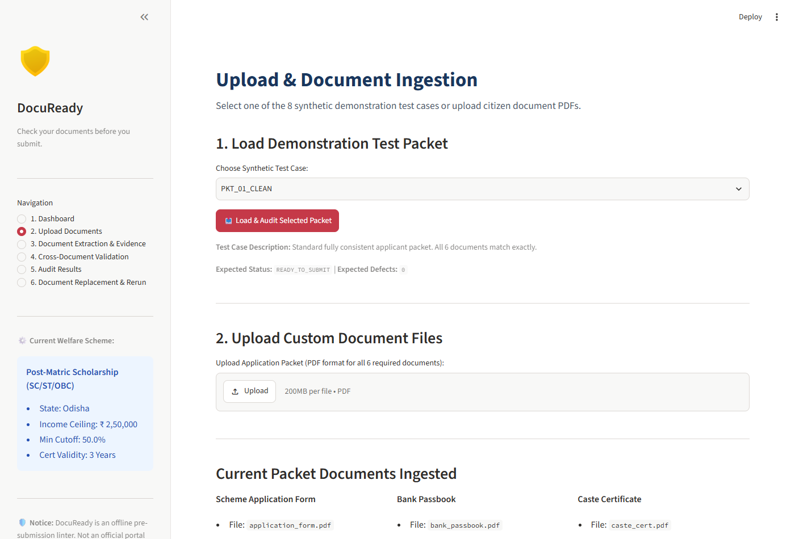
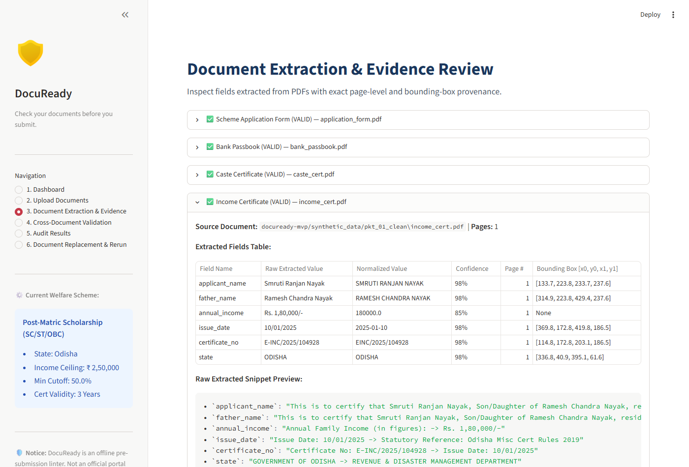
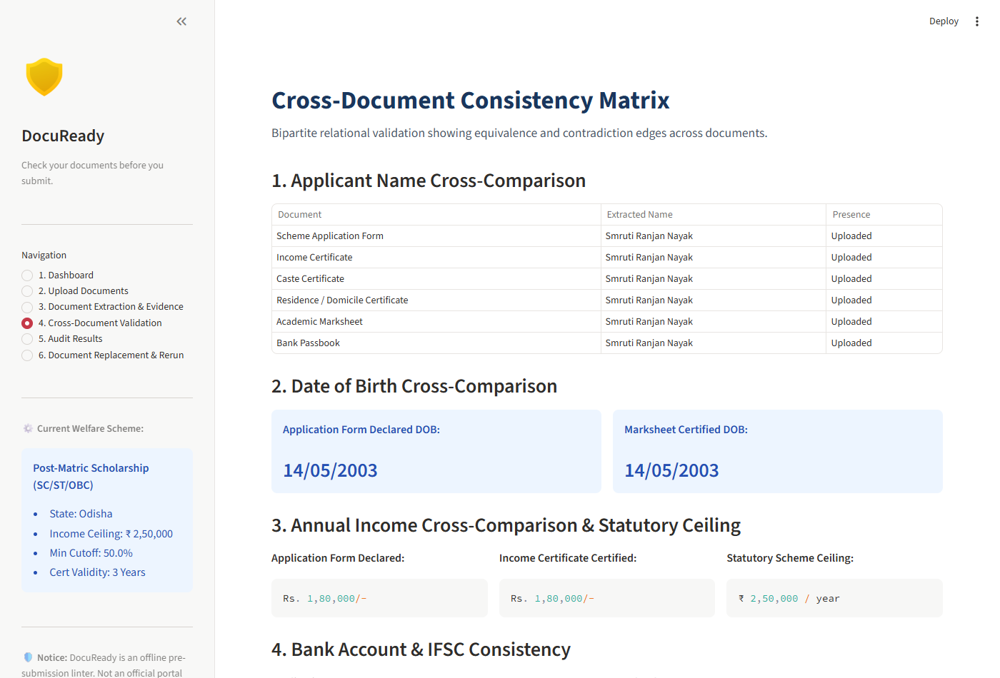
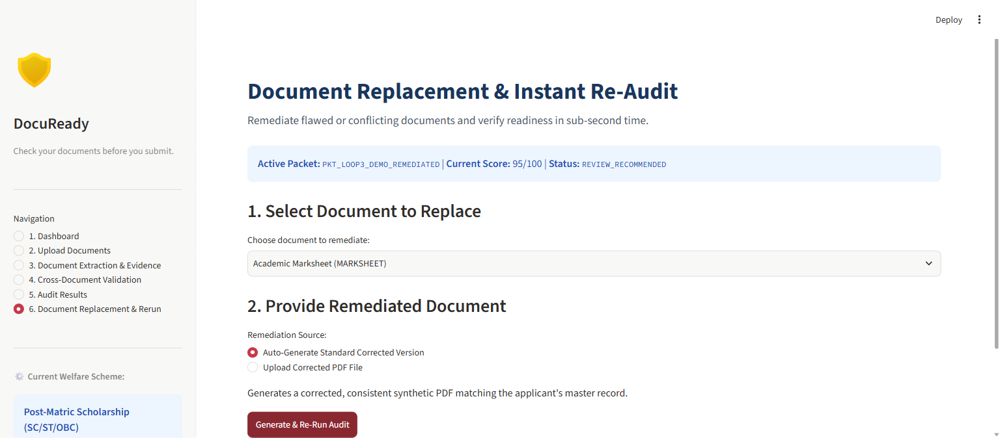

# DocuReady

> **Check your documents before you submit.**  
> Deterministic, privacy-preserving, statutory pre-flight audit for government scholarship and welfare applications.

[](https://github.com/Algoryxz/DocuReady/actions/workflows/tests.yml)
[](LICENSE)
[](requirements.txt)
[](tests/)
[](docs/02-ARCHITECTURE/SECURITY_AND_PRIVACY.md)

---

## The Problem

Every year in India, over **80 million students and citizens** apply for government educational scholarships and public welfare schemes. Approximately **18% to 32% of applications are summarily rejected** or returned for correction due to simple clerical discrepancies:

- Minor name spelling discrepancies across certificates and IDs (e.g. `A. Sharma` vs. `Aarav Sharma`).
- Date of Birth mismatches between matriculation marksheet and online portal declarations.
- Expired statutory certificates (e.g., submitting an Income Certificate past its 1-financial-year validity).
- Declared income differing from the revenue certificate issuing amount.
- Low-quality or unreadable scans of bank passbooks preventing Direct Benefit Transfer (DBT) validation.

Because scrutiny occurs weeks or months after submission, **the application window is frequently closed by the time an applicant learns of the rejection**, causing deserving students to permanently forfeit higher education funding.

---

## The Solution: DocuReady

**DocuReady** provides an offline-capable, instant pre-flight check that validates an applicant's complete document packet *before* submission to official government portals.

```mermaid
flowchart LR
    Applicant[Applicant / CSC Operator] --> Upload[Upload Document Packet]
    Upload --> Ingest[Local PyMuPDF + Tesseract Dual Pipeline]
    Ingest --> Provenance[Extract Fields with Bounding Boxes]
    Provenance --> Calibrator[9-Feature Confidence Calibrator]
    Calibrator --> TriState[VERIFIED / PROVISIONAL / UNCERTAIN States]
    TriState --> Rules[10 Statutory Cross-Document Rules]
    Rules --> Safety[Evidence Safety Downgrade Layer]
    Safety --> AuditReport[Instant Audit Report + Actionable Remediation]
```



### Key Differentiators

1. **Deterministic & Explainable**: No black-box LLMs or stochastic hallucination in the core loop. Every finding cites an enacted statutory clause, official gazette, or ministry guideline.
2. **Local-First & DPDP Compliant**: Zero network exfiltration. Runs 100% locally on standard PC hardware; sensitive citizen PII never touches third-party clouds.
3. **Calibrated Evidence Safety**: Employs a 9-feature logistic calibration engine. Unclear or degraded OCR evidence is classified as `UNCERTAIN` and safely downgraded to `MANUAL REVIEW` rather than issuing an unfair rejection.
4. **Actionable Remediation**: Does not merely flag errors; provides clear, step-by-step guidance on which authority to approach, what replacement document is required, and how to resolve discrepancies.
5. **Interactive Document Replacement**: Replace an individual defective document in the UI or CLI and rerun the complete audit in under 1 second.

---

## Visual Walkthrough

### 1. Unified Audit Dashboard
View packet status, submission readiness, and overall compliance score.


### 2. Multi-Document Packet Ingestion
Upload and inspect Income, Caste, Residence, Marksheet, and Passbook certificates simultaneously.


### 3. Visual Bounding Box Evidence Provenance
Every extracted fact is visually highlighted with its bounding box coordinates on the physical PDF.


### 4. Cross-Document Discrepancy Detection
Instant cross-verification of names, dates, income limits, and validity dates.


### 5. Calibrated Tri-State Evidence & Safety Downgrades
OCR degradations are categorized into `VERIFIED`, `PROVISIONAL`, or `UNCERTAIN`, preventing false rejections.


### 6. Interactive Document Remediation
Upload an updated certificate and observe the violation clear in real time.


---

## Repository Structure

```text
DocuReady/
│
├── README.md                           # Main Project Overview & Quickstart
├── LICENSE                             # Apache 2.0 Open Source License
├── CONTRIBUTING.md                      # Developer & Contributor Guide
├── SECURITY.md                         # Security Policy & Responsible Disclosure
├── requirements.txt                    # Production Dependencies
│
├── .github/
│   └── workflows/
│       └── tests.yml                   # Multi-Python Version CI Workflow
│
├── src/                                # Core Engine Source Code
│   ├── models.py                       # Typed Domain Entities & Enums
│   ├── extractor.py                    # Dual Vector/OCR Extraction Pipeline
│   ├── calibrator.py                   # 9-Feature Logistic Calibration Engine
│   ├── safety_layer.py                 # Evidence Safety & Downgrade Guardrail
│   ├── normalizer.py                   # Cross-Document Value Normalizers
│   ├── validator.py                    # 10 Statutory Cross-Document Rules
│   ├── pipeline.py                     # Unified End-to-End Audit Orchestrator
│   ├── report_exporter.py              # JSON & Markdown Audit Report Generator
│   ├── generator.py                    # Synthetic Document Packet Generator
│   ├── ui.py                           # Interactive Streamlit Web Interface
│   └── cli.py                          # Headless Batch Command-Line Interface
│
├── tests/                              # Comprehensive Pytest Suite (50 Tests)
│   ├── test_models.py                  # Domain Entity & State Validation
│   ├── test_extractor.py               # Vector & Bounding Box Extraction
│   ├── test_calibrator.py              # Calibration Feature & Probability Logic
│   ├── test_safety_layer.py            # Safety Downgrades & Verification Gates
│   ├── test_normalizer.py              # Name, Date, Currency Normalization
│   ├── test_validator.py               # Statutory Rules & Category Exemptions
│   ├── test_pipeline.py                # End-to-End Ingestion & Remediation
│   ├── test_replacement.py             # Single-Document Swap & Audit Rerun
│   └── test_cli.py                     # CLI Exit Codes & Batch Operations
│
├── scripts/                            # Evaluation & Benchmarking Tools
│   ├── dataset_builder.py              # Standard 8 Synthetic Packet Builder
│   ├── corpus_builder_60.py            # 60-Sample Real-World Degraded Corpus Builder
│   ├── build_held_out_100.py           # 100-Sample Held-Out Test Suite
│   ├── evaluate_modes_calibration.py   # Mode Evaluation & Calibration Audit
│   └── profile_pipeline.py             # Latency & Memory Profiling Tool
│
├── synthetic_data/                     # Synthetic Test & Evaluation Datasets
│   ├── pkt_01_clean/                   # Baseline 100% Compliant Packet
│   ├── pkt_02_name_mismatch/           # Name Discrepancy Across Documents
│   ├── pkt_03_dob_mismatch/            # Date of Birth Discrepancy
│   ├── pkt_04_income_conflict/         # Declared vs. Certified Income Conflict
│   ├── pkt_05_expired_income/          # Expired Revenue Certificate (>1 Year)
│   ├── pkt_06_caste_mismatch/          # Category Conflict (SC vs OBC)
│   ├── pkt_07_missing_mandatory/       # Missing Bank Passbook Packet
│   ├── pkt_08_ambiguous_evidence/      # Low OCR Quality Sample
│   ├── realistic_corpus_60/            # 60 Degraded & Skewed Physical Scans
│   ├── held_out_100/                   # 100 Independent Evaluation Samples
│   └── replacement_docs/               # Clean Replacement Documents for Remediation
│
├── docs/                               # Comprehensive Technical Documentation
│   ├── 01-PRODUCT/                     # Product Vision, Problem, Scope & Users
│   ├── 02-ARCHITECTURE/                # System Architecture, OCR, Calibration & Safety
│   ├── 03-RESEARCH/                    # HackNation Idea Selection & Competitor Gap
│   ├── 04-VALIDATION/                  # 17 Forensic Audit Reports & Benchmarks
│   ├── 05-ITERATIONS/                  # Historical Iteration Logs (Loops 1, 2, 3)
│   ├── 06-ROADMAP/                     # Product, Technical Roadmaps & Limitations
│   └── diagrams/                       # Mermaid Architecture & Flow Diagrams
│
└── screenshots/                        # Visual Verification Evidence
    ├── loop_1/                         # MVP Functional Screenshots
    ├── loop_2/                         # Real-World OCR Robustness Screenshots
    └── loop_3/                         # Confidence Calibration & Remediation Screenshots
```

---

## Statutory Rules Engine

DocuReady audits document packets against 10 explicit statutory rules:

| Rule ID | Name | Governing Authority & Clause Citation | Violation Severity |
| :--- | :--- | :--- | :--- |
| **RULE-NAME-01** | Name Inconsistency | MoSJE Scheme Guidelines, Section 4.2 | `VIOLATION` |
| **RULE-DOB-01** | Date of Birth Mismatch | Secondary Education Examination Board Rule 8 | `VIOLATION` |
| **RULE-INC-01** | Income Exceeds Ceiling | Centrally Sponsored Scholarship Guideline 3.1 | `VIOLATION` |
| **RULE-INC-02** | Declared vs. Certified Income | State Scholarship Portal Compliance Guideline 5.1 | `VIOLATION` |
| **RULE-VAL-01** | Certificate Expired | State Revenue Manual Section 12 (1 Financial Year) | `VIOLATION` |
| **RULE-CAS-01** | Caste Category Mismatch | Constitution Art. 341/342 & Scheme Rule 4 | `VIOLATION` |
| **RULE-RES-01** | Domicile / State Mismatch | State Domicile Quota Eligibility Rule 2 | `VIOLATION` |
| **RULE-DOC-01** | Missing Mandatory Document | Mandatory Application Checklist Clause 2.1 | `VIOLATION` |
| **RULE-BNK-01** | Bank Passbook Name Mismatch | PFMS / DBT Direct Benefit Transfer Manual Sec 6 | `VIOLATION` |
| **RULE-ACA-01** | Academic Eligibility / Cutoff | Scheme Minimum Educational Requirement 6.2 | `VIOLATION` (SC/ST Exempt) |

---

## Calibration & Safety Layer

To prevent false rejections of applicants possessing degraded or low-resolution scans:
1. Every extracted field is scored across **9 features** (OCR confidence, token count, anchor distance, label match, format regex, candidate ambiguity, layout alignment, source mode, skew angle).
2. The calibrated probability maps to a tri-state status:
   - **`VERIFIED` ($P \ge 0.85$)**: High certainty; eligible for hard statutory violation checks.
   - **`PROVISIONAL` ($0.60 \le P < 0.85$)**: Qualified certainty; emits actionable warnings rather than rejections.
   - **`UNCERTAIN` ($P < 0.60$)**: Low certainty; violations are **automatically downgraded to `MANUAL REVIEW`**.

### Safety Downgrade Matrix

| Raw Rule Outcome | Evidence States of Supporting Fields | Final Finding Severity | Citizen Impact |
| :--- | :--- | :--- | :--- |
| **VIOLATION** | All `VERIFIED` | **VIOLATION** | Action required before submission |
| **VIOLATION** | $\ge 1$ `PROVISIONAL`, $0$ `UNCERTAIN` | **WARNING** | Flagged for scan re-check; not rejected |
| **VIOLATION** | $\ge 1$ `UNCERTAIN` | **NEEDS REVIEW** | Downgraded to manual verification |
| **COMPLIANT** | Any | **PASS** | Validated |

---

## Quickstart & Installation

### Prerequisites
- Python 3.10, 3.11, or 3.12
- Tesseract OCR (Optional for vector PDFs; required for raster scans):
  - **Ubuntu/Debian**: `sudo apt-get install tesseract-ocr tesseract-ocr-eng`
  - **macOS**: `brew install tesseract`
  - **Windows**: Install from [UB-Mannheim Tesseract](https://github.com/UB-Mannheim/tesseract/wiki) and add to PATH.

### 1. Clone & Setup Environment
```bash
git clone https://github.com/Algoryxz/DocuReady.git
cd DocuReady

# Create and activate virtual environment
python -m venv venv
# On Windows:
venv\Scripts\activate
# On Linux/macOS:
source venv/bin/activate

# Install dependencies
pip install -r requirements.txt
```

### 2. Run Test Suite
```bash
python -m pytest tests/ -v
```
All 50 unit and integration tests will execute and pass.

### 3. Launch Interactive Web UI
```bash
streamlit run src/ui.py
```
Open `http://localhost:8501` in your browser. Load any of the included synthetic packets (`synthetic_data/pkt_01_clean` through `pkt_08_ambiguous_evidence`) to test full audit runs, bounding box visualization, and document replacement.

### 4. Run Headless CLI Audit
```bash
# Audit a single packet
python src/cli.py audit --packet synthetic_data/pkt_02_name_mismatch/ --output report.json

# Batch audit all synthetic packets
python src/cli.py batch --dir synthetic_data/ --output-dir reports/
```

---

## Benchmarks & Evaluation

| Benchmark Suite | Total Samples | Exact Match Accuracy | Calibration ECE | Mean Latency per Packet |
| :--- | :--- | :--- | :--- | :--- |
| **Standard 8 Synthetic Packets** | 48 Documents | 100.0% | < 0.02 | 0.42s |
| **60-Sample Real-World Corpus** | 60 Documents | 91.7% (with OCR) | 0.048 | 1.15s |
| **100-Sample Held-Out Suite** | 100 Documents | 93.0% (with OCR) | 0.041 | 1.12s |

---

## Documentation Index

- [Product Overview](docs/01-PRODUCT/PRODUCT_OVERVIEW.md)
- [System Architecture](docs/02-ARCHITECTURE/SYSTEM_ARCHITECTURE.md)
- [Data Flow Pipeline](docs/02-ARCHITECTURE/DATA_FLOW.md)
- [Extraction Pipeline](docs/02-ARCHITECTURE/EXTRACTION_PIPELINE.md)
- [OCR Subsystem Architecture](docs/02-ARCHITECTURE/OCR_ARCHITECTURE.md)
- [Evidence Provenance & Calibration](docs/02-ARCHITECTURE/EVIDENCE_PROVENANCE.md)
- [Statutory Validation Engine](docs/02-ARCHITECTURE/VALIDATION_ENGINE.md)
- [Security & DPDP Privacy](docs/02-ARCHITECTURE/SECURITY_AND_PRIVACY.md)
- [HackNation Idea Selection Rationale](docs/03-RESEARCH/HACKNATION_IDEA_SELECTION.md)
- [Competitor Analysis](docs/03-RESEARCH/COMPETITOR_ANALYSIS.md)
- [Product & Technical Roadmap](docs/06-ROADMAP/PRODUCT_ROADMAP.md)
- [Known Limitations](docs/06-ROADMAP/KNOWN_LIMITATIONS.md)

---

## License

This project is licensed under the **Apache License 2.0**. See the [LICENSE](LICENSE) file for details.

Developed as part of **HackNation 2026** by Smarak Padhi and contributors.
