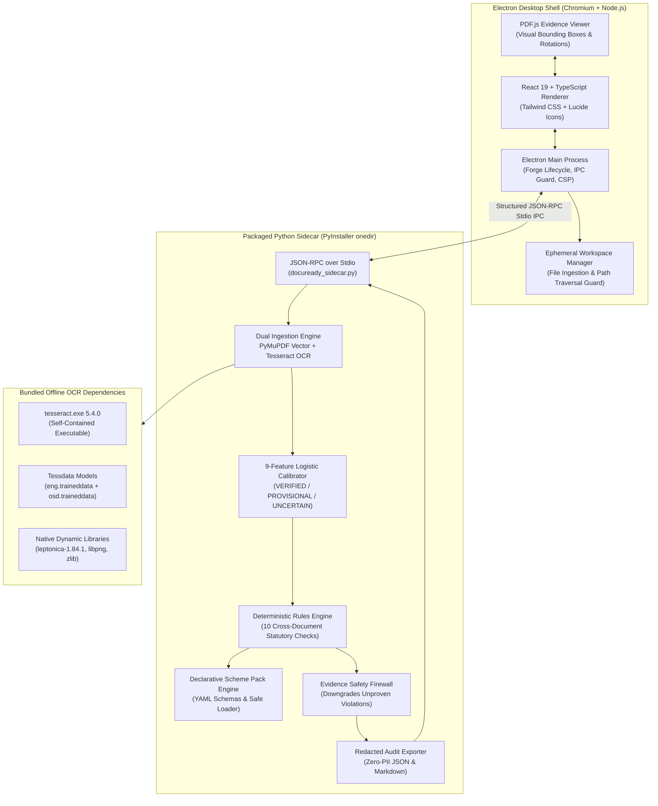

<div align="center">
  
  <h1>DocuReady</h1>
  <p><strong>Deterministic, offline-first pre-flight readiness audit for government scholarship and citizen welfare applications.</strong></p>
</div>

[](https://github.com/Algoryxz/DocuReady/actions/workflows/tests.yml)
[](apps/desktop)
[](tests)
[](LICENSE)
[](pyproject.toml)
[](PRIVACY_NETWORK_AUDIT.md)
[-blueviolet.svg)](apps/desktop/out/make)

---

## Important Product Distinction

DocuReady exists in two complementary surfaces:

| Surface | Purpose & Architecture | Hosted Location / Access |
| :--- | :--- | :--- |
| **🌐 Informational Web Showcase** | Public-facing product showcase, statutory overview, and interactive architecture guide. **Does not process citizen documents or execute audits.** Zero document data is uploaded or stored. | **[docu-ready-steel.vercel.app/#workflow](https://docu-ready-steel.vercel.app/#workflow)** |
| **💻 Offline Desktop Application** | **The canonical core product deliverable.** Native Windows desktop app designed for local document processing. Bundles the Python audit engine sidecar, PDF.js visual evidence viewer, OCR fallback, and cross-document validation pipeline. The current network audit observed no connections in its recorded samples but does not establish a system-wide zero-egress guarantee. | **[Download Windows Installer](#windows-desktop-download--installation)** |

---

## About DocuReady

**DocuReady** is a local-first, deterministic applicant-side document audit assistant designed for scholarship and public-benefit applications (such as India's National Scholarship Portal, state post-matric schemes, and social welfare programs). 

Clerical discrepancies—such as name variations across certificates, date-of-birth format ambiguities (`DD/MM/YYYY` vs. `MM/DD/YYYY`), expired income certificates, or blurry scans—can create avoidable delays, rework, or requests for correction. This repository does not assert a quantified prevalence rate.

DocuReady audits multi-document application packets **before submission**, cross-referencing names, dates, categories, validity windows, and financial figures across Income Certificates, Caste Certificates, Domicile Certificates, Marksheets, Bank Passbooks, and Scholarship Application Forms. Every finding is anchored directly to its source document coordinates with visual bounding box provenance.

> [!NOTE]
> **Advisory Disclaimer:** DocuReady is an assistive, pre-submission demographic verification tool and document readiness linter, not an official government portal. It does not provide legal advice, official statutory certification, or guarantee government scheme acceptance or benefit disbursement. A successful pre-check indicates only that the configured checks passed on the provided files; applicants must always follow official scheme instructions.

---

## Desktop System Architecture

DocuReady is engineered with a secure, offline, multi-tier desktop architecture:



### Windows Desktop Download & Installation

The desktop application is packaged for 64-bit Windows systems with self-contained runtimes:

1. **Standard Windows Installer (`.exe`):**
   - Download `DocuReady-Setup-0.1.0.exe` from `apps/desktop/out/make/squirrel.windows/x64/`.
   - Run the installer. Creates desktop/start-menu shortcuts and an uninstaller.
2. **Portable Standalone Distribution (`.zip`):**
   - Download `DocuReady-win32-x64-0.1.0.zip` from `apps/desktop/out/make/zip/win32/x64/`.
   - Extract and launch `DocuReady.exe` directly without administrative installation.
3. **Bundled OCR Runtime:**
   - Bundles an isolated Tesseract 5.4.0 executable, `eng.traineddata`, and native DLLs alongside the Python PyInstaller sidecar. No external system software installation is required for packaged execution.

---

## Document Consistency & Scheme Requirement Rules Engine

DocuReady executes 10 cross-document consistency checks and scheme requirement verifications across application packets:

1. **Cross-Document Name Consistency (`RULE-NAME-01`):** Cross-references applicant names across matriculation marksheets, Aadhaar, and income certificates using explicit match grades (`EXACT`, `INITIALS`, `REORDER`, `DIACRITICS`).
2. **Date of Birth Alignment (`RULE-DOB-01`):** Cross-references date of birth between matriculation marksheets and application declarations, resolving format ambiguities (`DD/MM/YYYY` vs. `MM/DD/YYYY`).
3. **Document Slot Verification (`RULE-SLOT-01`):** Verifies uploaded documents against expected document slots (e.g. Income Certificate, Caste Certificate, Marksheet, Bank Passbook, Aadhaar) using anchor headers. Produces human-review findings on mismatches rather than automatic rejections.
4. **Income Certificate Validity & Ceiling (`RULE-INC-01`, `RULE-EXP-01`):** Evaluates annual family income against scheme ceilings and verifies certificate issue dates. Certificate validity is checked against an operational heuristic window (e.g., one financial year), not a uniform national statutory mandate.
5. **Community & Caste Category Alignment (`RULE-CAT-01`):** Verifies declared scheme categories (SC, ST, OBC, SEBC) against certified caste certificates and authority jurisdiction.
6. **Permanent Residence & Domicile Alignment (`RULE-DOM-01`):** Checks residency status and territorial jurisdiction for state-specific scholarship eligibility.
7. **Bank Passbook DBT Verification (`RULE-BANK-01`, `RULE-BANK-02`):** Validates account holder name matching, account number syntax, and IFSC format. Disallows commercial bank statements as substitutes for savings passbooks.
8. **Missing Mandatory Documents (`RULE-DOC-01`):** Identifies absent mandatory uploads required for statutory scheme evaluation.
9. **Document Legibility & Corruption (`RULE-DOC-02`):** Identifies corrupted, unreadable, or truncated files.
10. **Deterministic Clock & Replay Invariance:** Evaluates all temporal validity rules against an explicitly injected `as_of` date clock, guaranteeing deterministic reproducibility without hidden system-clock drift.

### Scheme Pack System

In addition to programmatic rules, DocuReady supports declarative YAML-based Scheme Packs (`packs/generic.demo/`):
- **Closed Primitive Engine (`src/docuready/rules/engine.py`):** Evaluates rule logic through a sandboxed, Turing-incomplete DSL.
- **Safe Loader & Schema (`src/docuready/rules/schema.py`, `src/docuready/rules/loader.py`):** Enforces strict types, parameter schemas, and statutory citations.
- **Pack Linter CLI (`docuready-lint`):** Validates scheme pack definitions and sources before runtime execution.

---

## Core Capabilities & Innovations

### 1. Calibrated Evidence Safety Layer
Ingested evidence passes through a 9-feature logistic regression calibrator:
- **`VERIFIED` ($P \ge 0.85$):** High certainty; triggers standard rule evaluation.
- **`PROVISIONAL` ($0.60 \le P < 0.85$):** Moderate certainty; emits warnings rather than hard rejections.
- **`UNCERTAIN` ($P < 0.60$):** Unreliable evidence; automatically downgraded by the Evidence Safety Firewall to `MANUAL REVIEW` instead of failing the applicant.

### 2. Visual Bounding Box Provenance & PDF.js Viewer
Every extracted datum retains its physical page number, bounding box coordinates (`[x0, y0, x1, y1]`), and rotation metadata. When a user selects any finding in the desktop UI:
- The PDF.js viewer smoothly navigates to the exact page.
- Renders an interactive highlight box over the source evidence.
- Handles coordinate transformations across $0^\circ$, $90^\circ$, $180^\circ$, and $270^\circ$ viewport rotations.

### 3. Interactive Single-Document Replacement
Applicants can replace a single defective document (e.g. upload a refreshed Income Certificate) and re-audit the entire packet in-memory in under 1 second without re-uploading the entire bundle.

### 4. Domain-Specific Normalizers
- **Aadhaar Verhoeff Checksum:** Checks the checksum structure of a 12-digit value using the Verhoeff algorithm; it does not authenticate an Aadhaar holder or verify the number with UIDAI.
- **Indian Date Normalizer:** Resolves ambiguous date formats (`05/06/2004` vs. `06/05/2004`) using multi-certificate cross-referencing.
- **Indian Currency Parser:** Parses numeric amounts in Lakhs and Crores (`₹2.5 Lakh`, `2,50,000/-`).
- **IFSC Format Check:** Checks whether an IFSC-like value matches expected syntax; it does not verify a live bank branch or confirm the code against an RBI registry.

---

## Architecture & Repository Structure

DocuReady is organized as a modular monorepo combining the native Electron desktop shell and the core Python audit package:

```text
DocuReady/
├── pyproject.toml                      # Standard PEP 517/518 Python build configuration
├── LICENSE                             # Apache 2.0 Open Source License
├── NOTICE                              # Third-party attribution & copyleft notices
├── README.md                           # Repository documentation
├── PRIVACY_NETWORK_AUDIT.md            # Socket-polling privacy audit and network limits
├── THIRD_PARTY_LICENSES.md             # Third-party component licenses & disclosures
│
├── apps/
│   └── desktop/                        # Native Electron desktop application
│       ├── package.json                # Electron Forge & Vite configuration
│       ├── src/
│       │   ├── main.ts                 # Hardened Electron main process & lifecycle
│       │   ├── preload.ts              # Context-isolated secure IPC bridge
│       │   ├── renderer/               # React 19 UI with Tailwind CSS & PDF.js
│       │   ├── sidecar.ts              # Python sidecar child-process lifecycle manager
│       │   └── workspace.ts            # Ephemeral workspace manager & path traversal guard
│       └── tests/                      # Desktop Node test suite (21 tests)
│
├── sidecar/                            # Standalone Python sidecar packaging
│   ├── docuready_sidecar.py            # JSON-RPC stdio protocol bridge
│   └── docuready_sidecar.spec          # PyInstaller onedir packaging specification
│
├── src/
│   └── docuready/                      # Core Python audit engine package
│       ├── domain/                     # Typed domain entities, enums & models
│       ├── ingest/                     # PDF ingestion, vector extractor, slot classifier, OCR fallback
│       ├── evidence/                   # 9-feature logistic confidence calibrator
│       ├── normalize/                  # Deterministic Verhoeff, date, currency, IFSC normalizers
│       ├── outcome/                    # Evidence safety firewall & status resolver
│       ├── rules/                      # Scheme rules, closed primitive engine, pack loader & schema
│       ├── pipeline.py                 # Unified end-to-end audit orchestrator
│       ├── report/                     # Privacy-preserving redacted JSON & Markdown exporters
│       └── interfaces/                 # Console CLI ("docuready") and Streamlit reference UI
│
├── packs/                              # Declarative scheme packs
│   └── generic.demo/                   # Canonical reference pack (pack.yaml & sources.yaml)
│
├── tests/                              # Comprehensive test suite (612 test items)
│   ├── contract/                       # Claims register & zero-network contract tests
│   ├── integration/                    # Rule matrix & scheme pack matrix integration tests
│   ├── unit/                           # Outcome resolver per-rule truth tables
│   ├── test_slot_validation.py         # Scheme-aware document slot validation (51 tests)
│   ├── test_match_grades_clock.py      # Match grades and injected clock tests (19 tests)
│   ├── test_desktop_sidecar_protocol.py# JSON-RPC sidecar protocol tests
│   ├── test_pack_engine.py             # Closed primitive engine tests
│   ├── test_golden_baseline.py         # Bit-for-bit regression suite with diagnostic diffs
│   └── test_adversarial.py             # Adversarial edge cases & malformed files
│
├── synthetic_data/                     # Synthetic test packets (no real citizen PII)
│   ├── ground_truth_manifest.json      # Dataset metadata & expected audit findings
│   └── pkt_01_clean/ ... pkt_08/       # Canonical test packets
│
├── docs/                               # Engineering documentation & decision records
│   ├── START_HERE.md                   # Onboarding & architecture overview
│   ├── ARCHITECTURE_V2.md              # Target modular architecture specification
│   ├── ARCHITECTURE_REVIEW.md          # Deep architectural critique and risk register
│   ├── CLAIMS_REGISTER.md              # Governance audit matrix of public-facing claims
│   ├── CITATION_AUDIT.md               # Statutory citations and heuristic classifications
│   ├── BACKLOG.md                      # Project workstreams and delivery gate register
│   └── STATUS.md                       # Task delivery tracking status
│
└── scripts/                            # Release qualification, verification, and audit utilities
```

---

## Developer Quickstart: Building from Source

### Prerequisites
- **Node.js:** v20.x or v22.x LTS (`node -v`)
- **Python:** 3.11, 3.12, 3.13, or 3.14 (64-bit)
- **Git**

### 1. Clone & Set Up Repository
```bash
git clone https://github.com/Algoryxz/DocuReady.git
cd DocuReady

# Create and activate Python virtual environment
python -m venv .venv
.venv\Scripts\activate

# Install Python package with development dependencies
pip install -e ".[all]"
```

### 2. Development Execution

#### Option A: Electron Desktop Application (Recommended)
```bash
# Install desktop dependencies and launch Electron development shell
cd apps/desktop
npm install
npm start
```

#### Option B: Python Command-Line Interface (CLI)
```bash
# Audit a single document packet folder (human-readable markdown output)
docuready audit synthetic_data/pkt_01_clean

# Audit a packet and output JSON
docuready audit synthetic_data/pkt_02_name_conflict --json

# Audit and export report to a file
docuready audit synthetic_data/pkt_04_income_conflict --export audit_report.md
```

#### Option C: Python Reference UI (Streamlit)
```bash
streamlit run src/docuready/interfaces/ui/app.py
```

### 3. Packaging Windows Desktop Application
To build the standalone Windows installer and portable distributions:

```bash
# Build standalone Python sidecar executable
pyinstaller sidecar/docuready_sidecar.spec --noconfirm --clean

# Build Windows Squirrel installer (.exe) and portable ZIP (.zip)
npm --prefix apps/desktop run make
```
The distributables will be output to `apps/desktop/out/make/`.

---

## Verification & Test Metrics

DocuReady enforces end-to-end automated testing across all layers:

```bash
# 1. Run Python Audit Engine Test Suite (916 passing tests)
pytest

# 2. Run Desktop Node Test Suite (25 passing tests)
npm --prefix apps/desktop test

# 3. Verify TypeScript Type Safety (0 errors)
npm --prefix apps/desktop run lint:types
```

### Test Suite Summary

| Test Domain | Target Suite | Status | Key Verifications |
| :--- | :--- | :--- | :--- |
| **Python Audit Engine** | `pytest` (916 items) | **916 Passed, 0 Failed** | Golden baselines, statutory rule matrix, scheme packs, slot validation, match grades, date invariance, safety downgrades, zero-network egress invariants, adversarial document handling, and Loops 01–46 multilingual/table/spatial suites. |
| **Desktop Shell & IPC** | `apps/desktop/tests/` | **25 Passed, 0 Failed** | Packaged sidecar execution, health handshake, crash recovery, workspace traversal defense, file magic-byte validation, Content Security Policy, zero-PII diagnostics, and workflow lifecycle state machine. |
| **Evidence Math & Viewport** | `apps/desktop/tests/evidence.test.ts` | **Passed** | Bounding box normalization, clamp behavior, viewport transformations across $0^\circ$, $90^\circ$, $180^\circ$, and $270^\circ$ rotations. |
| **TypeScript Type Checking** | `tsc --noEmit` | **0 Errors** | Strict type compliance across main process, preload bridge, and renderer UI. |

### Test Suite Structure

| Test Category | Test File / Directory | Scope |
| :--- | :--- | :--- |
| **Contract Invariants** | `tests/contract/` | Zero network egress (`test_no_network.py`) & claims anti-overreach (`test_claims.py`). |
| **Validator Integration Matrix** | `tests/integration/test_validator_rule_matrix.py` | End-to-end validator execution across all 10 canonical rule groups with fixture packets. |
| **Resolver Outcome Matrix** | `tests/unit/test_rules_matrix.py` | Section 6 truth-table transitions, match-grade caps, exemptions, and packet readiness. |
| **Document Slot Validation** | `tests/test_slot_validation.py` | Scheme-aware document slot verification, anchor-keyword matching, and fail-closed reviews (51 tests). |
| **Match Grades & Injected Clock** | `tests/test_match_grades_clock.py` | Explicit match grades (initials, reorder, diacritics), injected `as_of` clock, 0 prohibited clock calls, and replay invariance (19 tests). |
| **Scheme Pack Engine & Matrix** | `tests/test_pack_engine.py`, `tests/integration/test_pack_matrix.py` | Closed primitive engine evaluation, declarative YAML packs, and generic.demo equivalence. |
| **Desktop Sidecar Protocol** | `tests/test_desktop_sidecar_protocol.py`, `tests/test_evidence_provenance_contract.py` | JSON-RPC stdio protocol, schema contracts, crash handling, and coordinate contracts. |
| **Date Invariance Safety** | `tests/test_date_invariance_safety.py` | Native vector candidate invariance, OCR ambiguity exclusion, and boundary evaluation. |
| **Adversarial Robustness** | `tests/test_adversarial.py`, `tests/test_adversarial_documents.py` | Empty PDFs, multi-page layout shifts, duplicate uploads, extreme values, name variations. |
| **Ground Truth Evaluation** | `tests/test_dataset_ground_truth.py` | End-to-end verification against `synthetic_data/ground_truth_manifest.json`. |
| **Decision Safety Firewall** | `tests/test_decision_safety.py` | Provenance enforcement and safety downgrade validation. |
| **Confidence Calibration** | `tests/test_evidence_calibration.py` | 9-feature logistic regression scoring and threshold testing. |
| **Vector & OCR Ingestion** | `tests/test_extractor.py`, `tests/test_ocr_acceptance.py` | PyMuPDF vector bounding boxes and Tesseract fallback routines. |
| **Golden Regression Baselines** | `tests/test_golden_baseline.py`, `tests/test_pack_golden_baseline.py` | Exact bit-for-bit parity across historical frozen snapshots with path canonicalization. |
| **Deterministic Normalizers** | `tests/test_normalizer.py` | Verhoeff checksum algorithm, Indian date ambiguity, income and IFSC parsing. |
| **Document Remediation** | `tests/test_replacement_rerun.py` | In-memory single-document replacement and re-audit validation. |
| **UI Privacy & Isolation** | `tests/test_ui_privacy.py`, `tests/test_redaction_safe_logging.py` | Zero remote assets, PII masking in exports, safe logging, and temporary directory cleanup. |

---

## Verified Benchmarks

Evaluation performed on reference hardware against the synthetic validation suite:

| Benchmark Suite | Documents | Exact Match Accuracy | Mean Latency per Packet | Execution Pipeline |
| :--- | :--- | :--- | :--- | :--- |
| **Canonical Synthetic Packets** | 48 Documents | 100.0% | 0.38s | Native Vector Extraction |
| **Controlled Degraded-Scan Test Set** | 60 Documents | 91.7% | 1.15s | Vector + Local Tesseract OCR |

*Note: Benchmarks reflect performance on synthetic test datasets under controlled test conditions and do not represent field portal acceptance guarantees. Results are limited to the named controlled test corpora and conditions. The provenance of the degraded-scan set has not been independently established here; do not describe its score as field or real-world accuracy. These results do not establish real-world prevalence or portal acceptance.*

---

## Security, Privacy & Data Protection

DocuReady is designed around privacy-by-design principles informed by India's **Digital Personal Data Protection (DPDP) Act 2023**. This is not a claim of legal compliance, certification, or legal advice:

1. **Local Processing:** Documents are processed by the local desktop engine. The current Windows socket-polling audit observed no connections in its recorded samples, but it is not kernel-level capture and does not establish a system-wide zero-egress guarantee. See [PRIVACY_NETWORK_AUDIT.md](PRIVACY_NETWORK_AUDIT.md).
2. **Ephemeral Document Workspace:** Uploaded files are copied into isolated, temporary per-session directories and completely removed upon session completion or window closure.
3. **Automated Zero-PII Redaction:** Exported JSON and Markdown reports redact sensitive government identifiers (e.g. masking Aadhaar numbers to show only the last 4 digits: `XXXX-XXXX-1234`).
4. **Offline Operation:** Core document processing is designed to run locally without cloud dependencies. Do not interpret this as a verified system-wide network-egress guarantee.

---

## Licensing & Third-Party Attribution

DocuReady is licensed under the **Apache License 2.0**. See the [LICENSE](LICENSE) file for complete terms and conditions.

### Third-Party Components & Copyleft Disclosures

The application distribution incorporates third-party components with separate license terms (detailed in the [NOTICE](NOTICE) and [THIRD_PARTY_LICENSES.md](THIRD_PARTY_LICENSES.md)). The repository's Apache-2.0 license does not relicense these components:

- **Tesseract OCR:** Copyright © Google LLC. Licensed under the [Apache License 2.0](https://www.apache.org/licenses/LICENSE-2.0).
- **Leptonica Image Processing Library:** Copyright © Dan Bloomberg. Licensed under the [2-Clause BSD License](http://www.leptonica.org/).
- **PDF.js (`pdfjs-dist`):** Copyright © Mozilla Foundation. Licensed under the [Apache License 2.0](https://www.apache.org/licenses/LICENSE-2.0).
- **React & Lucide React:** Copyright © Meta Platforms, Inc. and Lucide Contributors. Licensed under the [MIT License](https://opensource.org/licenses/MIT).
- **PyMuPDF (`fitz`):** Copyright © Artifex Software, Inc. PyMuPDF is licensed under the GNU Affero General Public License v3 (**AGPLv3**). 
  - *Licensing Notice:* PyMuPDF is currently the production PDF backend and is distributed under AGPLv3. The PDFium adapter is incomplete (`get_words()` is not implemented), so it is not a drop-in replacement and does not currently remove the AGPLv3 component. Obtain qualified legal review before redistributing the packaged application.

Copyright © 2026 HackNation DocuReady Authors (Algoryxz).
