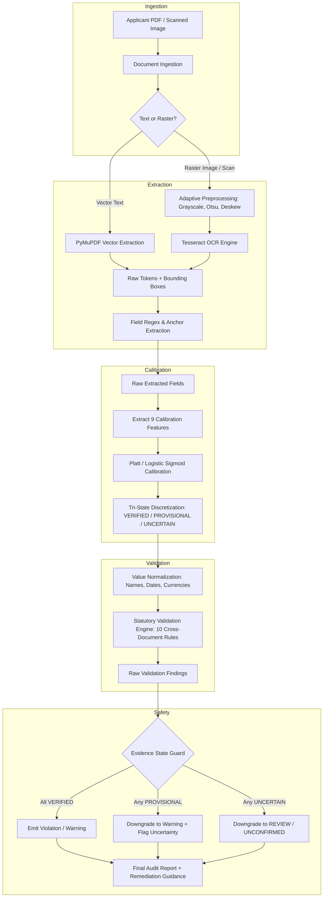

# DocuReady Data Flow Architecture

## Ownership & Contribution Responsibilities

| Role | Assignee | Primary Scope & Focus |
|---|---|---|
| **Primary Owner** | **Akriti** (Platform, Privacy & Delivery Lead) | Intake-to-report lifecycle, ephemeral disk storage, memory bounds, trust boundaries |
| **Supporting Contributor** | **Susmita** (Domain Rules & Evaluation Lead) | Extracted field entity flow, evidence state transitions, rule execution sequence |
| **Supporting Contributor** | **Deeptiman** (Product Owner & Integration Lead) | End-to-end user data privacy contract, remediation loop semantics |

### Detailed Responsibilities & Deliverables
- **Primary Owner (Akriti)**:
  - Specify the end-to-end data processing lifecycle from packet ingestion to report generation.
  - Enforce ephemeral file storage protocols: unique temp directories (`0700`), guaranteed cleanup in `finally` blocks, zero disk persistence of unencrypted citizen PII.
  - Define thread safety, process isolation, and memory bounding across pipeline stages.
- **Domain Contributor (Susmita)**:
  - Define data structures and state transitions between extraction, confidence calibration, bipartite matching, and decision safety.
- **Product Contributor (Deeptiman)**:
  - Confirm data flow aligns with user privacy expectations and instant document replacement re-auditing.

### Coordination & Review Gates
- Any change to file handling, caching, or data persistence requires Akriti's sign-off.
- Governed by [TEAM_RESPONSIBILITIES.md](../TEAM_RESPONSIBILITIES.md) and Gate G1 (No-Network Contract).

---

## End-to-End Data Pipeline

DocuReady processes applicant documents through a five-stage deterministic pipeline. Data transitions strictly through typed domain models, preserving full provenance at every transformation step.

## Detailed Data Transformations

### Stage 1: Ingestion & Document Model
- **Input**: Raw file bytes or file paths from applicant packet (Income Certificate, Caste Certificate, Residence Certificate, 10th Marksheet, Bank Passbook, Application Form).
- **Output**: `Document` object (`doc_id`, `doc_type`, `file_path`, `page_count`, `is_scanned`).
- **Invariants**: Files must exist and be valid PDF or common raster formats. Non-PDF raster files are internally handled or converted without modifying source files.

### Stage 2: Evidence Extraction
- **Input**: `Document` reference.
- **Output**: `ExtractedField` domain objects.
- **Data Captured**:
  - `field_name`: Canonical identifier (e.g., `applicant_name`, `date_of_birth`, `annual_income`, `caste_category`).
  - `value`: Raw extracted string representation.
  - `page_number`: 1-based page index.
  - `bounding_box`: `BoundingBox(x0, y0, x1, y1)` in points (72 DPI).
  - `confidence`: Raw OCR / token confidence score [0.0 - 1.0].
  - `source`: `ExtractionSource.NATIVE_TEXT` or `ExtractionSource.OCR`.
  - `evidence_snippet`: Surrounding 80-character textual context.

### Stage 3: Calibration & Tri-State Classification
- **Input**: `ExtractedField` with raw extraction metadata.
- **Feature Vector**:
  $$\mathbf{x} = [c_{\text{ocr}}, N_{\text{tokens}}, I_{\text{label}}, d_{\text{label}}, I_{\text{fmt}}, I_{\text{multi}}, c_{\text{layout}}, I_{\text{ocr}}, I_{\text{rot}}]$$
- **Probability Mapping**:
  $$P(\text{correct} \mid \mathbf{x}) = \frac{1}{1 + e^{-(\mathbf{w}^T \mathbf{x} + b)}}$$
- **Output State**:
  - $P \ge 0.85 \implies \text{VERIFIED}$
  - $0.60 \le P < 0.85 \implies \text{PROVISIONAL}$
  - $P < 0.60 \implies \text{UNCERTAIN}$

### Stage 4: Normalization & Cross-Document Alignment
- **Input**: `ExtractedField` values.
- **Output**: Normalized domain primitives:
  - `NormalizedName`: Tokenized, whitespace-collapsed, case-folded, salutations removed (`MR`, `MS`, `SHRIL`, etc.).
  - `NormalizedDate`: ISO `YYYY-MM-DD` with ambiguous slash formats parsed conservatively or flagged.
  - `NormalizedIncome`: Integer INR value; handles word conversions (e.g. `Lakhs`, `Crores`).
  - `NormalizedCaste`: Standardized categories (`SC`, `ST`, `OBC`, `GENERAL`, `EWS`).

### Stage 5: Safety-Gated Validation
- **Input**: Normalized fields across all documents in the packet.
- **Rules Evaluated**: 10 official statutory criteria (income ceiling, caste match, name consistency, DOB match, document completeness, issuance validity).
- **Safety Downgrading Matrix**:
  | Raw Rule Result | Evidence State of Supporting Fields | Final Action |
  | :--- | :--- | :--- |
  | VIOLATION | All `VERIFIED` | **BLOCKING VIOLATION** |
  | VIOLATION | $\ge 1$ `PROVISIONAL`, $0$ `UNCERTAIN` | **WARNING** (Actionable notice) |
  | VIOLATION | $\ge 1$ `UNCERTAIN` | **NEEDS REVIEW** (Human verification) |
  | WARNING | Any `UNCERTAIN` | **NEEDS REVIEW** (Do not penalize applicant) |
  | COMPLIANT | All `VERIFIED` / `PROVISIONAL` | **PASS** |

### Stage 6: Export & Remediation
- **Output**: JSON Audit Report (`AuditReport`), Human-readable PDF/Markdown report, and Interactive Streamlit UI state.
- **Key Fields**:
  - `overall_status`: `READY_TO_SUBMIT`, `ACTION_REQUIRED`, or `NEEDS_MANUAL_REVIEW`.
  - `findings`: List of `ValidationFinding` objects detailing severity, offending document IDs, bounding boxes, statutory clause citation, and applicant remediation step.
