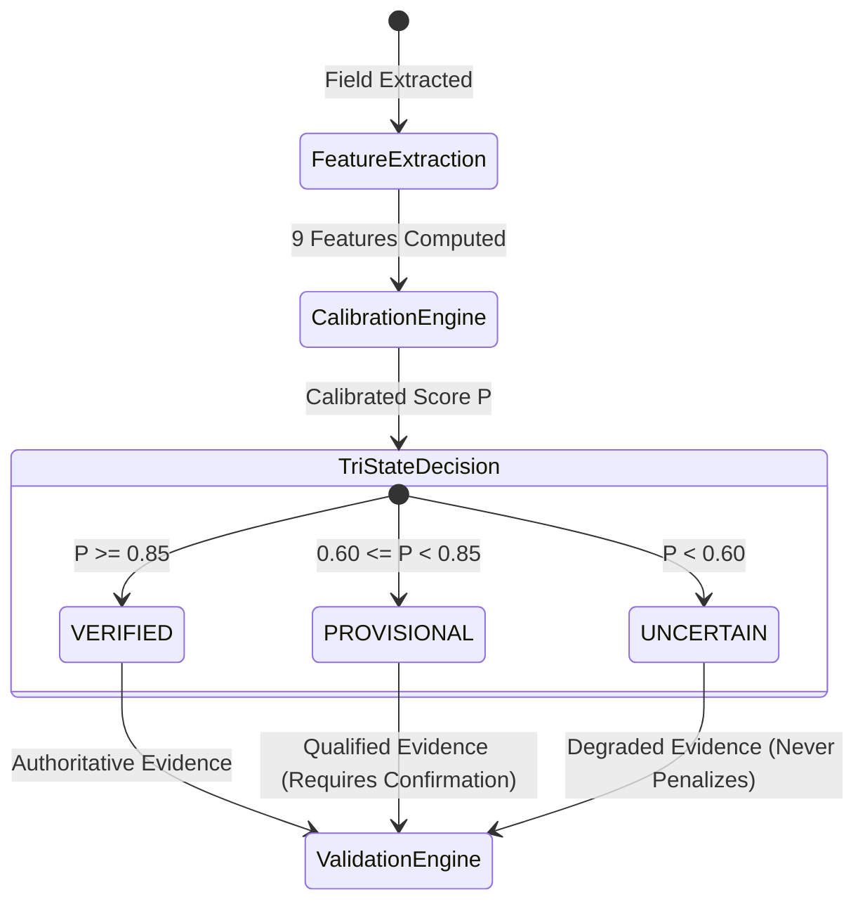

# Evidence Provenance and Calibration Architecture

## Ownership & Contribution Responsibilities

| Role | Assignee | Primary Scope & Focus |
|---|---|---|
| **Primary Owner** | **Susmita** (Domain Rules & Evaluation Lead) | Epistemic evidence modeling, 9-feature confidence calibration, provenance tracking, uncertainty states |
| **Supporting Contributor** | **Akriti** (Platform, Privacy & Delivery Lead) | Bounding box spatial coordinate extraction, raw engine confidence capture, serialization |
| **Supporting Contributor** | **Deeptiman** (Product Owner & Integration Lead) | User-facing evidence explanations, audit report provenance visibility |

### Detailed Responsibilities & Deliverables
- **Primary Owner (Susmita)**:
  - Author and maintain the formal evidence provenance specification and `EvidenceState` domain lifecycle (`VERIFIED`, `PROVISIONAL`, `UNCERTAIN`).
  - Design the 9-feature logistic calibration engine, scoring weights, and threshold definitions.
  - Enforce strict epistemic honesty: raw OCR scores must never be equated with statutory verification.
- **Platform Contributor (Akriti)**:
  - Supply normalized bounding boxes ($x_0, y_0, x_1, y_1$), page numbers, and raw extraction tokens from PDF/OCR layers into the provenance contract.
- **Product Contributor (Deeptiman)**:
  - Review that evidential provenance representations translate clearly into the user-facing remediation interface.

### Coordination & Review Gates
- Changes to calibration formulas, feature weights, or evidence state thresholds require Susmita's explicit sign-off and evaluation harness verification.
- Governed by [TEAM_RESPONSIBILITIES.md](../TEAM_RESPONSIBILITIES.md).

---

## Abstract

Traditional document processing systems treat extracted data as scalar strings (`name = "Aarav Sharma"`), stripping away contextual metadata and certainty scores. When an error occurs or a rule fails, the applicant cannot determine why the system made its decision or where the data came from.

DocuReady treats all extracted data as **Evidential Assertions with Complete Provenance**. Every fact retains its exact physical origin, visual coordinates, extraction pipeline history, calibration score, and evidential status.

---

## The Provenance Data Contract

Every extracted field is modeled as an immutable domain record:

```python
@dataclass(frozen=True)
class BoundingBox:
    x0: float  # Top-left X in PDF points (72 DPI)
    y0: float  # Top-left Y
    x1: float  # Bottom-right X
    y1: float  # Bottom-right Y

@dataclass(frozen=True)
class ExtractedField:
    field_name: str
    value: str
    page_number: int
    bounding_box: BoundingBox
    confidence: float            # Raw token confidence [0.0 - 1.0]
    calibrated_score: float      # Logistic calibrated probability [0.0 - 1.0]
    evidence_state: EvidenceState # VERIFIED | PROVISIONAL | UNCERTAIN
    source: ExtractionSource     # NATIVE_TEXT | OCR
    evidence_snippet: str        # Textual snippet from page
    document_id: str             # Parent document identifier
```

---

## 9-Feature Confidence Calibration Engine

Raw Tesseract OCR confidence numbers are notoriously overconfident (e.g. reporting 90% confidence on garbled characters). DocuReady computes a multi-dimensional feature vector $\mathbf{x} \in \mathbb{R}^9$ for every extraction candidate:

| Feature Dimension | Symbol | Rationale |
| :--- | :---: | :--- |
| **Mean OCR Token Confidence** | $c_{\text{ocr}}$ | Base acoustic / visual character recognizer probability. |
| **Supporting Token Count** | $N_{\text{tokens}}$ | Multi-token strings (full names) require higher joint evidence. |
| **Anchor Label Proximity** | $d_{\text{label}}$ | Euclidean distance from target anchor label (e.g. "Name:"). |
| **Label Match Confidence** | $I_{\text{label}}$ | Exact or fuzzy match score of the semantic label. |
| **Format Regex Validation** | $I_{\text{fmt}}$ | Boolean indicator if string satisfies strict statutory format. |
| **Candidate Ambiguity** | $I_{\text{multi}}$ | Penalty if multiple competing values appear in bounding zone. |
| **Layout Consistency** | $c_{\text{layout}}$ | Alignment score with document grid lines and margins. |
| **Extraction Source Mode** | $I_{\text{ocr}}$ | Prior probability penalty for scanned raster vs. vector text. |
| **Rotation / Skew Angle** | $I_{\text{rot}}$ | Angular deviation penalty detected during deskew. |

### Calibrated Probability Model
$$\text{Logit} = \beta_0 + \sum_{i=1}^9 \beta_i x_i$$
$$P(\text{Correct} \mid \mathbf{x}) = \sigma(\text{Logit}) = \frac{1}{1 + \exp(-\text{Logit})}$$

Empirically trained parameters minimize Cross-Entropy Loss over our 60-sample realistic calibration corpus and 100-sample held-out validation suite.

---

## Tri-State Evidence Discretization

To make calibration operational and safe for downstream rule evaluation, probabilities are mapped into three discrete evidential states:



- **VERIFIED ($P \ge 0.85$)**: High certainty. Suitable for hard blocking statutory checks (e.g., scheme income limit exceeded).
- **PROVISIONAL ($0.60 \le P < 0.85$)**: Plausible extraction with slight visual or linguistic noise. Generates warnings rather than rejections.
- **UNCERTAIN ($P < 0.60$)**: Severe degradation, heavy blur, or ambiguous match. Downstream `resolve_outcome()` automatically downgrades violations to `Status.REVIEW` (`ReasonCode.EVIDENCE_UNCERTAIN`) and prevents unsupported `PASS` outcomes (`ReasonCode.CANNOT_CONFIRM`).

> [!IMPORTANT]
> OCR confidence and `EvidenceState.VERIFIED` measure extraction certainty only. They never establish statutory verification, document authenticity, or government approval.
