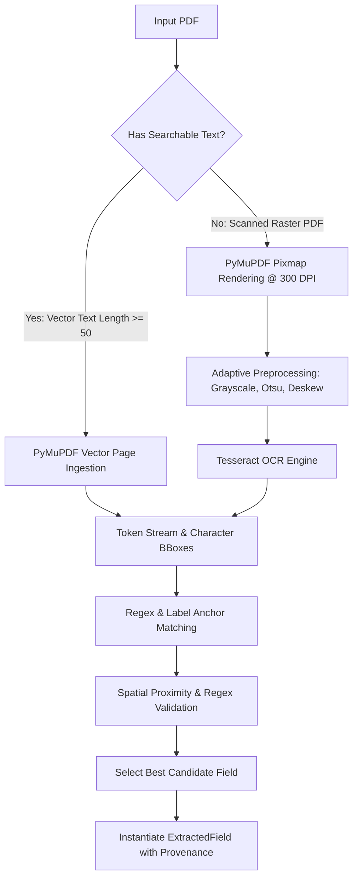

# DocuReady Extraction Pipeline

## Ownership & Contribution Responsibilities

| Role | Assignee | Primary Scope & Focus |
|---|---|---|
| **Primary Owner** | **Akriti** (Platform, Privacy & Delivery Lead) | Vector PDF parsing, OCR routing, spatial Y-clustering, extraction orchestration |
| **Supporting Contributor** | **Susmita** (Domain Rules & Evaluation Lead) | Target field schema, anchor keyword vocabulary, candidate extraction scoring |
| **Supporting Contributor** | **Deeptiman** (Product Owner & Integration Lead) | Multi-format extraction requirements, speed/latency acceptance criteria |

### Detailed Responsibilities & Deliverables
- **Primary Owner (Akriti)**:
  - Architect and maintain the dual-path extraction engine (native PyMuPDF / Pdfium vector text vs. local Tesseract OCR raster fallback).
  - Implement spatial Y-clustering, line assembly, bounding-box coordinate normalization, and extraction error handling.
  - Ensure extraction performance meets sub-second benchmarks on standard hardware.
- **Domain Contributor (Susmita)**:
  - Specify target fields per document type (Aadhaar, Marksheet, Income, Caste, Passbook) and regex/anchor patterns for high-precision capture.
- **Product Contributor (Deeptiman)**:
  - Validate that extraction accuracy and latency meet product requirements.

### Coordination & Review Gates
- Changes to extraction algorithms or PDF backends (e.g. ADR-001) require Akriti's lead and review from Susmita.
- Governed by [TEAM_RESPONSIBILITIES.md](../TEAM_RESPONSIBILITIES.md).

---

## Architectural Principles

The extraction pipeline is designed to extract target evidence fields from heterogeneous applicant documents (both clean vector PDFs and degraded physical scans) while maintaining strict provenance and zero hallucinations.

1. **Deterministic Execution**: No stochastic Large Language Models (LLMs) are used in the core extraction path. Every extracted token originates from PyMuPDF or Tesseract OCR bounding boxes.
2. **Dual-Route Ingestion**: Vector text is extracted with full geometric fidelity; scanned raster layers trigger automated local OCR.
3. **Anchor-Guided Localization**: Field extraction relies on semantic anchor labels (e.g., "Annual Income", "Caste / Category", "Date of Birth") combined with spatial coordinate filtering.
4. **Preserved Provenance**: Every extracted datum carries its bounding box coordinates, source document, page number, raw string, and surrounding text context.

---

## Target Document Types and Field Schema

| Document Type | Primary Target Fields | Pattern / Anchor Strategy |
| :--- | :--- | :--- |
| **Income Certificate** | `applicant_name`, `annual_income`, `issue_date`, `certificate_no` | Anchor: "Annual Income", "Total Income", "Cert No" |
| **Caste Certificate** | `applicant_name`, `caste_category`, `sub_caste`, `certificate_no`, `issue_date` | Anchor: "Community", "Caste", "Sub-caste", "SC/ST/OBC" |
| **Residence Certificate**| `applicant_name`, `address`, `state`, `district`, `pincode`, `issue_date` | Anchor: "Resident of", "Domicile", "Permanent Address" |
| **Marksheet (10th/12th)**| `candidate_name`, `roll_number`, `total_marks`, `percentage`, `year_of_passing` | Anchor: "Grand Total", "Percentage", "Result: PASS" |
| **Bank Passbook** | `account_holder_name`, `account_no`, `ifsc_code`, `bank_name` | Anchor: "A/C No", "IFSC", "Branch", "Account Holder" |
| **Application Form** | `applicant_name`, `date_of_birth`, `category`, `income`, `declared_pincode` | Anchor: Form tabular fields and key-value rows |

---

## Dual-Path Pipeline Architecture

---

## Technical Details

### 1. Vector Text Extraction
- Uses `pymupdf` (`fitz`).
- Calls `page.get_text("words")` to obtain exact word boundaries `(x0, y0, x1, y1, word, block_no, line_no, word_no)`.
- Reconstructs horizontal lines and tabular structures based on coordinate proximity.

### 2. Raster Image & Scanned PDF OCR
- If extracted text across page 1 is under 50 characters, the document is flagged as `is_scanned = True`.
- `page.get_pixmap(dpi=300)` renders high-resolution raster buffers.
- Preprocessing applies grayscale transformation, Otsu adaptive binarization, and skew detection via projection profile.
- Tesseract OCR (via `pytesseract`) is called with `image_to_data(output_type=Output.DICT)`, extracting:
  - Token text
  - Word coordinates `(left, top, width, height)` mapped to 72 DPI PDF point space
  - Token recognition confidence `conf` [0 - 100]

### 3. Spatial Anchor Filtering
For key-value pairs (e.g., `Annual Income: Rs. 1,20,000`):
1. **Label Localization**: Scan for label variants (`Annual Income`, `Family Income`, `Income per annum`).
2. **Search Window**: Define horizontal bounding zone $(x_{\text{label\_end}}, y_{\text{label\_top}} - 5, x_{\text{page\_right}}, y_{\text{label\_bottom}} + 15)$.
3. **Value Filtering**: Apply regex validation (e.g., currency pattern `(?:Rs\.?|INR|\u20B9)?\s*[\d,]+`) within the bounding zone.
4. **Fallback**: If horizontal search fails, inspect the immediate downward bounding zone (vertical stacked layout).

---

## Abstention vs. Hallucination Guardrail

When anchor matches fail or candidate values fail regex pattern validation:
- The extractor **does not fabricate default values**.
- The field is recorded as `value = None` or omitted from extracted fields.
- Upstream validation marks the required field as `MISSING` or `UNCERTAIN`.
- This ensures zero hallucinated compliance approvals.
