# DocuReady OCR Architecture

## Overview

DocuReady incorporates a fully local, privacy-preserving Optical Character Recognition (OCR) pipeline. No document pixels or text ever leave the local execution environment, satisfying strict statutory data protection and personal data privacy requirements (Digital Personal Data Protection Act, 2023).

---

## OCR Subsystem Pipeline

```mermaid
flowchart LR
    ScanPDF[Input Raster / Scanned PDF] --> Render[Render Pixmap at 300 DPI]
    Render --> Preproc[Adaptive Preprocessing Engine]
    subgraph Preprocessing
        Preproc --> Gray[Grayscale Conversion]
        Gray --> Deskew[Skew Detection & Rotation Correction]
        Deskew --> Otsu[Otsu Adaptive Thresholding]
        Otsu --> Denoise[Morphological Denoising]
    end
    Denoise --> Tess[Tesseract OCR Engine OEM 1, PSM 6]
    Tess --> TokenFilter[Word Box & Confidence Extraction]
    TokenFilter --> CoordMap[Coordinate Mapping to 72 DPI PDF Point Space]
    CoordMap --> FieldBuilder[ExtractedField Formulation]
```

---

## Detailed Components

### 1. High-Fidelity Rendering
- Input PDF pages are rendered using PyMuPDF at **300 DPI** (`matrix = fitz.Matrix(300 / 72, 300 / 72)`).
- 300 DPI ensures small font sizes (6 pt – 9 pt), official stamps, and subscript certificate numbers resolve with minimal antialiasing degradation.

### 2. Adaptive Preprocessing Pipeline
Degraded applicant documents (mobile camera captures, low-contrast photostat copies, skewed scans) undergo deterministic image conditioning before OCR:
- **Grayscale Conversion**: Eliminates color noise, tinted certificate backgrounds, and watermark interference.
- **Deskew Angle Calculation**: Evaluates horizontal projection profiles across an angular sweep $[-15^\circ, +15^\circ]$. When skew $> 0.5^\circ$, the image is bilinearly rotated to horizontal alignment.
- **Adaptive / Otsu Binarization**: Dynamically computes threshold values across local image patches, preventing faint text dropout under uneven lighting or shadow gradients.
- **Morphological Filtering**: Mild morphological opening removes salt-and-pepper noise without eroding thin character strokes (e.g., numerals `1`, `7`, `0`).

### 3. Tesseract Engine Configuration
- **Engine Mode**: OEM 1 (Neural Net / LSTM mode) for robust sequence recognition.
- **Page Segmentation Mode (PSM)**:
  - Default: `PSM 6` (Uniform block of text) for certificates and narrative declarations.
  - Fallback / Forms: `PSM 11` (Sparse text) for multi-column tables and scattered key-value forms.
- **Language Models**: `eng` (English) with extensible support for Indian languages (`hin`, `kan`, `tam`, etc.).

### 4. Coordinate Transformation
Tesseract produces coordinates relative to the 300 DPI raster bitmap:
$$\text{scale} = \frac{72.0}{300.0} = 0.24$$
Every bounding box $(x_0, y_0, x_1, y_1)$ is converted to 72 DPI PDF points:
$$x_{\text{pdf}} = x_{\text{tess}} \times 0.24, \quad y_{\text{pdf}} = y_{\text{tess}} \times 0.24$$
This allows exact visual overlays and bounding box highlights on the original PDF in the Streamlit UI.

---

## Performance and Resource Footprint

- **Average Processing Time per Page (Scanned)**: ~0.8s - 1.4s on standard dual-core x86 CPU.
- **Memory Overhead**: Peak heap usage $< 150 \text{ MB}$ during 300 DPI pixmap allocation.
- **Network I/O**: Exactly 0 bytes (zero external API calls).
