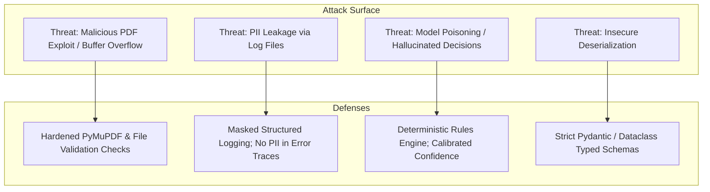

# Security and Privacy Architecture

## Ownership & Contribution Responsibilities

| Role | Assignee | Primary Scope & Focus |
|---|---|---|
| **Primary Owner** | **Akriti** (Platform, Privacy & Delivery Lead) | Zero-network enforcement, telemetry suppression, PII redaction, secure temp lifecycle |
| **Supporting Contributor** | **Deeptiman** (Product Owner & Integration Lead) | Privacy policy compliance, public security claims, DPDP Act alignment |
| **Supporting Contributor** | **Susmita** (Domain Rules & Evaluation Lead) | Sensitive field identification (Aadhaar, account numbers, personal identifiers) |

### Detailed Responsibilities & Deliverables
- **Primary Owner (Akriti)**:
  - Enforce the absolute zero-network exfiltration guarantee via automated contract tests (`test_no_network.py`).
  - Disable all third-party analytics, Streamlit telemetry (`gatherUsageStats = false`), and background HTTP requests.
  - Implement default PII redaction (masking Aadhaar, bank accounts, phone numbers) across UI, CLI, and exported reports.
  - Manage secure file permissions (`0700`), safe logging practices, and vulnerability reporting protocols.
- **Product Contributor (Deeptiman)**:
  - Verify that all public privacy statements in `README.md` and marketing materials match verified technical reality.
- **Domain Contributor (Susmita)**:
  - Maintain the registry of sensitive fields requiring redaction and safe handling.

### Coordination & Review Gates
- Any change to network access, telemetry, or file handling requires Akriti's sign-off and passing automated contract tests.
- Governed by [TEAM_RESPONSIBILITIES.md](../TEAM_RESPONSIBILITIES.md) and Gate G1 (T1.2 / T1.4).

---

## Core Philosophy: Local-First, Zero-Exfiltration

DocuReady is designed for public sector and citizen document pre-validation. Applicant documents routinely contain sensitive demographic data, Aadhaar references, income details, bank account numbers, and caste information.

To guarantee compliance with statutory privacy mandates and the **Digital Personal Data Protection Act (DPDP), 2023**:
1. **Zero External API Calls**: The core extraction and validation engine runs 100% locally. No document text, image, or metadata is ever transmitted over the network.
2. **Ephemeral In-Memory Processing**: When operated in Streamlit or CLI mode, uploaded files are processed in ephemeral memory sessions and cleared upon session termination.
3. **Deterministic Logic**: No proprietary third-party commercial LLM endpoints (OpenAI, Anthropic, Google Cloud Document AI) are invoked in the evaluation loop.
4. **Synthetic Data Enforcement**: All development, testing, and benchmarking are performed strictly using synthetically generated citizen profiles and documents. Zero real applicant documents are ever stored or processed in this repository.

---

## Data Classification and Handling

| Data Element | Sensitivity Level | Retention Policy | Protection Mechanism |
| :--- | :--- | :--- | :--- |
| **Applicant Name & DOB** | Personally Identifiable Information (PII) | In-memory only; cleared after audit | Ephemeral process memory, normalized in volatile heap |
| **Bank Account & IFSC** | Sensitive Personal Data | In-memory only; masked in report summaries | Truncated display (`****1234`) in visual exports |
| **Caste / Income Details**| Protected Statutory Data | In-memory only | Evaluated strictly against scheme rules; never indexed |
| **Raw PDF / Image Pixmaps**| Ephemeral Binary Data | Transient disk/RAM buffer during extraction | Deleted immediately upon job completion |

---

## Threat Model and Mitigations

### 1. File Upload Hardening
- Allowed file types: strictly `.pdf`, `.png`, `.jpg`, `.jpeg`.
- File header magic-byte validation prevents malicious executable masquerading.
- Maximum file size capped at 25 MB per document.
- Memory consumption per render capped at 300 DPI to prevent denial-of-service memory exhaustion.

### 2. Logging and Telemetry
- Application logs contain execution metrics, rule evaluation durations, and error codes.
- No applicant names, certificate numbers, or raw extracted text snippets are written to permanent stdout or file logs in production mode.

### 3. Dependency Vulnerability Auditing
- PyMuPDF, pytesseract, Pillow, and Streamlit dependencies are pinned and regularly audited against known Common Vulnerabilities and Exposures (CVEs).
- Sandboxed execution environments (Docker / microVMs) recommended for multi-tenant enterprise deployments.
