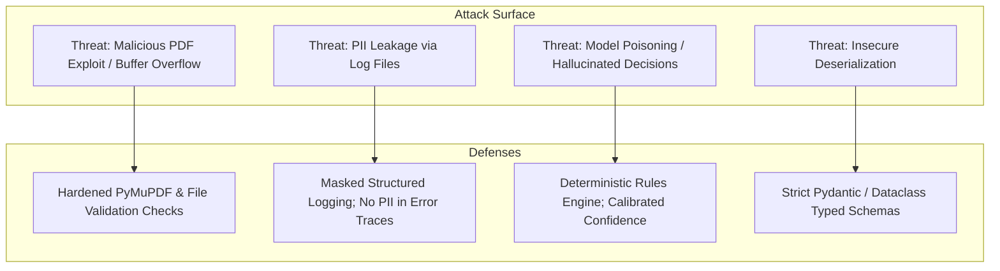

# Security and Privacy Architecture

## Ownership & Contribution Responsibilities

| Role | Assignee | Primary Scope & Focus |
|---|---|---|
| **Primary Owner** | **Akriti** (Platform, Privacy & Delivery Lead) | Zero-network enforcement, telemetry suppression, PII redaction, secure temp lifecycle |
| **Supporting Contributor** | **Deeptiman** (Product Owner & Integration Lead) | Privacy policy compliance, public security claims, DPDP Act alignment |
| **Supporting Contributor** | **Susmita** (Domain Rules & Evaluation Lead) | Sensitive field identification (Aadhaar, account numbers, personal identifiers) |

### Detailed Responsibilities & Deliverables
- **Primary Owner (Akriti)**:
  - Responsible for implementing and demonstrating the no-network runtime contract via automated contract tests (`test_no_network.py`) before any privacy guarantee is presented as verified.
  - Disable all third-party analytics, commit Streamlit telemetry suppression (`gatherUsageStats = false`), and eliminate background HTTP requests.
  - Implement and verify default PII redaction (masking Aadhaar, bank accounts, phone numbers) across UI, CLI, and exported reports.
  - Manage secure file permissions (`0700`), ephemeral directory cleanup in `finally` blocks, safe logging practices, and vulnerability reporting protocols.
- **Product Contributor (Deeptiman)**:
  - Ensure that public privacy and DPDP claims in `README.md` and documentation remain strictly unverified until contract test evidence is produced and recorded in the Claims Register.
- **Domain Contributor (Susmita)**:
  - Maintain the registry of sensitive fields requiring redaction and safe handling.

### Coordination & Review Gates
- No privacy or zero-exfiltration claim may be presented as verified or published until the appropriate contract tests pass under Task T1.2, supported by empirical test evidence, and receive Akriti's technical sign-off and Deeptiman's final acceptance.
- Governed by [TEAM_RESPONSIBILITIES.md](../TEAM_RESPONSIBILITIES.md) and Gate G1 (T1.2 / T1.4).

---

## Core Philosophy: Local-First, Zero-Exfiltration

> [!NOTE]
> This heading describes the target architectural requirement. It must not be interpreted as proof that the current implementation has already passed zero-network or zero-exfiltration verification. Such claims remain unverified until T1.2 contract tests pass and receive the required owner acceptance.

DocuReady is designed for public sector and citizen document pre-validation. Applicant documents routinely contain sensitive demographic data, Aadhaar references, income details, bank account numbers, and caste information.

### Target Security and Privacy Requirements (Verification Pending)

The system architecture is designed around four mandatory privacy requirements intended to support alignment with statutory privacy principles and the Digital Personal Data Protection Act (DPDP), 2023. These technical controls and legal/privacy obligations require separate, empirical verification before any compliance claim can be made:

1. **No External API Calls & Zero Network Transmission (Target Requirement — Pending T1.2 Verification)**: The core extraction and validation engine is designed to run 100% locally. Document text, images, and metadata must never be transmitted over the network; this property must be verified via automated contract tests (`test_no_network.py`) before being claimed as an active guarantee.
2. **Ephemeral Upload Handling & Guaranteed Cleanup (Target Requirement — Pending T1.4 Verification)**: Uploaded files in Streamlit UI and CLI modes must be processed in isolated, ephemeral temporary directories (`0700`) and cleared immediately upon job completion or session termination via robust `finally` blocks.
3. **Local-Only Deterministic Execution**: Evaluation logic relies on local parsing and deterministic rules rather than proprietary third-party commercial cloud LLM endpoints (e.g., OpenAI, Anthropic, Google Cloud Document AI).
4. **Synthetic Data Enforcement**: All development, testing, and benchmarking must be performed strictly using synthetically generated citizen profiles and documents. Zero real applicant documents are ever stored, processed, or permitted in this repository.

> [!WARNING]
> DocuReady does not claim existing DPDP certification or guaranteed statutory legal compliance. Stated technical controls and legal/privacy obligations represent architectural targets that require rigorous contract-test proof and formal owner sign-off.

---

## Data Classification and Handling

| Data Element | Sensitivity Level | Retention Policy | Protection Mechanism |
| :--- | :--- | :--- | :--- |
| **Applicant Name & DOB** | Personally Identifiable Information (PII) | In-memory only; cleared after audit | Ephemeral process memory, normalized in volatile heap |
| **Bank Account & IFSC** | Sensitive Personal Data | In-memory only; masked in report summaries | Truncated display (`****1234`) in visual exports |
| **Caste / Income Details**| Protected Statutory Data | In-memory only | Evaluated strictly against scheme rules; never indexed |
| **Raw PDF / Image Pixmaps**| Ephemeral Binary Data | Transient disk/RAM buffer during extraction | Deleted immediately upon job completion |

---

## Threat Model and Mitigations

### 1. File Upload Hardening
- Allowed file types: strictly `.pdf`, `.png`, `.jpg`, `.jpeg`.
- File header magic-byte validation prevents malicious executable masquerading.
- Maximum file size capped at 25 MB per document.
- Memory consumption per render capped at 300 DPI to prevent denial-of-service memory exhaustion.

### 2. Logging and Telemetry
- Application logs contain execution metrics, rule evaluation durations, and error codes.
- No applicant names, certificate numbers, or raw extracted text snippets are written to permanent stdout or file logs in production mode.

### 3. Dependency Vulnerability Auditing
- PyMuPDF, pytesseract, Pillow, and Streamlit dependencies are pinned and regularly audited against known Common Vulnerabilities and Exposures (CVEs).
- Sandboxed execution environments (Docker / microVMs) recommended for multi-tenant enterprise deployments.
