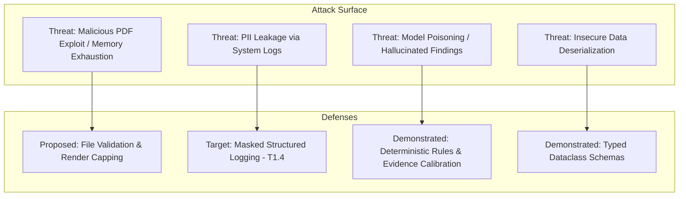

# Security and Privacy Architecture

## Ownership & Contribution Responsibilities

| Role | Assignee | Primary Scope & Focus |
|---|---|---|
| **Primary Owner** | **Akriti** (Platform, Privacy & Delivery Lead) | Zero-network enforcement, telemetry suppression, PII redaction, secure temp lifecycle |
| **Supporting Contributor** | **Deeptiman** (Product Owner & Integration Lead) | Privacy policy compliance, public security claims, DPDP Act alignment |
| **Supporting Contributor** | **Susmita** (Domain Rules & Evaluation Lead) | Sensitive field identification (Aadhaar, account numbers, personal identifiers) |

### Detailed Responsibilities & Deliverables
- **Primary Owner (Akriti)**:
  - Responsible for implementing and demonstrating the no-network runtime contract via automated contract tests (`test_no_network.py`) before any privacy guarantee is presented as verified.
  - Disable all third-party analytics, commit Streamlit telemetry suppression (`gatherUsageStats = false`), and eliminate background HTTP requests.
  - Implement and verify default PII redaction (masking Aadhaar, bank accounts, phone numbers) across UI, CLI, and exported reports.
  - Manage secure file permissions (`0700`), ephemeral directory cleanup in `finally` blocks, safe logging practices, and vulnerability reporting protocols.
- **Product Contributor (Deeptiman)**:
  - Ensure that public privacy and DPDP claims in `README.md` and documentation remain strictly unverified until contract test evidence is produced and recorded in the Claims Register.
- **Domain Contributor (Susmita)**:
  - Maintain the registry of sensitive fields requiring redaction and safe handling.

### Coordination & Review Gates
- No privacy or zero-exfiltration claim may be presented as verified or published until the appropriate contract tests pass under Task T1.2, supported by empirical test evidence, and receive Akriti's technical sign-off and Deeptiman's final acceptance.
- Governed by [TEAM_RESPONSIBILITIES.md](../TEAM_RESPONSIBILITIES.md) and Gate G1 (T1.2 / T1.4).

---

## Core Philosophy: Local-First, Zero-Exfiltration

> [!NOTE]
> This heading describes the target architectural requirement. It must not be interpreted as proof that the current implementation has already passed zero-network or zero-exfiltration verification. Such claims remain unverified until T1.2 contract tests pass and receive the required owner acceptance.

DocuReady is designed for public sector and citizen document pre-validation. Applicant documents routinely contain sensitive demographic data, Aadhaar references, income details, bank account numbers, and caste information.

### Target Security and Privacy Requirements (Verification Pending)

The system architecture is designed around four mandatory privacy requirements intended to support alignment with statutory privacy principles and the Digital Personal Data Protection Act (DPDP), 2023. These technical controls and legal/privacy obligations require separate, empirical verification before any compliance claim can be made:

1. **No External API Calls & Zero Network Transmission (Target Requirement — Pending T1.2 Verification)**: The core extraction and validation engine is designed to run 100% locally. Document text, images, and metadata must never be transmitted over the network; this property must be verified via automated contract tests (`test_no_network.py`) before being claimed as an active guarantee.
2. **Ephemeral Upload Handling & Guaranteed Cleanup (Target Requirement — Pending T1.4 Verification)**: Uploaded files in Streamlit UI and CLI modes must be processed in isolated, ephemeral temporary directories (`0700`) and cleared immediately upon job completion or session termination via robust `finally` blocks.
3. **Local-Only Deterministic Execution**: Evaluation logic relies on local parsing and deterministic rules rather than proprietary third-party commercial cloud LLM endpoints (e.g., OpenAI, Anthropic, Google Cloud Document AI).
4. **Synthetic Data Enforcement**: All development, testing, and benchmarking must be performed strictly using synthetically generated citizen profiles and documents. Zero real applicant documents are ever stored, processed, or permitted in this repository.

> [!WARNING]
> DocuReady does not claim existing DPDP certification or guaranteed statutory legal compliance. Stated technical controls and legal/privacy obligations represent architectural targets that require rigorous contract-test proof and formal owner sign-off.

---

## Target Data Classification and Handling (Controls Verification Pending)

> [!NOTE]
> The data classification, retention, and protection policies below specify **target controls** designed for the production architecture. While prototype implementations (e.g. Track A PR #3) explore ephemeral upload sandboxing and report redaction, full system-wide verification across all CLI and pipeline modes is pending the completion of Task T1.4 (Redaction and safe logging).

| Data Element | Sensitivity Level | Target Retention Policy | Target Protection Mechanism | Implementation & Verification Status |
| :--- | :--- | :--- | :--- | :--- |
| **Applicant Name & DOB** | Personally Identifiable Information (PII) | Target: In-memory only; cleared after audit | Ephemeral process memory, normalized in volatile heap | **Verification Pending (T1.4)** — Requires automated tests verifying zero residual heap/disk persistence. |
| **Bank Account & IFSC** | Sensitive Personal Data | Target: In-memory only; masked in report summaries | Truncated display (`****1234`) in visual and file exports | **Verification Pending (T1.4)** — Prototype redaction exists in PR #3 exporter; complete coverage across CLI and UI requires T1.4. |
| **Caste / Income Details**| Protected Statutory Data | Target: In-memory only | Evaluated strictly against scheme rules; never indexed | **Verification Pending (T1.4)** — Evaluated in memory, but production-wide memory sanitization requires T1.4 tests. |
| **Raw PDF / Image Pixmaps**| Ephemeral Binary Data | Target: Transient disk/RAM buffer during extraction | Deleted immediately upon job completion in `finally` blocks | **Verification Pending (T1.4)** — Ephemeral tempfile cleanup prototyped in Streamlit UI (PR #3); pipeline-wide enforcement pending T1.4. |

---

## Threat Model and Proposed Mitigations

> [!NOTE]
> The threat matrix and defenses below define the **target threat model and proposed mitigations**. Defenses are categorized into currently demonstrated prototype capabilities versus target controls awaiting verification under Workstreams WS1–WS5.

### 1. File Upload Hardening (Target Mitigations — Pending T1.4)
- **Allowed File Extensions**: Proposed restriction to `.pdf`, `.png`, `.jpg`, `.jpeg` (Streamlit prototype restricts to `.pdf`).
- **File Header Magic-Byte Validation**: Target mitigation to prevent executable masquerading (planned under T1.4).
- **File Size & Render Bounds**: Proposed cap of 10–25 MB per document and memory render capping at 300 DPI to mitigate resource exhaustion (planned under T1.4).

### 2. Logging and Telemetry (Target Control — Pending T1.4)
- **Target Structured Logging**: Execution metrics, rule evaluation durations, and error codes without raw PII.
- **Verification Requirement**: Existing baseline logging contains unverified snippets; complete suppression of applicant names, account numbers, and PII from logs must be implemented and verified in Task T1.4.

### 3. Dependency Vulnerability Auditing & Sandboxing (Target Control — Pending T5.1/T5.2)
- **Supply-Chain Verification**: Regular automated auditing (`pip-audit`, CycloneDX SBOM) is scheduled for Gate G6 (Task T5.2).
- **Execution Sandboxing**: Containerization (non-root, read-only filesystem) is planned under Task T5.1.
