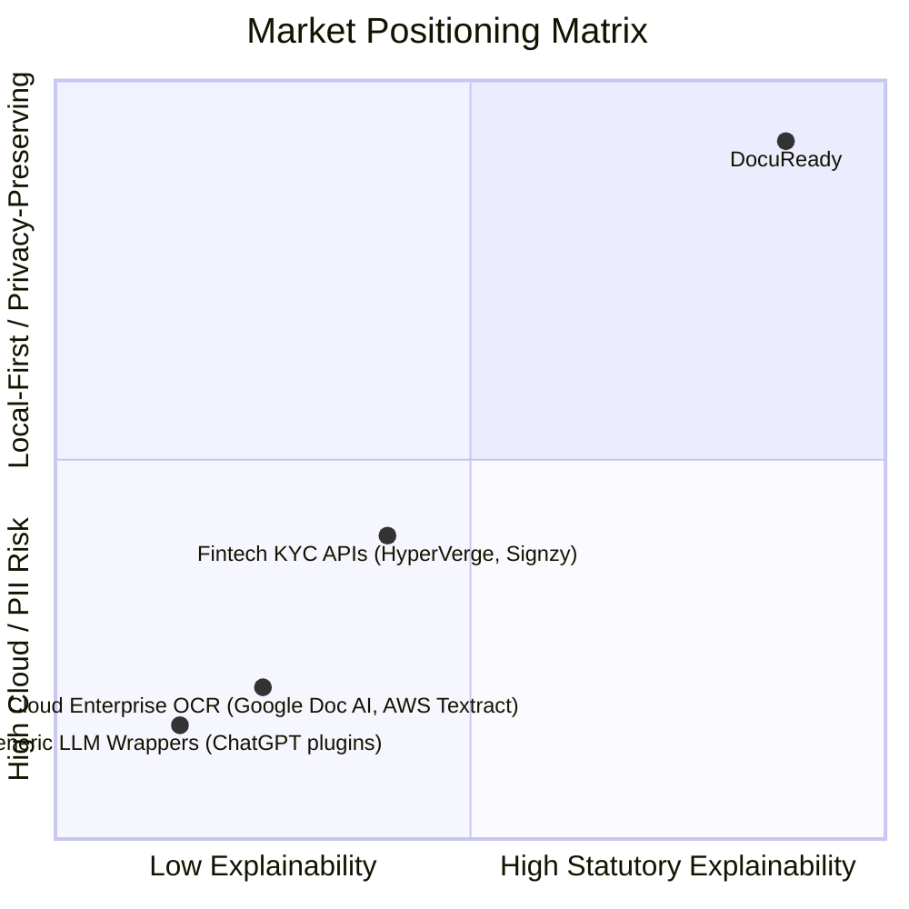

# Competitor and Landscape Analysis

## Landscape Overview

Existing document verification solutions cater almost exclusively to enterprise KYC (banks, fintechs) or high-end enterprise document understanding. None address the grassroots citizen pre-submission gap.

---

## Detailed Competitor Comparison

| Capability / Attribute | Generic Cloud OCR (AWS / GCP Doc AI) | Fintech KYC Providers (Signzy, HyperVerge) | Generic LLMs (ChatGPT / Claude Prompts) | **DocuReady** |
| :--- | :--- | :--- | :--- | :--- |
| **Primary Target User** | Enterprise Developers | Banks & NBFCs | End Consumers | **Citizen Applicants & CSC Operators** |
| **Execution Architecture** | Cloud API (per-page SaaS fee) | Cloud API + proprietary SDK | Cloud API | **100% Local / Edge First** |
| **Data Privacy & DPDP** | PII transmitted to cloud | Third-party PII processing | Third-party prompt retention | **Zero Data Exfiltration** |
| **Cross-Document Logic** | None (Single document extraction) | Basic KYC matching (Aadhaar/PAN) | Unpredictable, prone to hallucination | **Deterministic Cross-Document Statutory Rules** |
| **Statutory Clause Citations** | None | None | Hallucinated / Fabricated rules | **Exact Gazette & Ministry Order Citations** |
| **Evidence Safety Layer** | None | Raw confidence thresholds | None | **Calibrated Tri-State Downgrading (Prevents False Rejections)** |
| **Hardware Requirements** | Fast Internet connection | High bandwidth | High bandwidth | **Offline / Low-resource Kiosk Capable** |
| **Cost to Student / Citizen** | High ($15–$50 per 1k pages) | Expensive enterprise contracts | Subscription fees | **Free / Open Source** |

---

## Key Differentiation Summary

1. **Pre-Submission vs. Post-Submission**: Existing solutions help the *verifier* reject applicants faster. DocuReady helps the *applicant* fix defects before applying.
2. **Statutory Verifiability**: Every check links directly to official government scheme notifications, giving applicants legal defensibility.
3. **Safety from Hallucination**: By combining deterministic extraction with calibrated probabilistic confidence, DocuReady ensures an applicant is never falsely denied due to OCR blur or noise.
