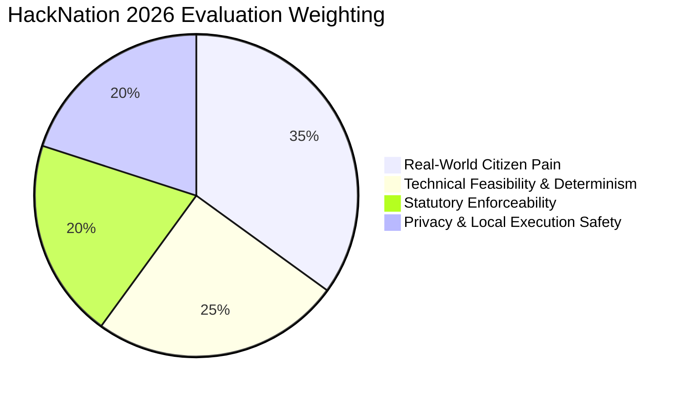

# HackNation 2026: Idea Selection Rationale

## The Genesis of DocuReady

During the HackNation 2026 research arena (spanning Arena 1, Arena 2, and Arena 3), dozens of civic-tech, government-interface, and AI applications were proposed and evaluated across key feasibility, statutory necessity, and real-world societal impact dimensions.

---

## The Core Problem Discovered

Every year across India, over **80 million students and citizens** apply for government scholarships, civil service exams, university admissions, and welfare benefits (e.g. NSP National Scholarship Portal, state e-District schemes, PMSSS, Post-Matric SC/ST Scholarships).

An alarming **18% to 32% of all initial applications are summarily rejected or returned for corrections**, not because the applicant is ineligible, but because of trivial clerical discrepancies:
1. **Name mismatches**: e.g., initial expanded as `A. Sharma` on one certificate and `Aarav Sharma` on the 10th marksheet.
2. **Expired validity**: Submitting an Income Certificate issued 14 months prior (violating the 1-financial-year statutory limit).
3. **Mismatched declarations**: Entering ₹1,80,000 in the portal form while the Tahsildar certificate states ₹2,20,000.
4. **Missing or illegible scans**: Unreadable bank passbook IFSC codes preventing Direct Benefit Transfer (DBT) account validation.

By the time the clerical error is flagged by government scrutiny officers weeks or months later, **the application window has closed**, causing deserving students to permanently forfeit life-changing educational scholarships and welfare support.

---

## Evaluated Alternatives vs. DocuReady

| Idea Evaluated | Core Mechanism | Reason Discarded / Deprioritized |
| :--- | :--- | :--- |
| **Civic Chatbot / Scheme Recommender** | Conversational LLM advising on schemes | High hallucination risk; cannot verify applicant documents; overcrowded space. |
| **Automated Form Filler** | Browser extension autofilling government portals | Fragile; government portals change DOM and captchas frequently; high fraud risk. |
| **Aadhaar / DigiLocker Scraper** | Direct scraping of government APIs | Legal and privacy violation; unworkable without state government MoUs and eKYC licenses. |
| **DocuReady (Selected)** | **Local-first, deterministic, pre-submission document audit** | Solves root cause of rejection; 100% private; actionable remediation before portal submission. |

---

## Why DocuReady Won

1. **Clear Pre-Submission Value Proposition**: "Check your documents *before* you submit." The user retains full control.
2. **Deterministic, Defensible Logic**: Statutory rules are transparent and audited against official gazettes, eliminating black-box LLM hallucinations.
3. **Local Privacy Guarantee**: Can run offline in internet kiosks (Common Service Centres - CSCs) on inexpensive hardware without risking citizen data.
4. **Immediate ROI**: Directly cuts rejection rates, reduces clerical backlog for scrutiny officers, and preserves citizen access to welfare entitlements.
