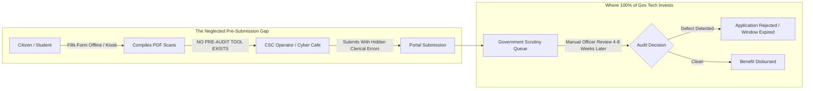

# The Market Gap: The Pre-Submission Void in Citizen Services

## The Citizen Verification Dilemma

In India's digital governance ecosystem (encompassing Digital India, e-District portals, National Scholarship Portal, state welfare schemes, and university centralized admission portals), massive investments have been poured into **front-end submission portals** and **back-end verification queues**.

However, the **pre-submission phase** has been completely overlooked.

---

## 3 Core Structural Failures in Current Systems

### 1. The Asymmetric Burden of Rejection
When a government scrutiny officer rejects an application due to an initial missing in a name (`R. Kumar` vs `Rajesh Kumar`), the officer spends 30 seconds clicking "Reject". The student, however, loses an entire academic year or ₹50,000 in tuition reimbursement. There is currently no pre-submission tooling in the hands of the applicant to detect this beforehand.

### 2. Common Service Centre (CSC) Operator Bottlenecks
Over 70% of rural and semi-urban applicants rely on village CSC operators and cyber cafes to scan documents and submit portal applications. CSC operators are overwhelmed, handling 50+ applicants daily. They do not cross-reference certificate issue dates against financial year eligibility or verify whether income declarations match Tehsildar seals.

### 3. The Fragility of Cloud Document Checkers
Most AI tools require high-speed broadband and costly cloud API keys. Rural CSCs operate in bandwidth-constrained environments where uploading 10 multi-megabyte PDFs to a remote cloud vision API is slow, expensive, and legally fraught under DPDP 2023 regulations.

---

## DocuReady's Strategic Intervention

DocuReady closes this gap by providing an offline-capable, instant pre-flight check:
1. **Under 5-Second Audit**: Operates locally within the browser or kiosk terminal.
2. **Actionable Remediation**: Does not just say "Error"; gives explicit instructions on which document to replace, which authority to contact, and how to format declarations.
3. **Inclusive Design**: Treats low-resolution scans with probabilistic safety downgrades so poor hardware does not result in false disqualification.
