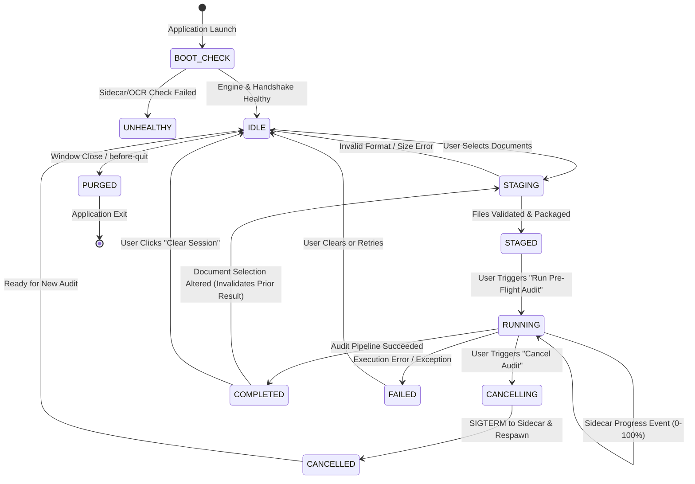

# DOCUREADY — DESKTOP APPLICATION STATE MACHINE & LIFECYCLE SPECIFICATION

**Project:** DocuReady — HackNation 2026  
**Engineering Phase:** Loop 08 — Desktop Workflow Integrity & Human Review UX  
**Document:** `docs/04-VALIDATION/LOOP_08_APPLICATION_STATE_MACHINE.md`  
**Classification:** Engineering Specification & Security Boundary  

---

## 1. Architectural Overview

DocuReady Desktop adheres to an isolated multi-process Electron architecture:
1. **Main Process (Node.js):** Coordinates native file dialogs, isolated workspaces, secure IPC handler registry, and sidecar process supervision.
2. **Sidecar Process (Python):** Long-running offline Python daemon running JSON-RPC over stdio (`protocol: 1`). Executes PDF parsing, Tesseract OCR, rule evaluation, and PII redaction within a strictly constrained `DOCUREADY_WORKSPACE_ROOT`.
3. **Renderer Process (Chromium / React):** Sandboxed, context-isolated UI. Renders multi-pane workspace (DocumentNav, EvidenceViewer, FindingPanel) without direct access to Node.js APIs or network sockets.

---

## 2. State Machine Diagram

---

## 3. Formally Defined States

| State | Process Owner | Invariants & Guarantees |
|---|---|---|
| `BOOT_CHECK` | Main Process | Validates bundled PyInstaller binary or Python environment; runs `health` method; verifies PDF backend and Tesseract English language availability before window creation. |
| `IDLE` | Renderer / Main | Zero active audit jobs; workspace clean; no document buffers in memory; action buttons enabled. |
| `STAGING` | Main (WorkspaceManager) | Inspects magic bytes (PDF `%PDF-`, PNG, JPEG), validates file size (<50MB/file, <200MB packet), copies to isolated `docuready-workspaces/<packet_id>/`. Rejects directory traversal. |
| `STAGED` | Renderer / Main | Document list staged in active session; document binary buffers cached lazily on demand; readiness score not yet calculated. |
| `RUNNING` | Main (SidecarManager) | Sidecar child process executes `audit_packet`. Progress events streamed to Renderer. Concurrency guard blocks duplicate clicks. |
| `CANCELLING` | Main Process | Atomic cancellation: sends `SIGTERM` to sidecar child, immediately resolves/cleans pending promise pool, removes packet workspace directory. |
| `CANCELLED` | Renderer / Main | In-flight execution cleanly aborted; sidecar respawned cleanly; UI displays `cancelled` status without throwing unhandled exceptions or leaking partial results. |
| `COMPLETED` | Renderer / Main | Full `RedactedAuditResult` rendered in UI. Bounding boxes mapped to unrotated/rotated viewports. Export actions (JSON/Markdown) unlocked. |
| `FAILED` | Renderer / Main | Error surfaced cleanly with actionable guidance; no unredacted stack traces or raw paths exposed to user. |
| `PURGED` | Main Process | All temporary directories in OS temp space recursively destroyed on session clear or `before-quit`. Zero PII remnants. |

---

## 4. Concurrency & Race Condition Protections (Hardened in Loop 08)

### 4.1 Double-Submission Prevention
- **Defect Scenario:** Rapid double-clicking on "Run Pre-Flight Audit" or pressing Enter twice rapidly could launch concurrent `audit_packet` requests over the stdio channel, causing sidecar job ID collision.
- **Loop 08 Mitigation:**
  - In `apps/desktop/src/renderer/main.tsx`: `handleRunAudit` guards with `if (auditStatus === "running") return;`.
  - In `apps/desktop/src/main/ipc.ts`: `audit:start` checks `this.auditResults.get(packetId)?.status === "running"` and returns existing handle.

### 4.2 In-Flight Cancellation Race Mitigation
- **Defect Scenario:** User clicks "Cancel Audit". While the cancellation signal is dispatched, the Python sidecar finishes or rejects with a cancellation exception, which previously caused `executeAudit` to return `status: "failed"` and overwrite the user's `cancelled` state.
- **Loop 08 Mitigation:**
  - `SidecarManager.executeAudit` checks if the caught exception message contains `cancelled` or `SIGTERM`, returning `{ status: "cancelled" }`.
  - `IpcHandlerRegistry.registerAll` checks `this.auditResults.get(packetId)?.status === "cancelled"` before storing `finalStatus`, preventing any stale resolution from overwriting cancellation.

### 4.3 Stale Audit Result Invalidation
- **Defect Scenario:** User audits 3 documents. Audit completes. User then adds or removes documents. Prior findings and readiness score previously lingered, causing visual discrepancy between staged documents and displayed findings.
- **Loop 08 Mitigation:**
  - When `handleSelectDocuments` adds/changes documents, if an `auditResult` is already present, it is immediately invalidated (`setAuditResult(null)`, `setAuditStatus("idle")`, `setSelectedRuleId(null)`).

### 4.4 Session Clear Process Abort
- **Defect Scenario:** User clicks "Clear Session" while an audit is running.
- **Loop 08 Mitigation:**
  - `session:clear` IPC handler actively invokes `await this.sidecarManager.cancelAudit("all")` before wiping workspace directories, ensuring the sidecar does not write to a deleted directory.

---

## 5. Verification & Test Evidence

All state machine transitions and race condition mitigations are verified by automated tests:
- `apps/desktop/tests/workflow_lifecycle.test.ts`:
  - `Desktop Workflow Lifecycle: Registration, Packet Creation, Sidecar Execution, and Isolation` (PASSED)
  - `Desktop Workflow: In-Flight Audit Cancellation and Safe Process Recovery` (PASSED)
  - `Desktop Workflow: Session Isolation and Complete Data Purge` (PASSED)
- `tests/test_loop08_desktop_workflow_integrity.py`:
  - `test_sidecar_health_handshake_returns_protocol_and_capabilities` (PASSED)
  - `test_sidecar_rejects_paths_outside_workspace_root` (PASSED)
  - `test_sidecar_end_to_end_audit_and_report_redaction` (PASSED)
