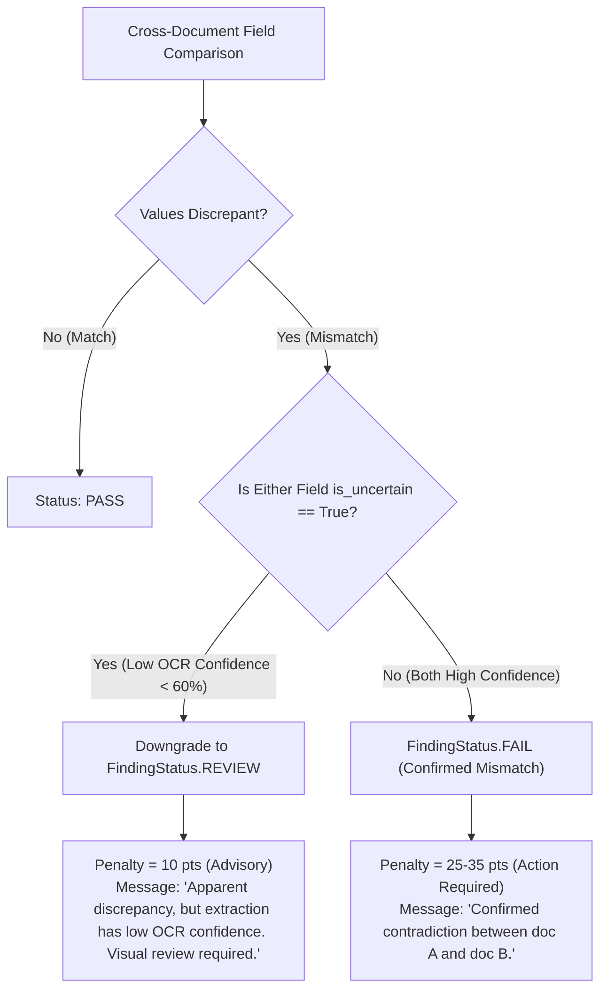

# Uncertainty & Non-Rejection Guarantees — DocuReady Loop 2

**Governance Framework:** Civic Tech Non-Adversarial Verification  
**Constitutional Reference:** Due Process and Natural Justice (Articles 14 & 21, Constitution of India)  
**Implementation Modules:** `docuready-mvp/src/validator.py`, `docuready-mvp/tests/test_uncertainty_safety.py`

---

## 1. The Core Principle: Never Reject on Low-Confidence Evidence

A critical failure mode of automated civic tech systems is **false rejection**: an eligible citizen is denied statutory welfare benefits because an OCR engine misread a character or a scanner smudged a date stamp.

DocuReady enforces a hard architectural axiom:
> **A machine failure to extract legible text must never establish statutory ineligibility.**

The system distinguishes between four distinct epistemic states:

| Status | Meaning | When Triggered | Action & Legal Effect |
| :--- | :--- | :--- | :--- |
| **PASS** | Confirmed Compliance | Evidence extracted with high confidence ($\ge 60\%$) and matches statutory rules and cross-document facts. | Informational only. Score untouched (0 penalty). |
| **REVIEW** | Human Judgment Required | Ambiguous evidence (e.g. DD/MM vs MM/DD), phonetic name variations, or **low-confidence OCR extraction** ($< 60\%$). | **Applicant NOT rejected.** Flagged for manual desk verification or self-declaration. Minimal advisory deduction (-5 to -10 pts). |
| **FAIL** | Statutory Discrepancy | High-confidence, deterministic violation (e.g. verified income exceeds ceiling, verified names are completely distinct people, expired certificate). | Corrective remediation required prior to final portal submission (-25 to -35 pts). |
| **UNKNOWN** | Evidence Unavailable | Document unreadable, corrupted header, completely blank page, or missing file. | Advisory re-scan guidance provided. No prejudice to applicant's legal eligibility. |

---

## 2. Decision Downgrade Architecture

When cross-checking facts across documents, any condition that would ordinarily trigger a `FAIL` is intercepted if either field was extracted with `is_uncertain == True`:

---

## 3. Statutory Relaxation: The SC/ST Cutoff Protection

In many state and central scholarship portals, arbitrary 50% or 60% academic cutoffs are erroneously applied across all applicants, leading to illegal rejections of Scheduled Caste (SC) and Scheduled Tribe (ST) students.

Under **Clause 4.1 of the Centrally Sponsored Post-Matric Scholarship Scheme for SC/ST Students (2021–2026)**:
> *"Scholarships will be paid to the students whose parents/guardians' income from all sources does not exceed Rs. 2,50,000/- per annum and who have passed the qualifying examination."*

There is **no minimum aggregate percentage cutoff** (such as 50% or 60%) for SC/ST applicants—merely a passing grade is statutorily sufficient.

**DocuReady Implementation:**
In `validator.py`:
1. The validator inspects the applicant's category from the Caste Certificate and Application Form.
2. If `caste_category` contains `SC`, `ST`, `SCHEDULED CASTE`, or `SCHEDULED TRIBE`, the 50% cutoff check is bypassed.
3. The finding is emitted as `RULE-MRK-RELAX-PASS` (`PASS`):
   > *"Candidate percentage (42.5%) satisfies scheme criteria: SC/ST candidates are exempt from minimum 50% cutoff upon passing qualifying examination."*
4. Automated test `test_sc_st_candidate_exempt_from_academic_cutoff` guarantees this protection under regression testing.

---

## 4. Empirical Validation: Test Coverage

Automated tests under `docuready-mvp/tests/test_uncertainty_safety.py` verify all five pillars of uncertainty protection:

1. `test_low_ocr_confidence_downgrades_to_review`: A smudged name scan (`conf = 0.48`) that would fail name matching is safely converted to `RULE-NAME-UNCERTAIN` (`REVIEW`).
2. `test_date_of_birth_uncertain_ocr_produces_review`: A smudged DOB scan (`conf = 0.52`) is converted to `RULE-DOB-UNCERTAIN` (`REVIEW`).
3. `test_income_ceiling_uncertain_ocr_produces_review`: A blurred income figure reading ₹2,80,000 with low confidence is converted to `RULE-INC-CEIL-UNCERTAIN` (`REVIEW`).
4. `test_sc_st_candidate_exempt_from_academic_cutoff`: An SC candidate with 42.5% marks receives `PASS`.
5. `test_unreadable_scan_produces_unknown_not_rejection`: Unreadable raster files emit `RULE-DOC-02` (`UNKNOWN`), halting automated processing safely.
