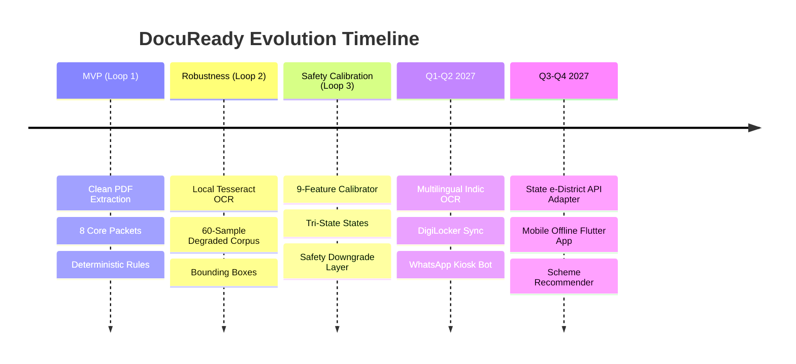

# DocuReady Product Roadmap

> [!WARNING]
> **Superseded for DocuReady 2.0:** The 2027 WhatsApp, Flutter Android, DigiLocker, and Streamlit-only items below reflect an early V1 roadmap and are **out of scope / superseded** for DocuReady 2.0. See [docs/07-DOCUREADY-2.0/PRODUCT_BRIEF.md](../07-DOCUREADY-2.0/PRODUCT_BRIEF.md) and [docs/07-DOCUREADY-2.0/24H_EXECUTION_PLAN.md](../07-DOCUREADY-2.0/24H_EXECUTION_PLAN.md) for the active Electron + Python Sidecar roadmap.

## Vision

Empower every Indian student and citizen to submit verified, error-free applications to government scholarship portals, higher education admissions, and public welfare schemes.

---

## Phase Breakdown

### Phase 1: Core Foundation (Completed — Loops 1, 2, 3)
- [x] Ingestion of 6 statutory document types.
- [x] PyMuPDF vector extraction + Tesseract OCR dual routing.
- [x] 10 cross-document statutory validation rules.
- [x] 9-feature confidence calibration engine.
- [x] Tri-state evidence classification (`VERIFIED`, `PROVISIONAL`, `UNCERTAIN`).
- [x] Safety layer preventing false applicant rejections.
- [x] Single-document replacement and instant audit rerun.
- [x] Comprehensive test suite (50 unit & integration tests).

### Phase 2: Kiosk & Mobile Enablement (Q1–Q2 2027)
- [ ] **Lightweight Web Kiosk Mode**: Tailored for village Common Service Centre (CSC) operators with batch scanning shortcuts.
- [ ] **Indic Language OCR**: Integration of trained Tesseract models for Hindi, Marathi, Bengali, Tamil, Telugu, and Kannada.
- [ ] **Offline Edge Android App**: Camera-based scanner with on-device edge AI preprocessing, skew correction, and real-time audit.
- [ ] **DigiLocker Optional Pull**: For applicants with DigiLocker accounts, allow automatic verified fetching of Class 10 marksheets and Aadhaar references.

### Phase 3: Portal Integration & Ecosystem Expansion (Q3–Q4 2027)
- [ ] **Browser Extension Companion**: Directly inspects portal form fields as the user fills them on the National Scholarship Portal or State e-District portal.
- [ ] **Dynamic Scheme Definition Language (SDL)**: JSON/YAML schema allowing state education departments to author custom scheme rules without code changes.
- [ ] **Open Governance Dashboard**: Anonymized metrics on common rejection reasons to help policymakers simplify forms.
