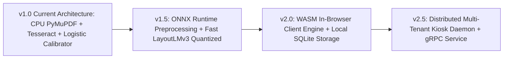

# DocuReady Technical Roadmap

## Technical Milestones & Architecture Evolution

---

## Detailed Technical Tracks

### 1. Extraction Engine Enhancements
- **Deep Layout Parsing**: Replace heuristic bounding box distance metrics with a lightweight, quantized ONNX LayoutLMv3 or Donut-based visual document parser running on CPU ($< 150 \text{ ms/page}$).
- **Tabular Marks Reconstruction**: Implement structured line-detection algorithms for complex grade sheets with non-standard semester matrices and CGPA-to-percentage conversions.
- **Handwritten Signature and Stamp Localization**: Implement dedicated cascade classifiers or lightweight YOLO models to confirm document execution authenticity.

### 2. Machine Learning & Calibration Rigor
- **Bayesian Confidence Calibration**: Upgrade from logistic sigmoid regression to non-parametric Isotonic Regression and Dirichlet calibration for complex multi-class document classification.
- **Continuous Calibration Feedback Loop**: In human-in-the-loop deployments, record operator override decisions to re-fit calibration weights while ensuring zero PII retention.

### 3. Performance & Platform Portability
- **WebAssembly (WASM) Compilation**: Compile PyMuPDF (MuPDF C core) and Tesseract into WebAssembly to enable a 100% client-side, zero-server deployment runnable inside standard web browsers on any device.
- **Dockerized Microservice Distribution**: Provide standardized, pre-configured container images with pre-warmed OCR models for rapid deployment in government intranet data centers.
