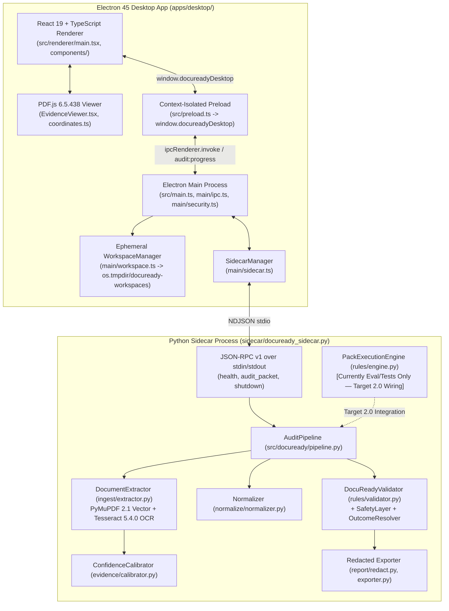

# DocuReady 2.0 — System Architecture

**Canonical Status:** Active DocuReady 2.0 Architecture (reconciles `docs/ARCHITECTURE_V2.md` and `docs/adr/ADR-002-desktop-runtime-and-sidecar.md` against verified `origin/main` source at `70b7ea5f001a5a30404a13b7d347527c641a434b`, updated from `9717ae5`).

---

## 1. Runtime Topology

---

## 2. Layer Responsibilities & Verified File Map

| Layer | Verified Files & Symbols | Current Behavior |
|---|---|---|
| **Renderer UI** | `apps/desktop/src/renderer/main.tsx`, `components/DocumentNav.tsx`, `EvidenceViewer.tsx`, `FindingPanel.tsx` | 3-panel workspace (document list, PDF.js/image viewer with bbox overlays, finding panel with status filters). |
| **Shared Contracts** | `apps/desktop/src/shared/types.ts`, `coordinates.ts`, `evidence.ts` | DTOs, `transformBBoxToViewport` (`0°/90°/180°/270°`), `normalizeFindingsAndEvidence`, `filterFindings`. |
| **Preload Bridge** | `apps/desktop/src/preload.ts` | Exposes frozen `window.docureadyDesktop` (`DocuReadyBridge`) with basic type guards; `contextIsolation: true`, `sandbox: true`. |
| **Main & IPC** | `apps/desktop/src/main.ts`, `main/ipc.ts` (`IpcHandlerRegistry`), `main/security.ts` | Squirrel lifecycle, CSP injection, `validateIpcSender` on all 10 channels, save/open dialogs, `audit:progress` forwarding. |
| **Workspace** | `apps/desktop/src/main/workspace.ts` (`WorkspaceManager`) | Ephemeral staging in `os.tmpdir()/docuready-workspaces/pkt-*`, 50MB/file, 200MB/packet, magic-byte validation, cleanup on quit/clear/cancel. |
| **Sidecar Bridge** | `apps/desktop/src/main/sidecar.ts`, `sidecar/docuready_sidecar.py` | NDJSON protocol v1 (`health`, `audit_packet`, `shutdown`). Packaged builds use PyInstaller `docuready_sidecar.exe` + bundled Tesseract 5.4.0. |
| **Python Engine** | `src/docuready/pipeline.py`, `ingest/`, `evidence/`, `normalize/`, `rules/`, `outcome/`, `report/` | Dual vector/OCR extraction, 9-feature calibration, Indic digit & Verhoeff/date/INR/IFSC normalizers, `DocuReadyValidator` + `DecisionSafetyLayer`, PII redaction. |

---

## 3. Data Flow (Current vs. DocuReady 2.0 Target)

1. **Intake:** User selects files via native dialog (`documents:select`) → `WorkspaceManager.registerDocument` validates magic bytes & size → `packet:create` copies files to isolated `pkt-*` directory. *(2.0 addition: slot-driven intake mapped to selected pack `doc_slots`.)*
2. **Audit Execution:** `audit:start` → `SidecarManager.executeAudit` → `docuready_sidecar.py` (`audit_packet`) → `AuditPipeline.load_and_audit_packet` → emits progress frames → returns `RedactedAuditResult`. *(2.0 addition: pass `schemeId` / pack selection, return `slot_statuses` and raw-vs-normalized field summaries.)*
3. **Evidence Review:** Renderer normalizes findings (`normalizeFindingsAndEvidence`), renders PDF/image in `EvidenceViewer`, and highlights `[x0, y0, x1, y1]` bounding boxes on target page. *(2.0 addition: unambiguous `documentId` linking, raw vs normalized view, uncertainty explanations, cross-doc comparison, session annotations.)*
4. **Correct & Re-audit:** *(2.0 addition)* User replaces a defective document in-slot (`packet:replace-document` / `AuditPipeline.replace_document_and_reaudit`) and triggers immediate re-audit without wiping unaffected documents.
5. **Redacted Export:** `report:export` writes PII-redacted JSON or Markdown report via `dialog.showSaveDialog`. *(2.0 addition: fix `f.remediation` redaction gap and include pack metadata + separated session review notes.)*

---

## 4. Informational Website Distinction

- `site/` (`site/index.html`, `site/vercel.json`) is a **static Vercel showcase** (`script-src 'none'`, `connect-src 'none'`). It is **not** part of the desktop runtime and processes zero documents.
