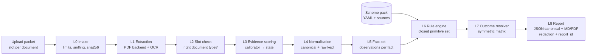

# DocuReady — Architecture V2

**Status:** proposed baseline · **Owner:** Claude (core architecture) · **Date:** 2026-11-13
**Canonical codebase:** `github.com/Algoryxz/DocuReady`
**Evidence base:** README, PUBLICATION_REPORT, SECURITY, CONTRIBUTING, LICENSE, `.gitignore`, `requirements.txt`, plus the Arena notes.
`src/` was **not** available for review. Anything said here about existing code comes from the docs and must be confirmed by task T0.1.

---

## 1. Verdict on the current design

| Keep | Change | Add |
|---|---|---|
| Deterministic core (no LLM in the decision loop) | Rules hardcoded in `validator.py` → **rule packs as data** | Packet **slot validation** (is this really an income certificate?) |
| Field provenance with bounding boxes | Safety layer only protects against false *rejection* → **symmetric** (also false *pass*) | **Clock injection** (`as_of`) so expiry/age rules are replayable |
| 9-feature calibration → tri-state evidence | Flat `src/*.py` scripts → installable package | **Engine manifest** in every report (versions, languages, backend) |
| Remediation guidance per finding | One synthetic benchmark → **dev / calibration / test** splits | **Claims register** (every public claim → evidence) |
| Single-document replacement + instant re-audit | PyMuPDF hard dependency (AGPL) → **PDF backend interface** | **Redaction by default** in exports and logs |
| Synthetic packet generator, CLI + Streamlit UI | Unpinned deps, `pytest` in prod deps | **No-network contract test** |
| | Unqualified README claims | **Golden snapshots** before any refactor |

---

## 2. Positioning (what we are allowed to say)

> **DocuReady is an applicant-side preparation aid.** It checks whether the documents in a packet are consistent with each other and with a scheme's published document requirements, and explains each defect and how to fix it. It does **not** decide eligibility, replace government verification, or guarantee acceptance.

**Why this wording.** Per the Arena notes (sources are cited there; re-verify in T1.5), the National Scholarship Portal and the Odisha State Scholarship Portal already ship eligibility checkers, and Subhadra has its own database/field/e-KYC verification. Open-source repos already cover OCR and Indian ID extraction (e.g. `haq-document-intelligence`, `Aadhaar_OCR`).

**Not differentiators:** OCR, Aadhaar/PAN extraction, eligibility checking.

**Defensible differentiators:**
1. Cross-document reconciliation with **graded** matches (exact / compatible / conflict), not just fuzzy equality.
2. Evidence-calibrated **abstention in both directions** (no unfair FAIL, no false PASS).
3. **Rule packs with verifiable sources** — every rule says where it comes from and whether a human verified it.
4. Defect → remediation (which authority, which replacement document, what to ask for).

**Claims that must be removed or sourced before any further promotion:**
- "80 million applicants", "18–32% rejected" (README) and "30–45%" (appears in the other DocuReady bundle). Neither is sourced, and they contradict each other.
- "Every finding cites an enacted statutory clause or gazette."
- "DPDP compliant", "100% local / zero exfiltration" without qualification.
- "Legally admissible", "guarantee", "official".
- Benchmarks presented without the word **synthetic**; ECE quoted from n=60 without a confidence interval.

Mechanism: `docs/CLAIMS_REGISTER.md` — one row per public claim: *claim · where it appears · evidence · status (verified / softened / removed)*. CI fails if a README sentence matching a banned pattern is not in the register.

---

## 3. Design principles

1. **Findings are claims about evidence, not verdicts about people.**
2. **Rules are data; the engine is code.** Policy changes must not require Python changes.
3. **Abstention is symmetric.** Uncertain evidence can neither fail nor pass a rule.
4. **Everything is traceable.** Every finding links to observations; every observation links to page + bbox + extractor.
5. **Deterministic and replayable.** Same packet + same pack version + same `as_of` + same engine manifest → byte-identical report body.
6. **Privacy by construction.** Stateless by default, redacted by default, no network in the runtime path (enforced by a test, not a sentence).
7. **Honest by construction.** Pack status, source verification and synthetic-data labels are shown in every report.

---

## 4. Target architecture



| Layer | Package | In → Out | Invariants |
|---|---|---|---|
| L0 Intake | `ingest.intake` | bytes → `DocumentArtifact` | size/page caps, MIME sniff (not extension), sha256, parse in subprocess with timeout |
| L1 Extraction | `ingest.pdf_backend`, `ingest.ocr`, `extract.*` | artifact → raw observations | vector text first, OCR fallback; OCR languages come from the pack's doc type |
| L2 Slot check | `extract.classify` | observations → slot verdict | wrong/unknown type → `REVIEW`, never silently proceeds |
| L3 Evidence | `evidence.*` | observation → `p`, `EvidenceState` | thresholds in config, not in code |
| L4 Normalise | `normalize.*` | raw → canonical | raw string always preserved; Odia/Devanagari digits handled; ambiguous dates are not guessed |
| L5 Facts | `domain.facts` | observations → `Fact` | a fact holds *all* observations across documents |
| L6 Rules | `rules.engine` | facts + pack → `RuleResult` | no `eval`, no free-form expressions; unknown primitive = load error |
| L7 Resolve | `outcome.resolver` | rule result + evidence → `Finding` | see §6; the only place statuses are assigned |
| L8 Report | `report.*` | findings → `AuditReport` | canonical JSON; redaction applied at render time |

### 4.1 Core contracts (Pydantic, `domain/`)

```python
class EvidenceState(str, Enum):  VERIFIED; PROVISIONAL; UNCERTAIN
class Status(str, Enum):         PASS; FAIL; WARN; REVIEW; MISSING; NOT_APPLICABLE
class Raw(str, Enum):            SATISFIED; VIOLATED; INDETERMINATE
class Grade(str, Enum):          EXACT; COMPATIBLE; CONFLICT; AMBIGUOUS

class Observation:   # one value read from one document
    id, doc_id, doc_type, field_key
    raw_text, canonical | None
    p_correct: float, state: EvidenceState
    provenance: {page, bbox, extractor, ocr_lang | None}

class Fact:          key: str; observations: list[Observation]      # e.g. "applicant.name"

class RuleResult:    rule_id, raw: Raw, grade: Grade | None, inputs: list[obs_id], detail: dict

class Finding:
    rule_id, status: Status, reason_code, explanation
    evidence: list[obs_id]
    remediation: {authority, replacement_document, steps[]}
    citation: {pack_id, source_id, clause, source_verified: bool}

class AuditReport:
    schema_version, report_id            # sha256 of canonical body (no timestamp)
    engine_manifest                      # docuready, pdf backend, tesseract, langs, python versions
    pack: {id, version, status, effective_from, effective_to}
    as_of: date                          # injected clock, never datetime.now() inside rules
    packet: {artifact_sha256s[], doc_slots}
    readiness: NOT_READY | NEEDS_CHECKS | NO_ISSUES_FOUND
    findings[], limitations[], data_label: "synthetic" | "user_supplied"
```

### 4.2 Match grades (normaliser contract)

| Field | EXACT | COMPATIBLE | CONFLICT | AMBIGUOUS |
|---|---|---|---|---|
| Name | identical after case/space/diacritics | initial expansion (`A. Sharma` ↔ `Aarav Sharma`), token reorder, minor spelling/phonetic variant | different surname/given-name tokens | one side unreadable or single token |
| Date | same date | — | different date | `03/04/2005` read two ways, or partial date |
| ID / account | same digits | — | different digits | checksum fails (e.g. Verhoeff) → likely OCR error, not conflict |
| Amount | same value | within declared tolerance | outside tolerance | unit/lakh-crore parse unclear |

Rule consequence: **CONFLICT → can FAIL; COMPATIBLE → at most WARN** (the applicant still needs a fix, but it is not a hard defect); **AMBIGUOUS → REVIEW**.

---

## 5. Packet slots

The MVP uses **slot-based upload** (one slot per required document, defined by the pack), not free-form classification. A light sanity classifier (anchor keywords per doc type) checks the file matches its slot. A mismatch is a `REVIEW` finding with reason `WRONG_DOCUMENT_TYPE`. Full automatic classification is a P2 item.

---

## 6. Outcome resolution (replaces the current safety layer)

`weakest` = the lowest evidence state among the observations a rule used.

| Raw | Weakest evidence | Status | Reason code | Citizen meaning |
|---|---|---|---|---|
| VIOLATED | VERIFIED | **FAIL** | `DEFECT_CONFIRMED` | Fix before submitting |
| VIOLATED | PROVISIONAL | **WARN** | `DEFECT_PROBABLE` | Re-scan / re-check; likely defect |
| VIOLATED | UNCERTAIN | **REVIEW** | `EVIDENCE_UNCERTAIN` | Cannot tell; human check |
| SATISFIED | VERIFIED | **PASS** | `CONFIRMED_OK` | No issue found on verified evidence |
| SATISFIED | PROVISIONAL / UNCERTAIN | **REVIEW** | `CANNOT_CONFIRM` | Looks fine but evidence too weak to say so |
| INDETERMINATE | any | **REVIEW** | `INSUFFICIENT_DATA` | Needed value missing or ambiguous |
| (required document absent) | — | **MISSING** | `DOC_ABSENT` | Add the document |
| (rule exempt, e.g. category exemption) | — | **NOT_APPLICABLE** | `EXEMPT:<why>` | Shown, never silently dropped |

Additional rules:
- A rule's pack-level `max_severity` caps its status (advisory rules can never FAIL).
- `COMPATIBLE` grade caps at WARN; `AMBIGUOUS` forces REVIEW.
- **Packet readiness:** `NOT_READY` if any FAIL/MISSING; else `NEEDS_CHECKS` if any WARN/REVIEW; else `NO_ISSUES_FOUND`. The words "approved", "eligible" and "ready to submit" are never emitted.
- CLI exit codes derive from readiness: `0` no issues, `1` needs checks, `2` not ready, `64` usage/system error.
- One status vocabulary, defined once in `domain/enums.py`. README, UI and CLI import it. This removes today's "MANUAL REVIEW" vs "NEEDS REVIEW" drift.

---

## 7. Scheme packs (rules as data)

```
packs/<pack_id>/
  pack.yaml        # parameters, doc slots, rules
  sources.yaml     # every source, with retrieval + review record
  CHANGELOG.md
```

```yaml
# pack.yaml (illustrative; values are placeholders, not facts)
pack_id: odisha.example
version: 2026.1
status: demo_snapshot            # draft | demo_snapshot | verified
effective: { from: 2026-04-01, to: 2026-04-30 }
as_of_required: true
parameters:
  income_cap_inr: <set from source>
  income_cert_valid_for: <set from source>
doc_slots:
  income_certificate: { ocr_langs: [eng, ori], required: true }
  bank_passbook:      { ocr_langs: [eng],      required: true }
rules:
  - id: RULE-INC-01
    primitive: numeric_cap
    inputs: { field: income.annual, docs: [income_certificate] }
    params: { cap: $income_cap_inr }
    max_severity: FAIL
    exempt_when: { fact: applicant.category, in: [SC, ST] }   # recorded as NOT_APPLICABLE
    citation: { source: S1, clause: "<clause>" }
    remediation:
      authority: "<issuing authority>"
      replacement_document: "<document>"
      steps: ["..."]
```

**Closed primitive set** (implemented in Python, each with a test matrix):
`require_document` · `field_present` · `match_across(grade=name|date|id|text)` · `within_validity` · `numeric_cap` · `numeric_consistency` · `age_on` · `enum_in` · `legible`.
New primitive = Python + tests + registry entry. YAML never contains code.

**Lifecycle and lint (enforced in CI):**
- `verified` requires every cited source to have `url`, `retrieved_on` and `reviewed_by`.
- Every rule has `citation`, `remediation`, `max_severity`.
- Parameters are typed; `$param` references must resolve.
- Packs are immutable once released; changes bump `version`.
- The engine refuses `draft` packs unless `--allow-draft`; reports print the pack status prominently.
- A rule whose citation is `unverified` renders as "source pending verification", so the UI cannot overstate authority.

**Pack plan:** `generic.demo` (a faithful port of today's 10 rules, used to prove equivalence) → `odisha.subhadra` (`demo_snapshot`; the 2026 window has closed, so it is a dated snapshot, not a live eligibility service) → one Odisha scholarship pack once its sources are verified.

---

## 8. Privacy and security by construction

| Concern | Control | How it is enforced |
|---|---|---|
| "Zero exfiltration" | No network in the runtime path | `tests/contract/test_no_network.py` patches `socket` to raise, runs the full pipeline on all demo packets |
| Streamlit telemetry | `.streamlit/config.toml` with `gatherUsageStats = false`; fix `.gitignore` to ignore only `.streamlit/secrets.toml` (today `.streamlit/` is ignored, so the config could never be committed) | test asserts the config exists and the flag is false |
| PII in exports | Aadhaar → last 4, bank account → last 4, phone → last 2 by default; `--no-redact` is explicit and warns | unit tests with synthetic identifiers; golden test on rendered output |
| PII in logs | Log field keys, states and rule ids, never values | log-capture test on a full run |
| Persistence | Stateless by default; uploads go to a `0700` temp dir and are deleted after the audit | test that the temp dir is empty after `run()` |
| Hostile PDFs/images | size/page/pixel caps, parse in subprocess with timeout, no external resource fetches | adversarial fixtures (huge page count, decompression bomb, malformed xref) |
| Reproducible OCR | Tesseract version + traineddata recorded in `engine_manifest`; Docker image pins them | manifest present in every report |
| Aadhaar handling | never persisted, masked everywhere outside memory | covered by redaction + persistence tests |
| Vulnerability intake | enable GitHub private vulnerability reporting; keep the email as fallback | `SECURITY.md` updated |

---

## 9. Evaluation protocol

The current numbers (100% / 91.7% / 93.0%, ECE 0.04–0.05) were produced on documents made by the same author with the same generator. They show the code works on those documents. They are not evidence of real-world accuracy, and an ECE from n=60 is statistically weak.

**Changes:**
1. **Three splits:** `dev` (tuning), `calib` (fit the calibrator), `test` (never used for tuning). The `test` split uses layouts/templates that do not exist in `dev`, not just different random seeds.
2. **Headline metrics (in this order):**
   - **False-pass rate** — packets with a real defect that the tool called `PASS`/`NO_ISSUES_FOUND`.
   - **False-fail rate** — clean packets given `FAIL`.
   - **Abstention rate** and **coverage** (what share gets a definite answer).
   - Per-field extraction accuracy.
   - Calibration: reliability table with bin counts and a bootstrap CI; ECE reported only with its CI.
3. **Perturbation matrix:** rotation, blur, JPEG quality, DPI, contrast, stamps/seals overlapping text, bilingual layout. Report metrics per perturbation, not one pooled accuracy.
4. **Negative controls:** same name different person, near-identical numbers, common-name collisions, wrong document in slot.
5. **Labelling:** every table in README/docs says `synthetic`. Real-world claims are forbidden until a real-sample set exists (T4.4).
6. **Regression gate:** `eval/baseline.json` stores the minimums; CI fails if a change worsens false-pass rate beyond tolerance.

**Real-sample protocol (T4.4):** start from official **specimen/format** certificates published on government portals, then volunteer-donated, redacted and consented documents. Never scraped personal documents.

---

## 10. Target repository layout

```
DocuReady/
├── pyproject.toml              # src layout, extras: [ui] [ocr] [dev] [pymupdf]
├── requirements.lock           # pinned (generated)
├── LICENSE  NOTICE             # NOTICE = third-party licences
├── README.md  SECURITY.md  CONTRIBUTING.md
├── .streamlit/config.toml      # telemetry off (committed)
├── src/docuready/
│   ├── domain/       enums.py models.py facts.py errors.py
│   ├── ingest/       intake.py ocr.py pdf_backend/{base,pdfium,pymupdf}.py
│   ├── extract/      classify.py fields/ provenance.py
│   ├── evidence/     features.py calibrator.py states.py
│   ├── normalize/    names.py dates.py money.py ids.py digits.py
│   ├── rules/        engine.py primitives.py loader.py schema.py lint.py
│   ├── outcome/      resolver.py
│   ├── report/       builder.py render_json.py render_md.py redact.py
│   ├── pipeline.py
│   └── interfaces/   cli.py  ui/app.py
├── packs/            generic.demo/  odisha.subhadra/
├── tests/            unit/ integration/ adversarial/ contract/ golden/
├── eval/             generators/ data/{dev,calib,test}/ harness.py baseline.json EVAL_CARD.md
├── docs/             ARCHITECTURE_V2.md  CLAIMS_REGISTER.md  STATUS.md  adr/  history/
└── .github/workflows/ ci.yml  release.yml
```

`docs/04-VALIDATION` (17 audit reports) and `docs/05-ITERATIONS` move to `docs/history/` so the public docs are the architecture, ADRs and claims register, not the build diary.

**Migration = strangler, not rewrite.** (1) Freeze golden outputs for all 8 packets. (2) Move files into the package with no behaviour change; golden tests must stay green. (3) Only then change behaviour, one gated task at a time.

---

## 11. Architecture decision register

| ID | Decision | Rationale | Gate |
|---|---|---|---|
| ADR-001 | Put PDF access behind a `PdfBackend` interface. Default to a permissively licensed backend (`pypdfium2`, with `pdfminer.six` as text/bbox fallback); keep PyMuPDF as an optional `[pymupdf]` extra. Adopt the new default only if corpus accuracy and false-pass rate do not regress beyond tolerance. If they do, stay on PyMuPDF **and** state the AGPL obligations in NOTICE/README (or relicense). | PyMuPDF is AGPL-3.0 unless a commercial licence is bought from Artifex. An Apache-2.0 repo that depends on it burdens anyone who deploys it as a service or ships a bundle. (Not legal advice; the T1.3 owner records the licence check for each replacement.) | G1 |
| ADR-002 | Rules are versioned YAML packs over a closed primitive set; no `eval`. | Policy changes without code changes; auditable; safe. | G3 |
| ADR-003 | Symmetric outcome resolution; single status vocabulary; readiness never says "eligible/approved". | A false PASS is as harmful as a false FAIL for a pre-flight tool. | G2 |
| ADR-004 | Positioning = applicant-side preparation aid; claims register enforced in CI. | Existing portals and repos already cover eligibility and OCR. | G1 |
| ADR-005 | Strangler refactor protected by golden snapshots. | No behaviour drift while restructuring. | G0 |
| ADR-006 | `Algoryxz/DocuReady` is the canonical codebase. The standalone bundle built outside it (Streamlit, Subhadra rules, 11 tests, UI never launched) is a **reference only**: we take its ideas (dated rule snapshot, rule-failure vs missing-evidence vs needs-human separation, claim guardrails) and do not merge its code. | Two diverged implementations cannot both be maintained; the repo has CI, 50 tests and provenance. | G0 |
| ADR-007 | Privacy-by-construction: stateless, redacted by default, no-network test. | Turns marketing claims into tested properties. | G1 |
| ADR-008 | Evaluation protocol in §9; all numbers labelled synthetic until real samples exist. | Credibility under judge/reviewer scrutiny. | G5 |
| ADR-009 | Clock injection (`as_of`) for all time-dependent rules. | Replayability; Subhadra-style reference dates. | G3 |

---

## 12. Top risks

| Risk | Impact | Mitigation |
|---|---|---|
| Rule citations are placeholders | Credibility / misleading citizens | T1.5 audit; `source_verified` flag shown in UI |
| Synthetic-only validation | Real documents behave differently (bilingual, stamps, handwriting) | §9 protocol, T4.2–T4.4, honest labelling |
| Backend swap regresses extraction | Lower accuracy | ADR-001 regression gate, fallback path |
| Refactor changes behaviour | Hidden bugs | golden snapshots (ADR-005) |
| Odia/Hindi name matching | High false-conflict rate | AMBIGUOUS → REVIEW, never FAIL; transliteration is a research item |
| Rule drift (schemes change) | Stale advice | pack `effective` window + `verified_on`; report prints pack age |
| Scope creep (tamper detection, auto-classification) | Dilutes the core | P2 list; revisit only after G5 |
