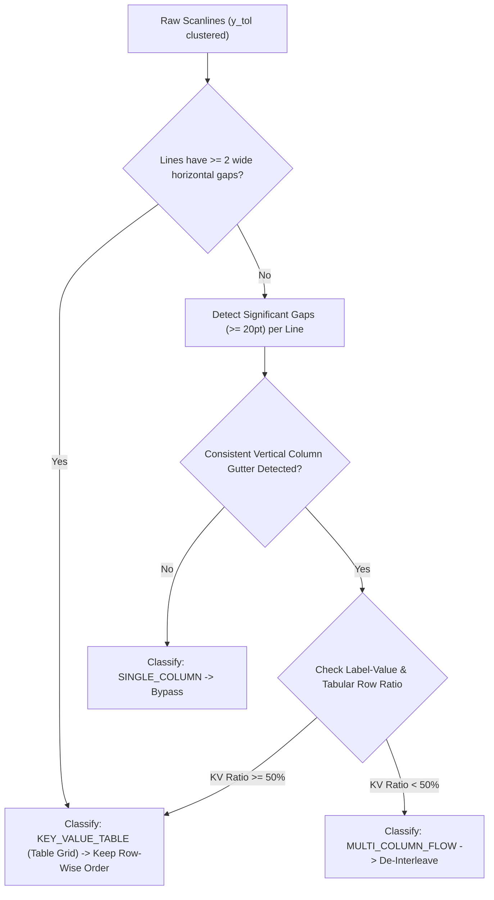

# DOCUREADY — LOOP 13
## Column-Aware Spatial Reading Order Reconstruction Specification

**Subsystem:** Ingestion & Spatial OCR Layout  
**Module:** `src/docuready/ingest/spatial_layout.py`  
**Integration:** `src/docuready/ingest/extractor.py` (`PageOCRData._build_lines`)  
**Status:** Qualified & Production-Hardened  
**Target Architecture:** Multi-Column De-Interleaving with Invariant Table/Form Row Preservation  

---

### 1. Architectural Problem Statement

In Loops 01 through 12, DocuReady's OCR line clustering engine (`PageOCRData._build_lines`) relied on a 1D vertical tolerance grouping algorithm. Words across the page were sorted primarily by vertical centroid ($y_0$) and assigned to the same scanline if their vertical difference was within `y_tol` (8 points).

#### The Cross-Column Interleaving Failure
In multi-column documents (such as government gazettes, scholarship circulars, journal articles, and two-column informational bulletins), text flows down Column 1 before continuing at the top of Column 2. Because words in Column 1 and Column 2 share identical vertical $y$-coordinates on adjacent lines, naive scanline clustering merged words horizontally across the central column gutter:

$$\text{Line}_k = [w_{1,k}, w_{2,k}, \dots, w_{m,k}] \cup [w'_{1,k}, w'_{2,k}, \dots, w'_{n,k}]$$

This produced interleaved sentences such as:
> *"The post-matric scholarship State verification offices scheme guidelines require shall inspect educational strict physical verification institutions annually to ensure."*

This corrupted downstream regex pattern matching, destroyed semantic clause continuity, and produced a pairwise word inversion error rate exceeding 17% to 29% on multi-column documents.

---

### 2. Design Invariants & Safety Constraints

To address this defect without introducing regressions into single-column certificates or structured tables, five non-negotiable invariants were established:

1. **Table Grid Invariant (Row-Wise Preservation):** Financial statements, marksheet tables, and 3+ column data grids must *never* be split vertically. They must be read horizontally row-by-row so that table rows (`Mathematics | 100 | 92`) remain intact.
2. **Key-Value Form Invariant:** Intake forms with label-value pairs (`Applicant Name: | ROHIT VERMA`) must preserve horizontal row association, ensuring downstream extraction rules match labels to values.
3. **Single-Column Certificate Invariant:** Single-column paragraphs, letterheads, and certificates must bypass spatial reordering with zero behavioral delta and bit-exact golden baseline parity.
4. **Coordinate Space Preservation:** All bounding box coordinates ($[x_0, y_0, x_1, y_1]$) and confidence scores for reconstructed lines must map directly to original page space without translation or scaling artifacts.
5. **Ultra-Low Latency Overhead:** Spatial layout detection and de-interleaving must execute in $< 5\text{ ms}$ per page, consuming $< 1\%$ of the $\sim 834\text{ ms}$ total OCR pipeline budget.

---

### 3. Geometric Layout Detection Algorithm

Layout classification operates via `detect_page_layout_structure(raw_lines, min_gutter_width=20.0)`:

#### Step 3.1: Table Grid Detection
Before evaluating column gutters, the algorithm inspects internal gaps per line:
- Let $G(L_i)$ be the set of horizontal gaps between adjacent words in line $L_i$:
  $$g_j = w_{j+1}.x_0 - w_j.x_1$$
- If line $L_i$ contains $\ge 2$ gaps where $g_j \ge 20.0\text{ pt}$, it contains at least 3 distinct aligned columns (e.g. *Subject | Max Marks | Marks Obtained*).
- If $\ge 2$ lines exhibit multi-gap alignment, the document is classified as `KEY_VALUE_TABLE` / `TABLE_GRID`, halting vertical splitting immediately.

#### Step 3.2: Column Gutter Overlap
For pages without multi-gap grids, the widest horizontal gap in each line is identified. The candidate split coordinate $x_{\text{split}} = (g_{x0} + g_{x1}) / 2$ is evaluated across all lines. The split coordinate maximizing overlapping line gaps is selected.

#### Step 3.3: Key-Value vs Narrative Disambiguation
For matching split lines, `is_label_value_or_table_row(left_words, right_words)` determines whether the line is a form row or narrative text:
- **Parallel Header Guard:** If both left and right text end with colons (`:` or `:-`), they represent parallel column headings in a multi-column document, NOT a label-value pair.
- **Form Label Match:** If left text ends with `:` and right text does not, or left text contains administrative cues (*Name, DOB, Income, Roll, District*) and right text is compact ($\le 8$ words), it is marked as a Key-Value row.
- **Tabular Value Match:** If right text consists of numbers, grades, or percentages (*100, 92, PASS, 88.5%*), it is marked as a tabular row.
- If the Key-Value / Tabular ratio is $\ge 50\%$, the page is classified as `KEY_VALUE_TABLE`. Otherwise, it is classified as `MULTI_COLUMN_FLOW`.

---

### 4. Spatial De-Interleaving & Zone Ordering

When `MULTI_COLUMN_FLOW` is detected, `cluster_and_order_words` partitions the document into four sequential zones:

$$\text{Reading Order} = \mathcal{Z}_{\text{Header}} \to \mathcal{Z}_{\text{Column 1 (Left)}} \to \mathcal{Z}_{\text{Column 2 (Right)}} \to \mathcal{Z}_{\text{Footer}}$$

1. **Header Zone ($\mathcal{Z}_{\text{Header}}$):**
   Lines strictly above the first split line ($y < y_{\text{split, start}}$) or spanning across the column gutter without an internal gap (e.g., banner titles: `GOVERNMENT OF INDIA`).
2. **Column 1 Zone ($\mathcal{Z}_{\text{Left}}$):**
   Words in the column region with $x \le x_{\text{split}}$, clustered and ordered top-to-bottom.
3. **Column 2 Zone ($\mathcal{Z}_{\text{Right}}$):**
   Words in the column region with $x > x_{\text{split}}$, clustered and ordered top-to-bottom.
4. **Footer Zone ($\mathcal{Z}_{\text{Footer}}$):**
   Lines strictly below the column region ($y > y_{\text{split, end}}$) or separated by a large vertical jump ($\ge 35\text{ pt}$), preserving full-width disclaimer and pagination text.

---

### 5. Line and Word Bounding Box Reconstruction

To ensure 100% downstream compatibility with PDF coordinate navigation and visual evidence viewers:
- Each reconstructed line's bounding box is computed from the bounding union of its constituent words:
  $$\text{bbox}(L) = [\min_{w \in L} w.x_0, \;\min_{w \in L} w.y_0, \;\max_{w \in L} w.x_1, \;\max_{w \in L} w.y_1]$$
- Confidence is computed as the word-length weighted mean of individual word confidences:
  $$\text{conf}(L) = \frac{\sum_{w \in L} \text{conf}(w) \cdot \text{len}(w.\text{word})}{\sum_{w \in L} \text{len}(w.\text{word})}$$
- Word bounding boxes (`word_boxes`) are preserved unaltered in original coordinate space.
