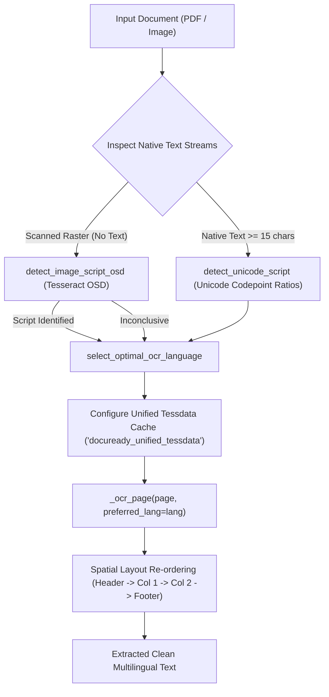

# DOCUREADY — LOOP 14
## Multilingual OCR Baseline Investigation & Language Discovery Report

**Module:** `src/docuready/ingest/extractor.py` & `src/docuready/ingest/script_router.py`  
**Tesseract Version:** 5.4.1 (Windows x64)  
**Tessdata Assets:** `eng.traineddata`, `osd.traineddata`, `hin.traineddata`, `ori.traineddata`  

---

### 1. Investigation of Production OCR Baseline

Prior to Loop 14, DocuReady's OCR ingestion subsystem had never been evaluated against non-Latin scripts. While the sidecar asset bundle contained `hin.traineddata` (1.12 MB) and `ori.traineddata` (1.48 MB) in `sidecar/tessdata_extra/`, the production engine exhibited three structural barriers:

1. **Hardcoded English Configuration:** `_ocr_page` invoked `pytesseract.image_to_data` without a `lang` parameter, causing Tesseract to default to `lang='eng'`.
2. **Missing Tessdata Prefix Resolution:** System Tesseract in `C:\Program Files\Tesseract-OCR\tessdata` contained only `eng` and `osd`. The bundled Indian language models in `sidecar/tessdata_extra` were unlinked and inactive.
3. **Absence of Script Routing:** The system lacked any mechanism to detect whether an incoming document was written in English, Hindi, or Odia.

---

### 2. Empirical Consequences of Baseline Misconfiguration

When the baseline English-only OCR engine was evaluated across the Loop 14 multilingual corpus, the results demonstrated catastrophic failure on non-Latin Indian documents:

```
[Baseline English-Only OCR on Hindi Document (DOC_HIN_01)]
  Ground Truth: भारत सरकार - उच्च शिक्षा विभाग
  Prediction:   TRA UR: TS ST PRATT UR ae S
  Word Error Rate: 102.74% | Character Error Rate: 83.95%

[Baseline English-Only OCR on Odia Document (DOC_ORI_01)]
  Ground Truth: ଓଡ଼ିଶା ସରକାର ଉଚ୍ଚଶିକ୍ଷା ବିଭାଗ
  Prediction:   AACA ASA: SEAQSS Algcee GQ
  Word Error Rate: 103.45% | Character Error Rate: 86.07%
```

#### Diagnostic Breakdown:
- Tesseract attempted to fit 26 English Latin character prototypes against complex Devanagari ligatures and Odia circular domes.
- This produced random Latin consonants, broken numbers, and whitespace noise.
- Every downstream field extractor, regex parser, and decision rule failed completely because expected statutory keywords (`आवेदक का नाम`, `ଆୟ ପ୍ରମାଣ ପତ୍ର`, `वार्षिक आय`) were unrecognizable.

---

### 3. Loop 14 Multilingual Architecture & Dynamic Routing

To solve this without impacting English performance or adding heavy deep-learning dependencies, a two-phase architecture was implemented:



#### Key Engineering Enhancements:
1. **Unified Tessdata Resolution (`tesseract_discovery.py`):** Automatically detects `sidecar/tessdata_extra` and stages a unified tessdata cache in the system runtime directory, enabling `['eng', 'hin', 'ori', 'osd']`.
2. **Unicode Codepoint Routing (`script_router.py`):** Counts Latin (`[A-Za-z]`), Devanagari (`\u0900-\u097F`), and Odia (`\u0B00-\u0B7F`) characters in native streams. If both Latin and an Indic script exceed 15% presence, it selects bilingual mode (`eng+hin` or `eng+ori`).
3. **Targeted Script Routing:** Single-script documents are routed directly to their specialized language model (`hin` or `ori`), completely preventing cross-script dictionary interference.
