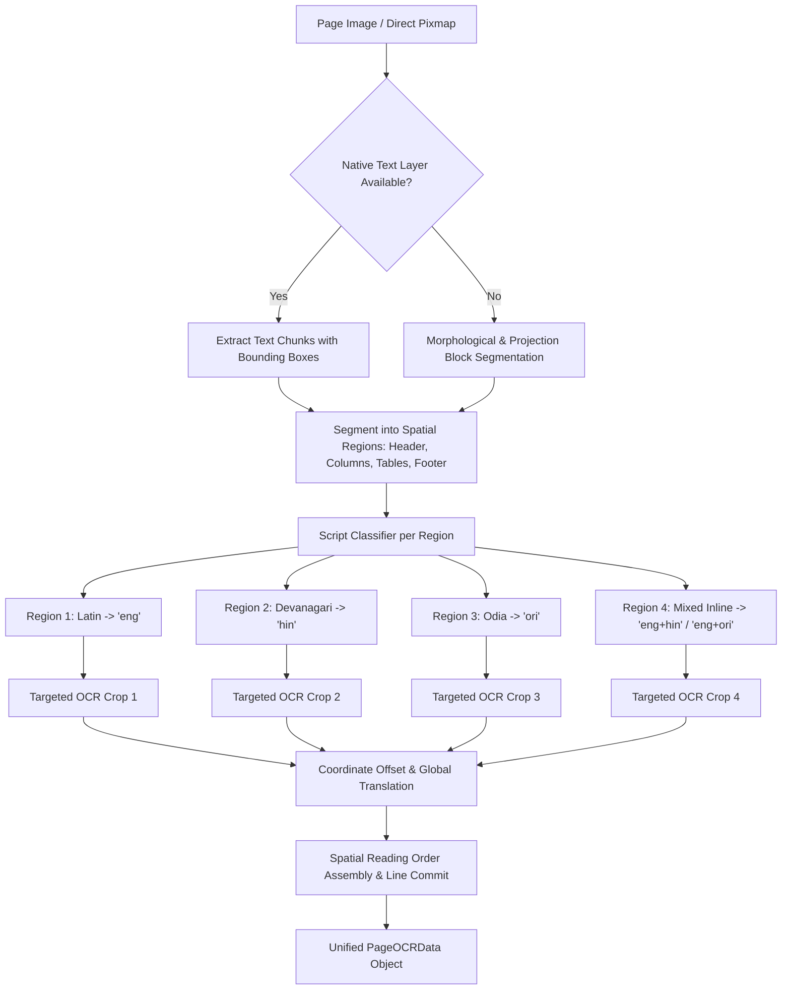

# DOCUREADY — LOOP 15 REGION-AWARE ROUTING DESIGN
## Architecture for Spatial Region Decomposition, Script Routing & Evidence Reconstruction

**Component:** Ingestion & OCR Subsystem  
**Module:** `src/docuready/ingest/region_ocr.py`  
**Loop:** 15  
**Date:** November 2026  
**Status:** SPECIFICATION & IMPLEMENTATION CONTRACT  

---

## 1. Architectural Problem Statement

In multilingual Indian administrative documents, a single page frequently incorporates distinct spatial regions composed in different scripts:
1. **Header Region:** Institutional titles, seals, and circular numbers in Latin script (`eng`).
2. **Body Primary Region:** Circular instructions or notifications in Devanagari script (`hin`).
3. **Body Secondary / Vernacular Region:** Regional translation or statutory notice in Odia script (`ori`).
4. **Data Grid / Form Matrix:** Tabular marks, dates, roll numbers, currency codes in Latin script (`eng`).

Loop 14 operated at the *whole-page* level. On multi-script pages, selecting any single script corrupted all other scripts, while invoking compound models (`eng+hin+ori`) tripled latency and introduced beam-search dictionary cross-talk.

**Loop 15 introduces Region-Aware OCR:** decomposing the page into discrete spatial blocks, classifying the script of each block, routing each block to its targeted language model, and reconstructing evidence in global page coordinates.

---

## 2. Pipeline Overview

---

## 3. Mathematical & Geometric Formulation

### 3.1 Region Coordinate Offset
Let a page image have pixel dimensions $(W, H)$.  
A detected region $R_k$ is bounded by box $(x_{0,k}, y_{0,k}, x_{1,k}, y_{1,k})$ in pixel space.

When Tesseract executes on the cropped sub-image $I_k = \text{Crop}(I, R_k)$, it outputs tokens with local bounding boxes $(l_{local}, t_{local}, w_{local}, h_{local})$.

The global page pixel coordinates are given by:
$$l_{global} = l_{local} + x_{0,k}$$
$$t_{global} = t_{local} + y_{0,k}$$
$$r_{global} = l_{global} + w_{local}$$
$$b_{global} = t_{global} + h_{local}$$

In 72 DPI PDF point space (scaling factor $s = 72.0 / \text{DPI}$):
$$X_0 = \text{round}(l_{global} \times s, 1)$$
$$Y_0 = \text{round}(t_{global} \times s, 1)$$
$$X_1 = \text{round}(r_{global} \times s, 1)$$
$$Y_1 = \text{round}(b_{global} \times s, 1)$$

### 3.2 Script Classification Heuristics per Region

1. **Native Text Stream Analysis:**
   If text exists in region $R_k$, compute Unicode codepoint frequencies:
   $$N_{dev} = \sum_{c \in R_k} \mathbb{I}(c \in [\text{U+0900}, \text{U+097F}])$$
   $$N_{ori} = \sum_{c \in R_k} \mathbb{I}(c \in [\text{U+0B00}, \text{U+0B7F}])$$
   $$N_{lat} = \sum_{c \in R_k} \mathbb{I}(c \in [A-Za-z])$$
   $$N_{tot} = N_{dev} + N_{ori} + N_{lat}$$

   - If $N_{dev} / N_{tot} > 0.40 \implies \text{lang} = \text{'hin'}$
   - If $N_{ori} / N_{tot} > 0.40 \implies \text{lang} = \text{'ori'}$
   - If $N_{lat} / N_{tot} > 0.70 \implies \text{lang} = \text{'eng'}$
   - If both $N_{dev} > 0.15$ and $N_{lat} > 0.15 \implies \text{lang} = \text{'eng+hin'}$
   - If both $N_{ori} > 0.15$ and $N_{lat} > 0.15 \implies \text{lang} = \text{'eng+ori'}$

2. **Raster Visual Morphological Analysis:**
   For scanned images without native text:
   - Identify horizontal bands by horizontal projection profile (sum of dark pixels per row).
   - Valleys ($P_y < \tau$) define region split boundaries.
   - For each horizontal band, sample representative lines:
     * Check for Devanagari **Shirorekha** (top horizontal continuous stroke line): horizontal projection peak near top 20-30% of character bounding box.
     * Check for Odia curved matras (round tops, absence of continuous straight horizontal top-line).
     * Check for Latin baseline alignment (bottom baseline peak, distinct ascenders/descenders).
   - Alternatively, execute a fast 1-line script probe or Tesseract OSD on the region crop.

---

## 4. Confidence Fallback & Error Recovery

To guarantee zero regression:
1. **Fallback Condition:** If a region routed to `hin` or `ori` produces mean token confidence $< 25.0$ or yields fewer than 3 valid tokens while significant ink is present, the region re-runs under `eng` or `eng+hin`.
2. **Monolithic Page Bypass:** If the page consists of a single uniform layout without distinct multi-script blocks (e.g. single-column English certificate), the region pipeline collapses to a single full-page pass, ensuring 100% bit-exact parity with existing golden baselines.
3. **Table Grid Preservation:** Tabular regions maintain horizontal row grouping to preserve key-value relationships as established in Loop 13.

---

## 5. Implementation Specification

The implementation resides in `src/docuready/ingest/region_ocr.py` exposing:
- `segment_page_into_regions(img, native_blocks=None)`
- `classify_region_script(img_crop, native_text=None)`
- `ocr_page_regions(img, dpi=200, preferred_lang=None, native_blocks=None)`
- Seamless translation into `PageOCRData` structures.
