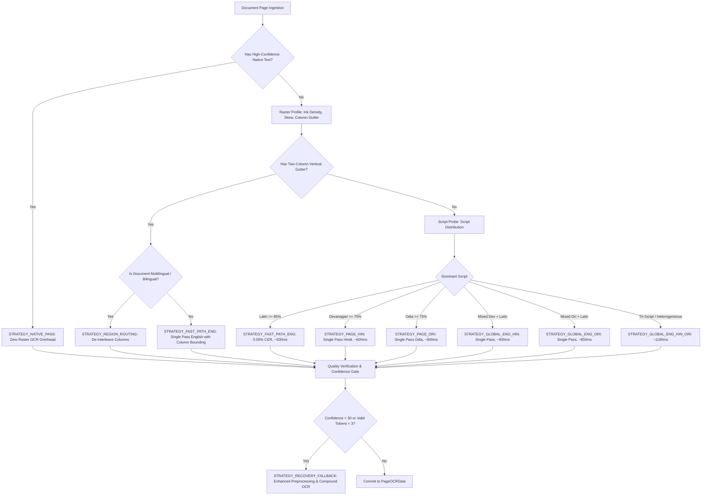

# DOCUREADY — LOOP 16 ADAPTIVE STRATEGY DESIGN
## Deterministic Strategy Selector, Decision Objective & State Architecture

**Component:** Ingestion & Strategy Selector Subsystem  
**Module:** `src/docuready/ingest/adaptive_ocr.py`  
**Loop:** 16  
**Date:** November 2026  
**Status:** SPECIFICATION & IMPLEMENTATION CONTRACT  

---

## 1. Mathematical Optimization Objective

A simplistic selector that minimizes CER alone would invariably select `CONFIG_F` (`eng+hin+ori`), incurring 1200 ms latency and 18–21% line interleaving on two-column pages. Conversely, a selector that maximizes speed would always run `CONFIG_A` (`eng`), suffering 80%+ error rates on Hindi and Odia documents.

DocuReady defines a multi-criteria optimization function over candidate OCR strategy $S \in \mathcal{S}$:

$$\min_{S \in \mathcal{S}} \quad \mathcal{J}(S) = \mathcal{E}_{recognition}(S) + \lambda_{order} \mathcal{I}_{reading\_order}(S) + \lambda_{latency} \mathcal{T}_{cost}(S) + \mathcal{P}_{audit}(S)$$

Where:
- $\mathcal{E}_{recognition}(S)$: Expected character/word error rate.
- $\mathcal{I}_{reading\_order}(S)$: Reading order inversion rate (weighted heavily ($\lambda_{order} = 2.5$) for multi-column documents to prevent cross-gutter line corruption).
- $\mathcal{T}_{cost}(S)$: Computational latency and process spawn count.
- $\mathcal{P}_{audit}(S)$: Risk penalty for missing statutory anchors (Name, DOB, Income, Authority).

---

## 2. Decision Tree & Routing State Machine



---

## 3. Decision Classes & Concrete Policies

### 3.1 Class 1: Fast Path (`STRATEGY_FAST_PATH_ENG`)
- **Criteria:** Single-column document, native PDF text layer in Latin script OR raster thumbnail showing $\ge 85\%$ Latin characters.
- **Action:** Single Tesseract pass with `lang='eng'`.
- **Target Performance:** Latency $\approx 500$ ms, CER $\approx 0.00\%$, Inv Rate $= 0.0\%$.

### 3.2 Class 2: Monolingual Indic Path (`STRATEGY_PAGE_HIN` / `STRATEGY_PAGE_ORI`)
- **Criteria:** Single-column layout with dominant Indic script ($\ge 75\%$) and negligible second script.
- **Action:** Single Tesseract pass with pure model (`hin` or `ori`).
- **Target Performance:** Avoids compound model dictionary noise, latency $\approx 600$ ms.

### 3.3 Class 3: Spatially Partitioned Region Path (`STRATEGY_REGION_ROUTING`)
- **Criteria:** Body band exhibits a distinct vertical whitespace gutter flanked by ink on both sides AND multiple scripts are detected.
- **Action:** Segment left and right columns; route Column 1 and Column 2 to their respective language models independently.
- **Target Performance:** Completely prevents horizontal line interleaving, keeping Reading Order Inversion Rate $< 3.0\%$.

### 3.4 Class 4: Mixed Single-Column Path (`STRATEGY_GLOBAL_MULTILINGUAL`)
- **Criteria:** Single-column or tabular layout with mixed scripts (e.g. CBSE marksheets, tri-script circulars without vertical gutters).
- **Action:** Single full-page pass with targeted compound model (`eng+hin` or `eng+hin+ori`).
- **Target Performance:** Eliminates 8 to 24 subprocess spawns, reducing latency from 7.5s to 1.1s while delivering the lowest CER (8–14%).

### 3.5 Class 5: Recovery Path (`STRATEGY_RECOVERY_FALLBACK`)
- **Criteria:** Initial strategy yields mean word confidence $< 30.0$ or tokens $< 5$ on an image with verified ink content.
- **Action:** Fallback to compound model with adaptive local contrast binarization.

---

## 4. Auditability & Observability

Every execution produces a structured `StrategyDecisionRecord`:
```json
{
  "document_id": "DOC_MULTI_02_BILINGUAL_COLUMNS_HIN_ENG",
  "features": {
    "has_native_text": false,
    "has_column_gutter": true,
    "gutter_x": 409,
    "primary_script": "MIXED_DEVANAGARI_LATIN",
    "script_distribution": {"latin": 0.45, "devanagari": 0.55, "odia": 0.0}
  },
  "selected_strategy": "STRATEGY_REGION_ROUTING",
  "selection_reason": "Bilingual two-column layout detected; region routing required for spatial de-interleaving",
  "ocr_model_invocations": 2,
  "elapsed_ms": 2851.3,
  "fallback_triggered": false
}
```
No private citizen PII or document text is ever recorded in strategy telemetry.
