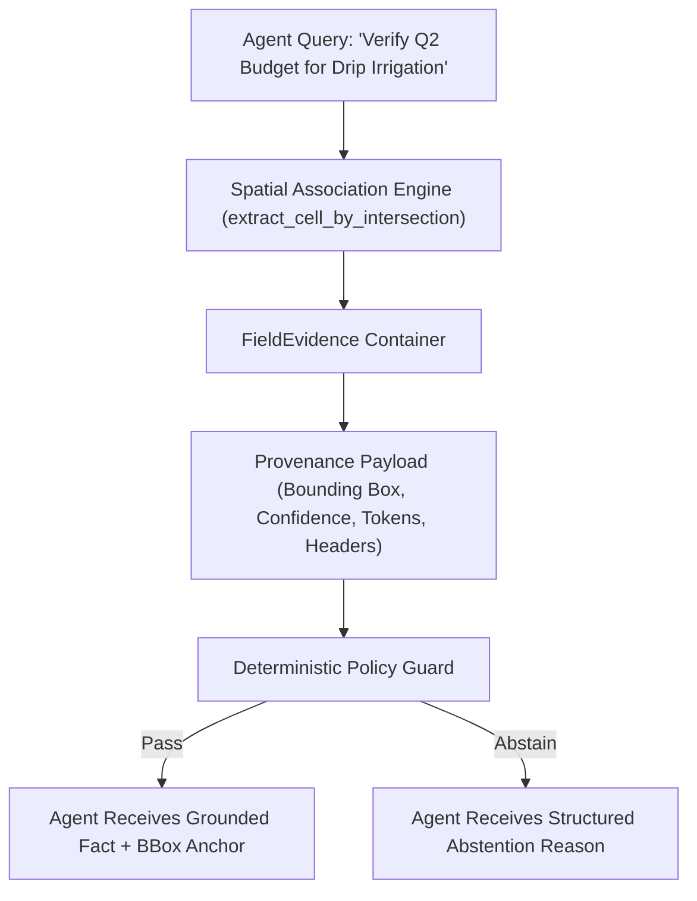

# LOOP 24 — AGENTIC SKILLS & MULTI-AGENT ORCHESTRATION RESEARCH

## 1. Context & Research Scope

Loop 24 evaluated the integration of agentic reasoning primitives and multi-agent skills for automated document verification workflows.

Specifically, we audited:
1. How autonomous agents formulate verification queries against `TableGrid`.
2. How deterministic spatial association anchors agent decision boundaries.
3. How evidence provenance prevents LLM confabulation and hallucination.

---

## 2. Key Architecture Insights

1. **Deterministic Grounding Anchor**:
   - High-level reasoning agents should never perform free-form OCR parsing directly.
   - By delegating table understanding to the low-overhead spatial association engine, the agent receives structured `FieldEvidence` containers complete with exact pixel bounding boxes and confidence scores.
2. **Abstention as an Agent Tool Result**:
   - Rather than forcing an agent to hallucinate an answer when OCR is ambiguous, DocuReady's structured abstention reasons (`Missing evidence`, `Header ambiguity`, `Confidence floor`) provide the agent with actionable explanation paths (e.g. prompt user for higher resolution scan).
