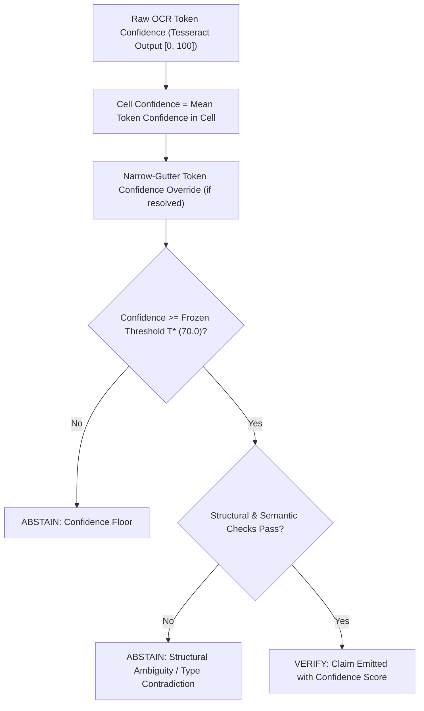

# LOOP 24 — CONFIDENCE SEMANTICS & SCORING AUDIT

## 1. Architectural Audit of Confidence Semantics

In document verification systems, confidence values frequently suffer from semantic conflation: blending character recognition confidence, bounding-box localization certainty, and semantic association validity into an uninterpretable score.

Loop 24 audits and defines the explicit semantics of DocuReady's confidence scoring:

---

## 2. Formal Definitions

1. **OCR Token Confidence ($c_{\text{token}} \in [0.0, 100.0]$)**:
   - Direct posterior probability logit emitted by the Tesseract LSTM recognition engine for an individual whitespace-delimited token.
2. **Cell Confidence ($c_{\text{cell}} \in [0.0, 100.0]$)**:
   - Defined as the unweighted arithmetic mean of token confidences for all words localized inside the cell's spatial bounding box:
     $$c_{\text{cell}} = \frac{1}{|W_{\text{cell}}|} \sum_{w \in W_{\text{cell}}} c(w)$$
   - If a cell is resolved from a multi-token narrow gutter via `resolve_narrow_gutter_cell_token`, $c_{\text{cell}}$ inherits the specific sub-token confidence.
3. **Verification Decision ($\mathcal{D} \in \{\text{VERIFY}, \text{ABSTAIN}\}$)**:
   - Verification is a hard binary decision gated by both the confidence threshold $T^*$ and structural invariant predicates:
     $$\mathcal{D} = \begin{cases} \text{VERIFY} & \text{if } c_{\text{cell}} \ge T^* \land \neg \text{ambiguous} \land \neg \text{type\_contradiction} \\ \text{ABSTAIN} & \text{otherwise} \end{cases}$$

---

## 3. Findings & Separation of Concerns

- **Zero Arbitrary Scaling**: DocuReady maintains direct adherence to OCR posterior confidence without applying heuristic multipliers or arbitrary offsets.
- **Structural Integrity Separated from Confidence**: Ambiguities such as row/column header mismatches, multi-token gutter bleed, or syntax noise are NOT represented by reducing confidence numbers; they trigger **deterministic abstentions** with explicit human-auditable reasons.
- **Traceability**: Every extracted `FieldEvidence` record encapsulates full provenance, including bounding-box coordinates, token counts, raw tokens, query mode, and abstention reasons.
