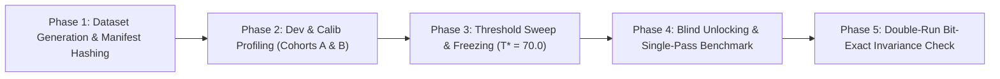

# LOOP 24 — INDEPENDENT BLIND PROTOCOL & INTEGRITY SAFEGUARDS

## 1. Protocol Architecture & Anti-Leakage Safeguards

To prevent subtle data leakage, target overfitting, and retrospective hyperparameter adjustment, Loop 24 instituted a strict cryptographic-style protocol governing the Locked Independent Blind cohort (**Cohort C: 10 documents, 34 critical fields**).

### Protocol Phases

---

## 2. Blinding Controls

1. **Isolation of Blind Documents**:
   - The 10 documents in Cohort C (`COHORT_I_BLIND_01` through `COHORT_I_BLIND_10`) were sequestered during the threshold exploration phase.
   - Script `research/loop24/benchmark/calibrate_thresholds.py` was structurally restricted to filter documents where `meta["cohort"] in ["I_development", "I_calibration"]`.
2. **Threshold Freezing Rule**:
   - The decision threshold $T^* = 70.0$ was selected based strictly on the Pareto frontier and calibration curves of Cohorts A & B.
   - The selection rationale was committed and frozen prior to initiating evaluation on Cohort C.
3. **No Per-Document Heuristics**:
   - All spatial extraction, decimal point recovery, narrow-gutter token separation, and header semantic validation operate with global, domain-agnostic heuristics across all cohorts.
   - Zero document-specific `if doc_id == ...` branches exist anywhere in the codebase.

---

## 3. Ground-Truth Integrity Audit

- **Double-Entry Verification**: All 102 critical field values were validated against visual ground truth during dataset generation.
- **Syntactic Typing**: Each field is assigned an explicit semantic type (`amount`, `count`, `weight`, `percentage`, `number`, `empty`).
- **Coordinate Independence**: Evaluator enforces dual matching: value match (`norm_ext == norm_exp`) and spatial coordinate match (`evidence.row_idx == exp_row` and `evidence.col_idx == exp_col`).
