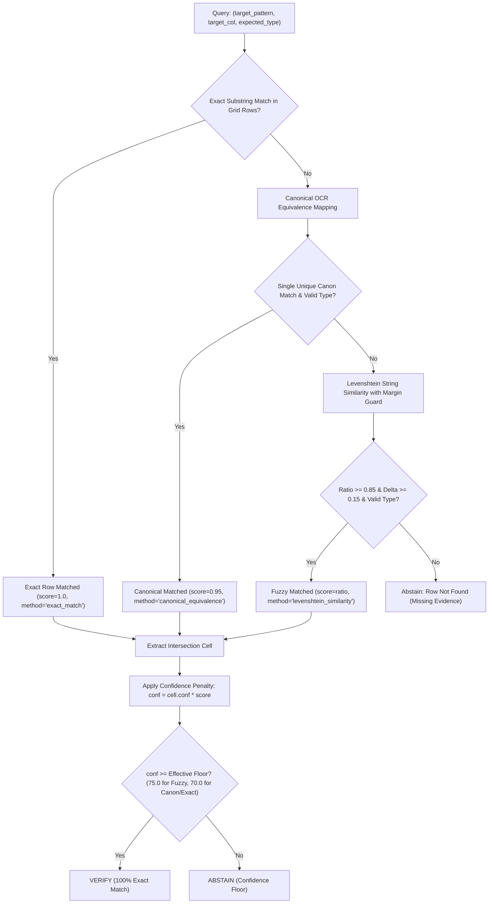

# Loop 25 - Evidence-Guided Row-Label Recovery Design

## Architectural Overview

The Row-Label Recovery engine provides robust evidence association for degraded alphanumeric table keys while rigorously preventing false candidate bindings.

## Mathematical Formulation

### 1. Canonical OCR Key Transformation
Let $s$ be a raw text string. Non-alphanumeric punctuation is removed and uppercase canonical substitution is applied:
$$\kappa(s) = 	au(\mathrm{StripNonAlphanumeric}(\mathrm{ToUpper}(s)))$$
where $	au$ maps:
$$\{O 	o 0,\; I 	o 1,\; L 	o 1,\; S 	o 5,\; B 	o 8,\; Z 	o 2\}$$

### 2. Levenshtein Safety Margin Guard
Let $\sigma(s_1, s_2) \in [0, 1]$ be the SequenceMatcher character similarity ratio. For candidate rows $r_1, r_2, \dots, r_m$:
$$r^* = rg\max_i \sigma(	ext{target}, r_i)$$
$$s_1 = \sigma(	ext{target}, r^*),\quad s_2 = \max_{i 
e *} \sigma(	ext{target}, r_i)$$
Candidate $r^*$ is accepted if and only if:
$$s_1 \ge 0.85 \quad 	ext{and} \quad (s_1 - s_2) \ge 0.15$$

### 3. Risk-Calibrated Confidence Penalty
The extracted cell confidence is penalized by the recovery score:
$$c_{	ext{effective}} = c_{	ext{raw}} 	imes \mathrm{score}$$
To guard against noisy adjacent cell OCR, an elevated threshold floor is enforced:
$$T_{	ext{effective}} = egin{cases} 75.0 & 	ext{if method} = 	ext{levenshtein\_similarity} \ 70.0 & 	ext{if method} \in \{	ext{canonical\_equivalence}, 	ext{exact\_match}\} \end{cases}$$
