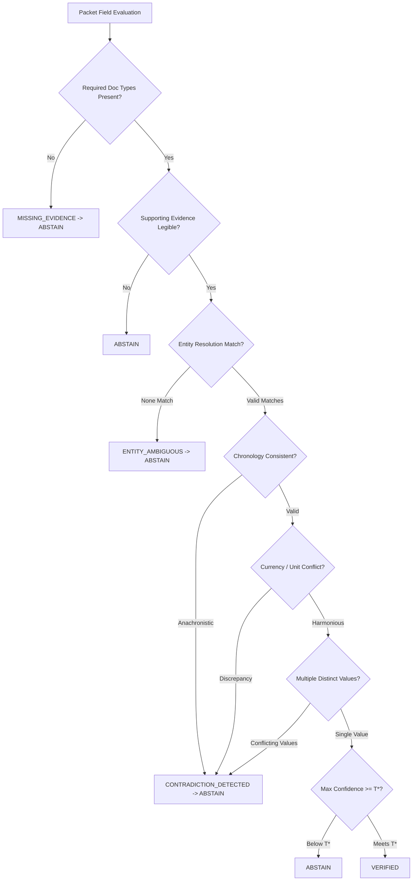

# Loop 28 Cross-Document Verification Policy

## 1. Operating Rules & Thresholds
- **Primary Operating Threshold**: $T^* = 70.0$
- **Fuzzy / Confusable Threshold**: $T_{\text{fuzzy}} = 75.0$
- **Corroborating Anchor Sim Threshold**: $0.85$

## 2. Verification Decision Flow

