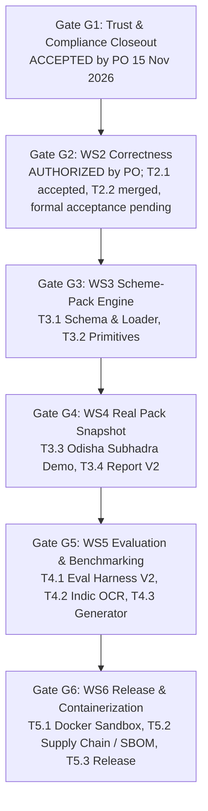

# Non-Visual Product and Engineering Quality Assessment

**Document Version:** 1.2.1
**Date:** 15 November 2026
**Status:** Gate G1 Accepted & Gate G2 Authorized Quality Framework
**Repository:** `Algoryxz/DocuReady`
**Product Owner:** Deeptiman
**Implementation Engineer:** Antigravity

---

## 1. Executive Summary & Objective

DocuReady is entering a structured product-quality improvement programme. Our objective is to raise the engineering and product quality of the application to a demonstrable **9/10 or higher** across all non-visual product and engineering quality dimensions, including website functional reliability and responsive behavior, prior to production general availability.

This framework defines objective, measurable criteria and calibrated score anchors for evaluating the system. It replaces ungrounded claims with traceable evidence, links acceptance criteria to verifiable automated tests and benchmark artifacts, and establishes an evidence-backed roadmap for the quality programme.

> [!NOTE]
> **Scope Boundary:** Visual frontend graphic design, artistic polish, and native Android application development are outside this scoring target. Website functional reliability, touch usability, mobile viewport responsiveness, client-side data privacy, and security remain strictly inside scope.

---

## 2. Calibrated Scoring Methodology & Anchors

To ensure scoring objectivity and prevent score inflation, every dimension is evaluated against three standard score anchors:

| Anchor | Level | Definition & Criteria |
|---|---|---|
| **Score 5** | Baseline / Prototype | Partial implementation or isolated unit test. May contain unhandled edge cases, lack negative/adversarial proofs, rely on unverified assumptions, or lack full end-to-end pipeline integration. |
| **Score 7** | Production-Ready / Bounded | Fully implemented and integrated into the end-to-end pipeline. Comprehensive positive and negative test coverage passing CI across supported runtime matrix (Python 3.11–3.14). All known limitations, bounds, and failure modes explicitly documented. |
| **Score 9** | Exemplary / Hardened | Rigorously hardened with independent verification. Non-silent contract assertions, reproducible benchmark scripts across multiple synthetic corpora, fail-closed runtime invariants, property-based verification, zero ungrounded/unverified claims, and verified supply chain integrity. |

### Scoring & Confidence Rules:
- **No Automatic Score 9:** A dimension cannot receive Score 9 merely because it has a working baseline and passing tests. Score 9 strictly requires empirical evidence satisfying the Score 9 criteria, including independent verification where specified.
- **Evidence-Justified Scores:** Current scores must be directly substantiated by observed tests and known gaps. If a score cannot be fully substantiated, it is marked provisional or bounded.
- **Calibrated Confidence:** The declared `Confidence / Evidence` rating describes exactly what the underlying evidence validates, rather than an ungrounded assertion about the general quality of the dimension:
  - **High:** Directly verified by dedicated automated tests, CI matrix runs, or cryptographic hashes for the specified capability.
  - **Medium:** Verified for basic functional operation or source-level syntax; awaiting end-to-end integration, heap inspection, or multi-corpus stress testing.
  - **Low / Unrated:** Preliminary code inspection without empirical execution data.

---

## 3. Methodological Corrections & Grounding Rules

In accordance with strict governance principles, this framework implements five specific methodology corrections:

1. **Statutory Citations vs. Operational Heuristics:**
   - Previous formulation: *"100% of findings cite verified statutory clauses."*
   - Corrected standard: Every finding must include **traceable citation metadata** with an explicit verification state (`verified statutory rule` vs. `unverified operational heuristic`). Sourced rules must link to an official gazette, circular, or scheme guideline with URL, retrieval date, and exact clause reference in `packs/generic.demo/sources.yaml`. Heuristics must be clearly declared as document consistency checks.

2. **Grounded Remediation Authority:**
   - Previous formulation: Generic suggestions to contact "Welfare Department".
   - Corrected standard: Remediation guidance and replacement-document instructions must reference **grounded issuing authorities** (e.g., Tahsildar / Revenue Department for Income Certificates, UIDAI for Aadhaar update/e-Aadhaar, issuing School Examination Board for Matriculation Certificates) without manufacturing fictitious department or portal names.

3. **Memory Ephemerality & Buffer Safety:**
   - Previous formulation: Unverifiable claims that *"Python garbage collection securely erases memory"*.
   - Corrected standard: Python CPython runtime garbage collection does not provide cryptographically zeroed heap memory. The verifiable privacy requirement is that **raw upload byte buffers are never intentionally retained in Streamlit session state, global variables, or persistent storage**, temporary directories are strictly isolated (`0700`) and unlinked in `finally` blocks, and safe logging filters purge PII from format arguments before logging.

4. **PDF Backend Scope & Decision Boundary:**
   - Previous formulation: Assumption of completed dual-backend feature parity.
   - Corrected standard: PyMuPDF 2.1 is the verified, working production default backend. PDFium (`pypdfium2`) is a deferred prototype (`PdfiumPageBackend.get_words()` raises `NotImplementedError`, resulting in `UNVERIFIED` field accuracy). Completing PDFium word segmentation remains conditional on an explicit Product Owner scope and licensing determination under ADR-001.

5. **Accessibility Terminology & Target Standards:**
   - Previous formulation: Describing 44px touch targets as the "WCAG 2.1 AA minimum".
   - Corrected standard: DocuReady adopts `44 × 44 CSS px` as a **stricter internal product design standard**, aligned with WCAG 2.1 AAA Success Criterion 2.5.5 (Target Size) and exceeding the WCAG 2.2 AA Success Criterion 2.5.8 (Target Size Minimum: 24 × 24 CSS px).
   - Official References:
     - [W3C WCAG 2.1 SC 2.5.5: Target Size (Level AAA)](https://www.w3.org/WAI/WCAG21/Understanding/target-size)
     - [W3C WCAG 2.2 SC 2.5.8: Target Size (Minimum) (Level AA)](https://www.w3.org/WAI/WCAG22/Understanding/target-size-minimum)

---

## 4. 12-Dimension Product Quality Gap Matrix

| # | Dimension | Current Score | Target Score | Confidence / Evidence | Observed Gap & Current State | Target 9+ Criteria & Acceptance Test |
|---|---|:---:|:---:|:---:|---|---|
| **1** | **Core Extraction & Layout Robustness** | **7 / 10** | **9 / 10** | Medium (Vector & OCR Baseline) | PyMuPDF extracts vector text and bounding boxes reliably on 8 canonical synthetic packets. Packet 7 OCR fallback passes semantic contracts. Gap: PDFium backend raises `NotImplementedError` on `get_words()`; multi-corpus real scans and automated deskewing are future work. | Zero crashes on malformed/skewed PDFs; layout segmentation verified across multi-corpus benchmark (`eval/reports/`); clear error reporting for scanned documents exceeding noise threshold. |
| **2** | **Deterministic Validation & Resolver Symmetry** | **7 / 10** | **9 / 10** | Medium (10 Core Rules Matrix) | 10 core rules execute deterministically. Pass/Fail/Review states mapped in validator. Gap: V2 symmetric status resolver (`outcome/resolver.py`) with explicit readiness and reason codes implemented in T2.1 (PR #43, PR #44, PR #46, PR #47, PR #48) and contract-hardened in PR #53 (merged at `4e56a99adbcdb413030e53706d6715e137647527`), formally accepted by Product Owner Deeptiman on 15 November 2026. T2.2 per-rule resolver transition matrix delivered in PR #49 (105 tests), and validator-level document fixture execution completed in PR #57 (52 tests in `tests/integration/test_validator_rule_matrix.py` exercising all 10 canonical rule groups through `DocuReadyValidator.validate_packet()`). Validator-level fixture coverage is complete. Formal T2.2 technical acceptance remains pending explicit PO review by Deeptiman; T2.3 onward held. | Symmetric resolver truth table fully implemented and exercised at validator level; property-based test proves `SATISFIED` + non-`VERIFIED` never yields `PASS`; injected clock (`as_of`) tested for 100% reproducible historical replays (T2.3). |
| **3** | **Sourced Citations & Regulatory Grounding** | **7 / 10** | **9 / 10** | Medium (YAML Schema & 5 Statutory Rules) | 13 rules classified across 10 rule groups in `sources.yaml`: 5 verified statutory rules (e.g., IT Act §4, Aadhaar Reg 28, Odia Act 1954), 8 unverified heuristics. Schema validation enforced. Gap: 8 rules remain operational heuristics without primary legal grounding; scheme-pack parameterization belongs to G3/G4. | All rule findings emit structured citation objects containing `citation_type` (`statutory` vs `heuristic`), issuing body, clause reference, retrieval date, and grounded remediation authority. |
| **4** | **Privacy, Ephemerality & Memory Boundaries** | **7 / 10** | **9 / 10** | Medium (Export Redaction & Temp Cleanup) | Default redaction for Aadhaar, bank accounts, and phone numbers in JSON, Markdown, and UI; isolated 0700 temp directory cleaned in `finally`; Screen 6 synthetic-only guard. Gap: Existing tests do not inspect CPython heap or verify that `st.session_state` retains 0 raw upload bytes across screens. | Test suite explicitly asserts `st.session_state` retains no raw bytes or unredacted PII across screens; memory isolation verified; zero persistent artifacts on disk after pipeline execution. |
| **5** | **Network Isolation & Egress Protection** | **8 / 10** | **9 / 10** | High (Python Socket Interception) | 12 automated contract tests intercept `socket.socket` and `socket.getaddrinfo`. Streamlit `gatherUsageStats = false` enforced. Deliberate socket call verified to fail immediately with `NetworkAccessBlockedError`. Gap: Container-level rootless and network-disabled sandbox (`docker run --network none`) belongs to G6 (T5.1). | Maintain 100% negative proof coverage in CI; zero external HTTP/DNS dependencies in audit pipeline; containerized non-root network sandbox in G6 (T5.1). |
| **6** | **Packaging, Build Reproducibility & Supply Chain** | **8 / 10** | **9 / 10** | High (PEP 517/518 Build & Lockfiles) | PEP 517/518 build with `hatchling`/`setuptools`; `--no-isolation` editable and wheel builds; locked requirements for Python 3.11–3.14 with SHA-256 hashes; direct PyYAML dev dependency. Gap: CycloneDX SBOM generation and `pip-audit` CVE scan belong to G6 (T5.2). | Fully automated SBOM generation; automated `pip-audit` zero-vulnerability check in CI; reproducible wheel byte verification across clean containers. |
| **7** | **Performance & Latency Profile** | **7 / 10** | **9 / 10** | Medium (CI Execution Timing) | Native vector PDF packet audit completes in <200ms per packet. OCR fallback on Packet 7 completes in <1.8s. Gap: Benchmark suite lacks automated latency regression gating, multi-threading profiling, and memory leak verification across long-running executions. | Automated regression test asserting execution time <500ms on 4-page native vector PDF packet and <3.0s on OCR raster packet on standard CI runner; no memory leaks across 100 consecutive runs. |
| **8** | **Error Handling & Fail-Closed Invariants** | **8 / 10** | **9 / 10** | High (Adversarial File Inputs) | Adversarial corrupt files, empty byte streams, zero-byte uploads, and missing documents fail closed with descriptive `REVIEW` or error results without unhandled crashes. Gap: Global unhandled exception handler in Streamlit UI needs explicit user-safe error boundary. | Every user-facing UI route wraps pipeline execution in an explicit error boundary displaying friendly diagnostic advice while logging masked failure metadata; zero raw stack traces shown to end users. |
| **9** | **Test Harness Integrity & Golden Parity** | **8 / 10** | **9 / 10** | High (369+ Passing Tests & Golden Hash) | 371 automated test items (369 passed, 2 skipped due to local environment tesseract dependency, 0 failures locally; 371 passed in remote CI) across 4 Python matrix jobs (3.11–3.14); bit-for-bit golden parity on Packets 1–6 & 8; semantic contract parity on Packet 7; golden baseline SHA-256 intact (`E8FB1A6B842A47089937777133DE79E1E7F704BEE591D5B4471A1A90BC8C5FA9`). Gap: Property-based testing and multi-corpus test splits belong to G2/G5. | Golden test suite preserved across all future sprints; zero regressions; recursive diff diagnostics pinpoint exact field divergence if golden contracts are breached. |
| **10** | **Multi-Format & Multi-Engine Modularity (PDF)** | **6 / 10** | **9 / 10** | High (Backend Abstraction & Eval Report) | `PDFDocumentBackend` abstraction in place; PyMuPDF 2.1 fully functional; PDFium prototype implemented but limited to text rendering and page count; ADR-001 documents commercial licensing trade-offs. Gap: PDFium word segmentation raises `NotImplementedError` (numerical accuracy `UNVERIFIED`). | Either (a) complete PDFium bounding box and word segmentation matching PyMuPDF field accuracy within 1.0 percentage point, or (b) Product Owner formal decision ratifying PyMuPDF AGPL-v3 default with dual-backend deferred to commercial plugin. |
| **11** | **Responsive Web Interface & Touch Usability** | **7 / 10** | **9 / 10** | Medium (Source CSS & Headless AppTest) | Responsive CSS (`@media (max-width: 768px)`), stricter internal target of >=44px touch targets, sticky readiness status bar, LAN run guide (`MOBILE_RUN_GUIDE.md`), automated tests, and 5 rendered viewport screenshots. Gap: CSS touch target test is a source-level string smoke check, not a computed rendered DOM box model calculation. | All primary workflows operable on 360px viewport; automated tests assert zero horizontal overflow; all buttons and inputs satisfy internal 44px touch target standards. |
| **12** | **Documentation Truthfulness & Claims Register** | **8 / 10** | **9 / 10** | High (Banned Phrases & Claims Register) | `CLAIMS_REGISTER.md` catalogues CLM-001 through CLM-011 with verified/qualified dispositions; automated contract tests enforce absence of 6 core banned hyperbolic phrases across all public surfaces; advisory disclaimer mandatory. Gap: Contract tests cover 6 core phrases; future docs must be continuously audited. | Continuous enforcement of claims register in CI; every new public doc added to test surface; 100% alignment between code capabilities and documented statements. |

---

## 5. Dependency-Aware Implementation Sequence

To advance all dimensions toward Score 9 without introducing architectural debt or regression risks, the following phased sequence is established:

### Phase Schedule & Focus Areas:
1. **Gate G1 (Trust & Compliance — ACCEPTED):**
   - Formally ACCEPTED by Product Owner Deeptiman on 15 November 2026.
2. **Gate G2 (WS2 — Correctness — AUTHORIZED):**
   - Formally AUTHORIZED by Product Owner Deeptiman on 15 November 2026.
   - Symmetrical status resolver (`T2.1`) implemented and contract-hardened (PR #53 merged at `4e56a99`); formally accepted by Product Owner Deeptiman on 15 November 2026.
   - Per-rule resolver transition matrix (`T2.2`) merged via PR #49 (105 tests) and validator-level fixture matrix merged via PR #57 (52 tests in `tests/integration/test_validator_rule_matrix.py`); all 10 canonical rule groups exercised through `validate_packet()`. Validator-level fixture coverage is complete; formal technical acceptance pending PO review.
   - Advance **Dimension 2** (Deterministic Validation) from 7 to 9: complete formal T2.2 review, then proceed to injected clock (`T2.3`), and slot classification (`T2.4`).
   - Advance **Dimension 8** (Error Handling) to 9 via slot error boundaries.
3. **Gate G3 (WS3 — Scheme-Pack Engine):**
   - Advance **Dimension 3** (Regulatory Grounding) from 7 to 9 via formal Pydantic pack schema (`T3.1`) enforcing citation metadata, retrieval dates, and remediation authorities.
4. **Gate G5 (WS5 — Evaluation & Benchmarking):**
   - Advance **Dimension 1** (Extraction Robustness) and **Dimension 7** (Performance Profile) from 7 to 9 via held-out evaluation harness (`T4.1`), Indic numeral normalization (`T4.2`), and 5 synthetic layout generators (`T4.3`).
5. **Gate G6 (WS6 — Release & Hardening):**
   - Advance **Dimension 5** (Network Isolation) and **Dimension 6** (Packaging & Supply Chain) from 8 to 9 via rootless non-networked Docker container (`T5.1`), automated SBOM generation, and `pip-audit` vulnerability scanning (`T5.2`).
