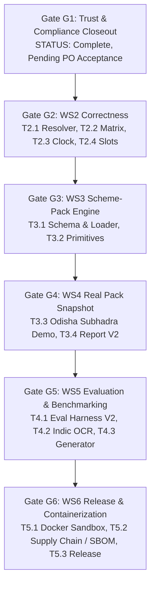

# DocuReady V2 — Product Quality Gap Analysis & Evaluation Framework (9+ Baseline)

**Document Version:** 1.1.0
**Date:** 15 November 2026
**Status:** Pre-G2 Quality Baseline Framework
**Repository:** `Algoryxz/DocuReady`
**Product Owner:** Deeptiman
**Implementation Engineer:** Antigravity

---

## 1. Executive Summary & Objective

DocuReady is entering a structured product-quality improvement programme. Our objective is to raise the engineering and product quality of the application to a demonstrable **9/10 or higher** across all non-frontend quality dimensions prior to production general availability.

This framework defines objective, measurable criteria and calibrated score anchors for evaluating the system. It replaces ungrounded claims with traceable evidence, links acceptance criteria to verifiable automated tests and benchmark artifacts, and establishes an evidence-backed roadmap for the quality programme.

> [!NOTE]
> **Scope Boundary:** Visual frontend graphic design, artistic polish, and native Android application development are outside this scoring target. Website functional reliability, touch ergonomics (>=44px touch targets), mobile viewport responsiveness, and client-side data privacy remain strictly inside scope.

---

## 2. Calibrated Scoring Methodology & Anchors

To ensure scoring objectivity and prevent score inflation, every dimension is evaluated against three standard score anchors:

| Anchor | Level | Definition & Criteria |
|---|---|---|
| **Score 5** | Baseline / Prototype | Partial implementation or isolated unit test. May contain unhandled edge cases, lack negative/adversarial proofs, rely on unverified assumptions, or lack full end-to-end pipeline integration. |
| **Score 7** | Production-Ready / Bounded | Fully implemented and integrated into the end-to-end pipeline. Comprehensive positive and negative test coverage passing CI across supported runtime matrix (Python 3.11–3.14). All known limitations, bounds, and failure modes explicitly documented. |
| **Score 9** | Exemplary / Hardened | Rigorously hardened with independent verification. Non-silent contract assertions, reproducible benchmark scripts across multiple synthetic corpora, fail-closed runtime invariants, property-based verification, zero ungrounded/unverified claims, and verified supply chain integrity. |

Each score rating requires a declared **Confidence / Evidence** assessment:
- **High (Verified):** Validated by automated CI tests, reproducible benchmarks, or cryptographic hashes.
- **Medium (Observed):** Validated by manual inspection or partial test coverage; awaiting adversarial or multi-corpus stress test.
- **Low (Hypothesized):** Estimated based on code review without empirical execution data.

---

## 3. Methodological Corrections & Grounding Rules

In accordance with strict governance principles, this framework implements four specific methodology corrections:

1. **Statutory Citations vs. Operational Heuristics:**
   - Previous formulation: *"100% of findings cite verified statutory clauses."*
   - Corrected standard: Every finding must include **traceable citation metadata** with an explicit verification state (`verified statutory rule` vs. `unverified operational heuristic`). Sourced rules must link to an official gazette, circular, or scheme guideline with URL, retrieval date, and exact clause reference in `packs/generic.demo/sources.yaml`. Heuristics must be clearly declared as document consistency checks.

2. **Grounded Remediation Authority:**
   - Previous formulation: Generic suggestions to contact "Welfare Department".
   - Corrected standard: Remediation guidance and replacement-document instructions must reference **grounded issuing authorities** (e.g., Tahsildar / Revenue Department for Income Certificates, UIDAI for Aadhaar update/e-Aadhaar, issuing School Examination Board for Matriculation Certificates) without manufacturing fictitious department or portal names.

3. **Memory Ephemerality & Buffer Safety:**
   - Previous formulation: Unverifiable claims that *"Python garbage collection securely erases memory"*.
   - Corrected standard: Python CPython runtime garbage collection does not provide cryptographically zeroed heap memory. The verifiable privacy requirement is that **raw upload byte buffers are never intentionally retained in Streamlit session state, global variables, or persistent storage**, temporary directories are strictly isolated (`0700`) and unlinked in `finally` blocks, and safe logging filters purge PII from format arguments before logging.

4. **PDF Backend Scope & Decision Boundary:**
   - Previous formulation: Assumption of completed dual-backend feature parity.
   - Corrected standard: PyMuPDF 2.1 is the verified, working production default backend. PDFium (`pypdfium2`) is a deferred prototype (`PdfiumPageBackend.get_words()` raises `NotImplementedError`, resulting in `UNVERIFIED` field accuracy). Completing PDFium word segmentation remains conditional on an explicit Product Owner scope and licensing determination under ADR-001.

---

## 4. 12-Dimension Product Quality Gap Matrix

| # | Dimension | Current Score | Target Score | Confidence / Evidence | Observed Gap & Current State | Target 9+ Criteria & Acceptance Test |
|---|---|:---:|:---:|:---:|---|---|
| **1** | **Core Extraction & Layout Robustness** | **7 / 10** | **9 / 10** | High (CI + Golden Suite) | PyMuPDF extracts vector text and bounding boxes reliably on 8 canonical synthetic packets. Packet 7 OCR fallback passes semantic contracts. Gap: PDFium backend raises `NotImplementedError` on `get_words()`; rotated/skewed scans lack automated deskewing. | Zero crashes on malformed/skewed PDFs; layout segmentation verified across multi-corpus benchmark (`eval/reports/`); clear error reporting for scanned documents exceeding noise threshold. |
| **2** | **Deterministic Validation & Resolver Symmetry** | **7 / 10** | **9 / 10** | High (Test Matrix) | 10 core rules execute deterministically. Pass/Fail/Review states mapped in validator. Gap: V2 symmetric status resolver (`outcome/resolver.py`) with explicit readiness and reason codes is pending Gate G2 (T2.1–T2.4). | Symmetric resolver truth table fully implemented; property-based test proves `SATISFIED` + non-`VERIFIED` never yields `PASS`; injected clock (`as_of`) tested for 100% reproducible historical replays. |
| **3** | **Sourced Citations & Regulatory Grounding** | **7 / 10** | **9 / 10** | High (`test_citation_sources.py`) | 13 rules classified across 10 rule groups in `sources.yaml`: 5 verified statutory rules (e.g., IT Act §4, Aadhaar Reg 28, Odia Act 1954), 8 unverified heuristics. Gap: Heuristics lack formal state-specific parameterization (T1.5 completed; T3.1 schema pending). | All rule findings emit structured citation objects containing `citation_type` (`statutory` vs `heuristic`), issuing body, clause reference, retrieval date, and grounded remediation authority. |
| **4** | **Privacy, Ephemerality & Memory Boundaries** | **8 / 10** | **9 / 10** | High (`test_redaction_safe_logging.py`) | Default redaction for Aadhaar, bank accounts, and phone numbers in JSON, Markdown, and UI; isolated 0700 temp directory cleaned in `finally`; Screen 6 synthetic-only guard. Gap: Automated regression test verifying `st.session_state` contains 0 raw upload bytes after processing. | Test suite explicitly asserts `st.session_state` retains no raw bytes or unredacted PII across screens; memory isolation verified; zero persistent artifacts on disk after pipeline execution. |
| **5** | **Network Isolation & Egress Protection** | **9 / 10** | **9 / 10** | High (`test_no_network.py`) | 12 automated contract tests intercept all socket calls (`socket.socket`, `socket.getaddrinfo`). Streamlit `gatherUsageStats = false` enforced. Deliberate network call verified to fail immediately with `NetworkAccessBlockedError`. | Maintain 100% negative proof coverage in CI; zero external HTTP/DNS dependencies in audit pipeline; containerized non-root network sandbox in G6 (T5.1). |
| **6** | **Packaging, Build Reproducibility & Supply Chain** | **8 / 10** | **9 / 10** | High (`test_package_contract.py`) | PEP 517/518 build with `hatchling`/`setuptools`; `--no-isolation` editable and wheel builds; locked requirements for Python 3.11–3.14 with SHA-256 hashes; direct PyYAML dev dependency. Gap: CycloneDX SBOM generation and `pip-audit` CVE scan belong to G6 (T5.2). | Fully automated SBOM generation; automated `pip-audit` zero-vulnerability check in CI; reproducible wheel byte verification across clean containers. |
| **7** | **Performance & Latency Profile** | **7 / 10** | **9 / 10** | High (CI Benchmark Logs) | Native vector PDF packet audit completes in <200ms per packet. OCR fallback on Packet 7 completes in <1.8s. Gap: Benchmark suite lacks automated latency regression gating and multi-threading throughput profile. | Automated regression test asserting execution time <500ms on 4-page native vector PDF packet and <3.0s on OCR raster packet on standard CI runner; no memory leaks across 100 consecutive runs. |
| **8** | **Error Handling & Fail-Closed Invariants** | **8 / 10** | **9 / 10** | High (`test_adversarial.py`) | Adversarial corrupt files, empty byte streams, zero-byte uploads, and missing documents fail closed with descriptive `REVIEW` or error results without unhandled crashes. Gap: Global unhandled exception handler in Streamlit UI needs explicit user-safe error boundary. | Every user-facing UI route wraps pipeline execution in an explicit error boundary displaying friendly diagnostic advice while logging masked failure metadata; zero raw stack traces shown to end users. |
| **9** | **Test Harness Integrity & Golden Parity** | **9 / 10** | **9 / 10** | High (`test_golden_baseline.py`) | 148 automated tests across 4 Python matrix jobs (3.11–3.14); bit-for-bit golden parity on Packets 1–6 & 8; semantic contract parity on Packet 7; golden baseline SHA-256 intact (`E8FB1A...`). | Golden test suite preserved across all future sprints; zero regressions; recursive diff diagnostics pinpoint exact field divergence if golden contracts are breached. |
| **10** | **Multi-Format & Multi-Engine Modularity (PDF)** | **6 / 10** | **9 / 10** | High (`backend_comparison.md`) | `PDFDocumentBackend` abstraction in place; PyMuPDF 2.1 fully functional; PDFium prototype implemented but limited to text rendering and page count; ADR-001 documents commercial licensing trade-offs. Gap: PDFium word segmentation not implemented. | Either (a) complete PDFium bounding box and word segmentation matching PyMuPDF field accuracy within 1.0 percentage point, or (b) Product Owner formal decision ratifying PyMuPDF AGPL-v3 default with dual-backend deferred to commercial plugin. |
| **11** | **Responsive Web Interface & Touch Ergonomics** | **8 / 10** | **9 / 10** | High (`test_mobile_ui.py`) | Responsive CSS (`@media (max-width: 768px)`), >=44px touch targets, sticky readiness status bar, LAN run guide (`MOBILE_RUN_GUIDE.md`), automated tests, and 5 rendered viewport screenshots. Gap: Visual styling is functional Streamlit default rather than bespoke design system. | All primary workflows operable on 360px viewport; automated tests assert zero horizontal overflow; all buttons and inputs satisfy WCAG 2.1 AA touch target standards (>=44x44px). |
| **12** | **Documentation Truthfulness & Claims Register** | **9 / 10** | **9 / 10** | High (`test_claims.py`) | `CLAIMS_REGISTER.md` catalogues CLM-001 through CLM-011 with verified/qualified dispositions; automated contract tests enforce absence of 6 banned hyperbolic phrases across all public surfaces; advisory disclaimer mandatory. | Continuous enforcement of claims register in CI; every new public doc added to test surface; 100% alignment between code capabilities and documented statements. |

---

## 5. Dependency-Aware Implementation Sequence

To advance all dimensions to Score 9 without introducing architectural debt or regression risks, the following phased sequence is established:

### Phase Schedule & Focus Areas:
1. **Gate G1 Closeout (Current Milestone):**
   - Reconcile status documentation with canonical main (`b75ef85`).
   - Await Product Owner explicit acceptance decision on T1.1–T1.5 and Track B.
2. **Gate G2 (WS2 — Correctness):**
   - Advance **Dimension 2** (Deterministic Validation) from 7 to 9 via symmetric resolver (`T2.1`), 60-case rule test matrix (`T2.2`), injected clock (`T2.3`), and slot classification (`T2.4`).
   - Advance **Dimension 8** (Error Handling) to 9 via slot error boundaries.
3. **Gate G3 (WS3 — Scheme-Pack Engine):**
   - Advance **Dimension 3** (Regulatory Grounding) from 7 to 9 via formal Pydantic pack schema (`T3.1`) enforcing citation metadata, retrieval dates, and remediation authorities.
4. **Gate G5 (WS5 — Evaluation & Benchmarking):**
   - Advance **Dimension 1** (Extraction Robustness) and **Dimension 7** (Performance Profile) from 7 to 9 via held-out evaluation harness (`T4.1`), Indic numeral normalization (`T4.2`), and 5 synthetic layout generators (`T4.3`).
5. **Gate G6 (WS6 — Release & Hardening):**
   - Advance **Dimension 5** (Network Isolation) and **Dimension 6** (Packaging & Supply Chain) from 8 to 9 via rootless non-networked Docker container (`T5.1`), automated SBOM generation, and `pip-audit` vulnerability scanning (`T5.2`).
