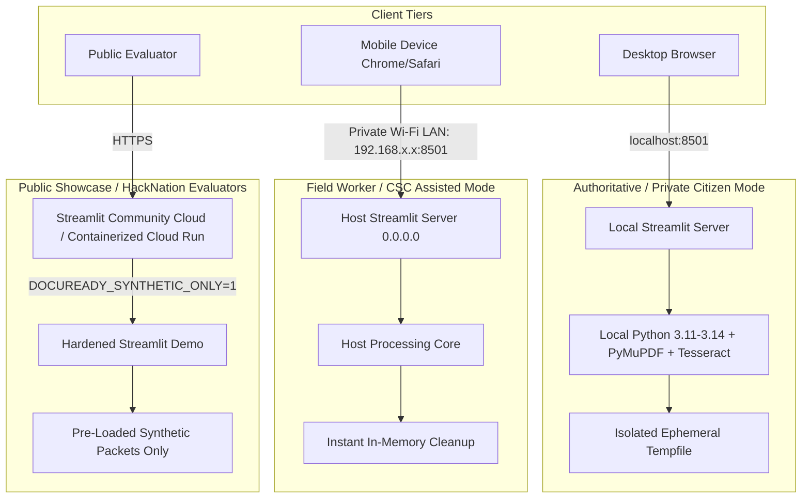

# ADR-002: Deployment Architecture & Hosting Strategy

**Status:** Decided (Multi-tier execution architecture: Local Desktop primary, Mobile LAN field tier, Streamlit Community Cloud demo tier; reject Vercel Serverless for monolithic Python core)  
**Date:** 15 November 2026  
**Deciders:** Deeptiman (Architecture Lead & Product Owner), Antigravity (Implementation Engineer)  
**Task:** Gate G1 Closeout / Track B (Mobile Web MVP) / Deployment Resolution  
**Affects:** `docs/MOBILE_RUN_GUIDE.md`, `src/docuready/interfaces/ui/app.py`, CI/CD, Deployment Configuration  

---

## 1. Context and Problem Statement

A live automated deployment attempt of DocuReady to Vercel failed with the following diagnostic record:

```text
Deploying project: docu-ready
Deployment URL: https://vercel.com/smarakpadhi58-projects/docu-ready/CwqLKKCow1UXWQ4tAG88oNve82At
Error: PYTHON_ENTRYPOINT_NOT_FOUND
Code: PYTHON_ENTRYPOINT_NOT_FOUND
Message: An error occurred while executing the build pipeline. No entrypoint was found for the Python runtime.
```

To resolve this issue sustainably and ethically, the engineering team must determine whether to adapt the current codebase for Vercel Serverless or establish a coherent multi-tier hosting architecture aligned with DocuReady's design principles.

---

## 2. Root Cause Analysis: Architectural Mismatch

The failure is caused by an intrinsic mismatch between Vercel Serverless Functions and DocuReady's runtime profile:

| Requirement / Property | DocuReady Architecture | Vercel Python Serverless Environment | Compatibility |
| :--- | :--- | :--- | :--- |
| **Application Model** | Stateful Streamlit application using persistent bidirectional WebSockets. | Stateless WSGI/ASGI event-driven HTTP request-response. | **Incompatible** (Streamlit requires persistent server process). |
| **Native System Binaries** | Tesseract OCR engine (native C++ binary `tesseract`, leptonica, trained data packs `eng`, `ori`, `hin`). | Minimal AWS Lambda / Vercel execution container; no system package manager (`apt-get`) available at build time. | **Incompatible** (OCR fallback fails; missing shared libraries). |
| **Native C Bindings** | PyMuPDF (`fitz` C/C++ engine bindings for exact vector layout and page rendering). | Size-constrained ephemeral lambda packages (50MB–250MB limit); risks glibc symbol mismatch. | **High Risk** |
| **Privacy & Data Residency** | Zero runtime network egress; strict ephemeral in-memory processing. Citizen document confidentiality. | Cloud-hosted serverless nodes processing uploads across shared public cloud infrastructure. | **Policy Violation** unless strictly isolated or constrained to synthetic demo packets. |
| **Entrypoint Expectation** | Entrypoint is `streamlit run src/docuready/interfaces/ui/app.py`. | Expects WSGI/ASGI handler file (e.g., `api/index.py` or root `main.py` exporting `app`). | **Failed Build** (`PYTHON_ENTRYPOINT_NOT_FOUND`). |

### Rejection of "Fake Fixes"
Creating a dummy `main.py` or synthetic Flask/FastAPI stub simply to appease Vercel's build parser is **strictly prohibited**. A stub would produce a hollow deployment that builds on CI but fails to execute DocuReady's interactive Streamlit interface, misleading users and eroding trust.

---

## 3. Decision

DocuReady adopts an explicit **Three-Tier Hosting Architecture**:



### Mode A: Local Desktop (Authoritative & Default)
- **Target:** Citizen personal computer or privacy-sensitive operator terminal.
- **Command:** `streamlit run src/docuready/interfaces/ui/app.py`
- **Guarantees:** 100% offline, zero network telemetry, full access to local Tesseract OCR and PyMuPDF, byte-exact golden baseline reproducibility.

### Mode B: Mobile Web over LAN (Field & CSC Assisted Delivery)
- **Target:** Common Service Centre (CSC) operators and village field assistants on local Wi-Fi.
- **Command:** `streamlit run src/docuready/interfaces/ui/app.py --server.address=0.0.0.0 --server.port=8501`
- **Guarantees:** Host machine executes heavy OCR/vector compute; applicant uses mobile browser over private LAN; ephemeral memory lifecycle; responsive touch-friendly layout ($\ge 44\text{px}$ targets).

### Mode C: Public Cloud Demonstration (Streamlit Community Cloud / Cloud Run)
- **Target:** HackNation jury, remote evaluators, and public portfolio reviewers.
- **Hosting Platform:** Streamlit Community Cloud (native support for Streamlit apps with `packages.txt` for `tesseract-ocr`) or containerized Google Cloud Run.
- **Privacy Hardening:** Mandatory flag `DOCUREADY_SYNTHETIC_ONLY=1`. When active, arbitrary file uploads are disabled, and users interact exclusively with the 8 canonical synthetic demonstration packets (`pkt_01`–`pkt_08`).

---

## 4. Role of Vercel in Future Roadmap

Vercel is a best-in-class platform for static web delivery, Edge Middleware, and modern React/Next.js frameworks. It is **not** an appropriate runtime for monolithic, stateful Python applications with native C++ dependencies.

In future milestones (e.g. Workstream WS4 or WS5):
1. The DocuReady core can be encapsulated behind a high-performance REST/gRPC API deployed in a Docker container (GCP Cloud Run / AWS ECS).
2. A modern Next.js mobile-first client application can be built and deployed on Vercel, querying the backend via secure signed requests.
3. Until such decoupling occurs, Vercel deployments of the Python Streamlit core are suspended.

---

## 5. Consequences and Action Items

1. **Vercel Project Configuration:**
   - Document the architectural mismatch in `docs/adr/ADR-002-deployment-architecture.md` and repository status.
   - Deactivate or archive the failing Vercel build trigger for the Python repository to avoid misleading failure notifications.
2. **Cloud Demonstration Setup:**
   - Commit `packages.txt` with `tesseract-ocr` and `tesseract-ocr-hin` `tesseract-ocr-ori` to support seamless one-click Streamlit Community Cloud deployment.
   - Guard cloud environments with `DOCUREADY_SYNTHETIC_ONLY=1`.
3. **Operational Run Guides:**
   - Maintain `docs/MOBILE_RUN_GUIDE.md` as the authoritative operations manual for Mode B (Mobile LAN).
