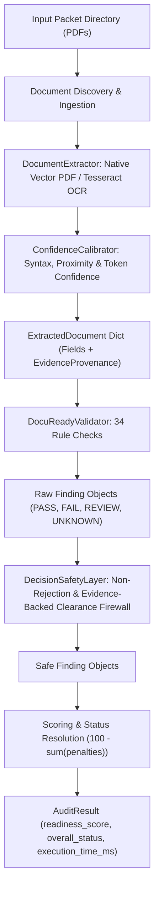

# DocuReady — T0 Code Audit: Characterising Current Behaviour

**Author:** Akriti (Platform & Baseline Delivery) with Susmita (Rules & Citations) & Deeptiman (Architecture Coordination)  
**Date:** 14 November 2026  
**Status:** Canonical T0.1 Deliverable  
**Repository:** `Algoryxz/DocuReady`  
**Base Commit:** `6d1ea77e6e82eeccb3b69fa0a9120d416157c005` (incorporating PRs #1, #2, #3, and #4)

---

## Executive Summary

Task **T0.1** establishes the baseline characterisation of DocuReady before modifying application behavior or beginning V2 structural work. This audit grounds future development strictly in the verified reality of the codebase rather than outdated documentation, initial PR descriptions, or aspirational specifications.

Key findings of this baseline audit:
1. **Cross-Platform Baseline Compatibility:** The golden regression test suite (`tests/test_golden_baseline.py`) previously failed in Linux CI due to Windows backslash (`\`) versus Linux forward slash (`/`) path separators stored in `file_path` and `file_name` fields when the baseline snapshot was originally generated on Windows. Applying path-only normalization strictly to path-valued fields resolves cross-platform test execution without touching any non-path strings, enum values, scores, or message texts. The committed `tests/golden/legacy_v0/GOLDEN_BASELINE.json` remains completely untouched (SHA-256: `E8FB1A6B842A47089937777133DE79E1E7F704BEE591D5B4471A1A90BC8C5FA9`).
2. **Current Calibration vs Target V2 Architecture:** The codebase currently runs `ConfidenceCalibrator` with 3 core feature weights (`w_token=0.55`, `w_label=0.20`, `w_format=0.25`) and heuristic thresholds (`tau_high=0.70`, `tau_abstain=0.45`). The 9-feature logistic sigmoid model described in `docs/02-ARCHITECTURE/` is an architectural design target to be realized in Gate G2 (tasks T1.2/T2.1).
3. **Statutory Rules & Citations:** 34 rule checks are implemented in `src/docuready/rules/validator.py`. Citations to Odisha government guidelines (OSSP, Odisha Misc Cert Rules, Medhabruti) have not yet been legally verified against official gazettes (scheduled for task T1.5).
4. **Zero Runtime Network Calls:** The production engine and UI contain zero runtime network requests (`requests`, `httpx`, `urllib`, `socket` are absent). All UI remote CDN calls were excised in PR #3.
5. **Track A and Track B Merged:** Both prototype tracks are fully merged into `main` (PR #2 at `1994f66`, PR #3 at `6d1ea77`, PR #4 at `a93ace2`), with exactly 0 open PRs.
6. **Code vs Documentation Discrepancies:** The test suite contains 74 passing tests across 12 files, while `README.md` still cites an outdated flat tree of 50 tests.

---

## Section A: Source Structure and Runtime Flow

### 1. Package Inventory (`src/docuready/`)

The core package lives under `src/docuready/` structured as follows:

| File / Subpackage | Module Purpose | Public Classes & Functions | External Dependencies | Key Data Structures |
|---|---|---|---|---|
| `__init__.py` | Package root & version declaration | `__version__ = "1.0.0"` | None | None |
| `pipeline.py` | Top-level facade orchestrating document loading, extraction, validation, and safety auditing | `AuditPipeline` (`load_and_audit_packet`, `audit_packet`) | `time`, `pathlib`, `pydantic` | `ExtractedDocument`, `AuditResult` |
| `generator.py` | Synthetic PDF packet generator for testing, regression benchmarking, and demonstrations | `generate_synthetic_packet`, `generate_clean_packet`, `generate_packet_with_defect` | `reportlab`, `os`, `pathlib` | Synthetic PDF generation templates |
| `domain/__init__.py` | Domain model exports | Re-exports all domain models | None | Domain model aliases |
| `domain/models.py` | Pydantic V2 data contracts defining the document hierarchy, epistemic states, and findings | `DocumentType`, `FieldProvenance`, `EvidenceState`, `ExtractionMethod`, `ExtractedField`, `ExtractedDocument`, `Severity`, `FindingStatus`, `Finding`, `AuditResult` | `pydantic` (v2), `typing`, `enum` | Immutable validation schemas |
| `ingest/__init__.py` | Extraction engine exports | Re-exports extractor and OCR capability flags | None | None |
| `ingest/extractor.py` | Hybrid PDF text extraction engine using native vector stream parsing with fallback to local OCR | `DocumentExtractor` (`extract`, `extract_text_pdfminer`, `extract_text_tesseract`), `PDF_MINER_AVAILABLE`, `PYTESSERACT_AVAILABLE` | `pdfminer.six`, `pytesseract`, `PIL.Image`, `pdf2image` | Bounding box coordinates, token metadata |
| `normalize/__init__.py` | Normalization utility exports | Re-exports normalization routines | None | None |
| `normalize/normalizer.py` | Deterministic text, name, date, currency, and IFSC normalizers | `normalize_whitespace`, `normalize_name`, `parse_and_normalize_date`, `normalize_income`, `validate_ifsc_code`, `are_names_consistent`, `are_dates_consistent` | `re`, `datetime`, `unicodedata` | Canonical date tuples, token sets |
| `evidence/__init__.py` | Evidence calibration exports | Re-exports calibrator | None | None |
| `evidence/calibrator.py` | Multi-feature confidence calibration engine mapping token confidence and layout syntax into calibrated probabilities | `ConfidenceCalibrator` (`calibrate`), `validate_field_syntax` | `re`, `typing` | Epistemic states (`EvidenceState`) |
| `rules/__init__.py` | Statutory validation exports | Re-exports validator and scheme configuration | None | None |
| `rules/validator.py` | Deterministic scholarship scheme rule evaluation engine | `DocuReadyValidator` (`validate_packet`), `SchemeConfig` | `re`, `datetime`, `typing` | `Finding`, `AuditResult` |
| `outcome/__init__.py` | Outcome safety exports | Re-exports decision safety layer | None | None |
| `outcome/safety_layer.py` | Independent safety firewall enforcing non-rejection axioms and evidence-backed PASS verification | `DecisionSafetyLayer` (`audit_findings`, `_audit_fail_finding`, `_audit_pass_finding`) | `typing`, `re` | Adjusted `Finding` lists |
| `report/__init__.py` | Report generation exports | Re-exports exporters | None | None |
| `report/exporter.py` | Privacy-conscious audit report exporter producing redacted JSON and formatted Markdown summaries | `export_audit_report_json`, `generate_readiness_summary_markdown`, `redact_audit_result_dict` | `json`, `re`, `os` | Redacted dictionaries, Markdown reports |
| `interfaces/__init__.py` | Interface exports | Re-exports CLI and UI components | None | None |
| `interfaces/cli.py` | Command-line interface for batch auditing and report generation | `cli_entrypoint`, `main` | `argparse`, `sys`, `pathlib` | CLI arguments, exit codes (0/1/2) |
| `interfaces/ui/__init__.py` | UI package marker | None | None | None |
| `interfaces/ui/app.py` | Local Streamlit web application providing interactive audit triage, evidence preview, and synthetic document replacement | `main`, UI rendering functions | `streamlit`, `tempfile`, `shutil`, `html` | Session state, uploaded file buffers |

---

### 2. Runtime Execution Flow

The end-to-end execution of `AuditPipeline.load_and_audit_packet(packet_dir, packet_id=None, scheme=None)` proceeds through the following deterministic pipeline:

#### Step-by-Step Trace:
1. **Document Discovery & Identification (`load_and_audit_packet`):**
   - Discovers all PDF files inside `packet_dir`.
   - Maps each file to a canonical `DocumentType` (e.g., `APPLICATION_FORM`, `INCOME_CERT`, `CASTE_CERT`, `RESIDENCE_CERT`, `MARKSHEET`, `BANK_PASSBOOK`, `AADHAAR`) using deterministic filename and header heuristics.
2. **Extraction & Provenance Capture (`DocumentExtractor`):**
   - Attempts native vector text and font bounding-box extraction via `pdfminer.six`.
   - If native text is absent (scanned bitmap), falls back to local PyTesseract OCR.
   - Extracts bounding boxes `[x0, y0, x1, y1]`, page numbers, raw text snippets, and raw token confidences.
3. **Confidence Calibration (`ConfidenceCalibrator`):**
   - Evaluates syntactic validity (`validate_field_syntax`) for each expected field type.
   - Computes calibrated probability from token confidence, label proximity, and format validity.
   - Assigns epistemic `EvidenceState` (`VERIFIED_TEXT`, `OCR_EXTRACTED`, `AMBIGUOUS`, `LOW_CONFIDENCE`, `NOT_FOUND`).
   - Produces `Dict[DocumentType, ExtractedDocument]`.
4. **Rule Evaluation (`DocuReadyValidator.validate_packet`):**
   - Normalizes applicant names, dates of birth, certificate validity dates, bank IFSC codes, and financial amounts.
   - Evaluates mandatory document completeness, legibility, cross-document demographic consistency, income ceiling compliance, certificate expiry, and academic merit cutoffs.
   - Emits raw `Finding` items with associated severity (`INFO`, `REVIEW`, `CRITICAL`, `FATAL`) and score penalty deductions.
5. **Safety Firewall Interception (`DecisionSafetyLayer.audit_findings`):**
   - Intercepts all findings before applicant presentation.
   - **Non-Rejection Axiom:** Any `FAIL` finding relying on ambiguous, unreadable, or low-confidence evidence is downgraded to `REVIEW` (or `UNKNOWN`), preventing wrongful statutory rejection on degraded scan quality.
   - **Evidence-Backed Clearance Axiom:** Any `PASS` finding lacking verified multi-source corroboration, or relying on uncertain fields, is downgraded to `REVIEW`.
6. **Score & Status Determination:**
   - Computes readiness score: $\text{score} = \max(0, \min(100, 100 - \sum \text{penalties}))$.
   - Resolves top-level status hierarchically:
     - `UNREADABLE_PACKET` if any finding has status `UNKNOWN`.
     - `REJECT_PRECHECK` if any finding has status `FAIL` with severity `FATAL`.
     - `ACTION_REQUIRED` if any finding has status `FAIL` with severity `CRITICAL`.
     - `REVIEW_RECOMMENDED` if any finding has status `REVIEW`.
     - `READY_TO_SUBMIT` if all checks have status `PASS`.
7. **Performance & Provenance Sealing:**
   - Calculates latency using `time.perf_counter()`.
   - Stamps ISO 8601 UTC/local time using `datetime.now().isoformat()`.
   - Returns the sealed `AuditResult` and document dictionary.

---

## Section B: Rule Base and Citations

The statutory validation engine in `src/docuready/rules/validator.py` evaluates 34 distinct rule conditions.

> [!IMPORTANT]
> **Statutory Citation Notice:** The statutory references and citations listed below were formulated during initial prototype development. **They have NOT yet been legally verified against official Odisha State Scholarship Portal (OSSP) gazettes or Department of Higher Education (DHE) notifications.** Legal and administrative verification is formally assigned to task **T1.5** (`docs/STATUS.md`).

### Verbatim Rule Inventory

| Rule ID | Rule Name | Conditions Evaluated | Statutory Reference Citation | Remediation Text |
|---|---|---|---|---|
| `RULE-DOC-01` | Mandatory Document Completeness | Required document type missing from packet | OSSP Guidelines 2024-25, Section 3.1 & NSP Common Framework | `f"Obtain and upload a valid {req_doc.value} before portal submission."` |
| `RULE-DOC-02` | Document Legibility & Evidence Integrity | Extracted document marked UNREADABLE or low confidence | NSP Upload Guidelines & IT Act 2000 Section 6A | `Re-scan the document with at least 300 DPI flatbed scanner and ensure good lighting.` |
| `RULE-FLD-01` | Mandatory Field Completeness | Essential field missing from document | NSP Common Application Standards 2024 | `f"Ensure {req_field} is clearly visible and correctly positioned on {doc_type.value}."` |
| `RULE-NAME-UNCERTAIN` | Cross-Document Name Verification (Uncertain OCR) | Name field marked AMBIGUOUS or LOW_CONFIDENCE | MeitY Demographic Verification Standards 2023, Clause 4.2 | `Inspect physical scan to verify whether apparent name variance is due to scanning noise or an actual discrepancy.` |
| `RULE-NAME-01` | Cross-Document Applicant Name Consistency | Conflicting name tokens across documents | MeitY Demographic Verification Standards 2023, Clause 4.2 | `Ensure the exact legal name is used across all documents or attach Gazette notification/affidavit.` |
| `RULE-NAME-02` | Cross-Document Applicant Name Variation | Minor name variation (initials / expansion) | UIDAI Name Matching Standard Guidelines | `Verify if this abbreviation/transliteration is acceptable under local portal rules or upload self-declaration.` |
| `RULE-NAME-PASS` | Cross-Document Applicant Name Consistency | Exact or compatible name tokens corroborated | MeitY Demographic Verification Standards 2023 | `No action required.` |
| `RULE-DOB-03` | Date of Birth Format Validity | Unparseable date of birth string | HSC Examination Board Verification Manual | `Enter Date of Birth in standardized DD/MM/YYYY format.` |
| `RULE-DOB-02` | Date of Birth Ambiguity | Date of birth with ambiguous DD/MM ordering | ISO 8601 Date Standard & NSP Portal Format Requirement | `Confirm whether day precedes month before final submission.` |
| `RULE-DOB-UNCERTAIN` | Cross-Document Date of Birth (Uncertain OCR) | Date of birth extraction uncertain | UIDAI Demographic Guidelines 2023 | `Inspect original certificates to verify exact date of birth digits.` |
| `RULE-DOB-01` | Cross-Document Date of Birth Consistency | Incompatible calendar dates of birth across documents | UIDAI & Board of Secondary Education Regulation Clause 7 | `Update Date of Birth on portal application to strictly match the Class 10 High School Certificate.` |
| `RULE-DOB-PASS` | Date of Birth Consistency | Exact matching dates across application and certificate | HSC Board Verification Guidelines | `No action required.` |
| `RULE-INC-03` | Income Extraction | Income field unparseable or obscured | Odisha Misc Cert Rules 2019 | `Verify income figure on certificate is not smudged or obscured.` |
| `RULE-INC-CEIL-UNCERTAIN` | Statutory Income Ceiling Compliance (Uncertain OCR) | Income near ceiling with low OCR confidence | Post-Matric Scholarship Scheme Guidelines 2021-2026, Clause 5.2 | `Inspect certificate scan manually to confirm the exact income digits.` |
| `RULE-INC-01` | Statutory Income Ceiling Compliance | Certified annual income exceeds statutory ceiling | Post-Matric Scholarship Scheme Guidelines 2021-2026, Clause 5.2 | `f"Applicant exceeds statutory economic threshold of ₹{self.scheme.income_ceiling:,}. Application will be rejected under economic criteria."` |
| `RULE-INC-CEIL-PASS` | Statutory Income Ceiling Compliance | Certified annual income within ceiling | Post-Matric Scholarship Guidelines Clause 5.2 | `No action required.` |
| `RULE-INC-MISMATCH-UNCERTAIN` | Income Consistency (Uncertain OCR) | Declared vs certified income discrepancy with low OCR confidence | NSP Guidelines on Income Declaration Verification | `Check application form and income certificate to confirm values.` |
| `RULE-INC-02` | Income Consistency (Declared vs Certified) | Declared income differs from certified certificate income | NSP Guidelines on Income Declaration Verification | `Correct declared income in application form to exactly equal the certified income.` |
| `RULE-INC-MATCH-PASS` | Income Consistency (Declared vs Certified) | Declared income matches certified income exactly | NSP Guidelines | `No action required.` |
| `RULE-EXP-02` | Certificate Date Parseability | Certificate issuance date cannot be parsed | Odisha Misc Cert Rules 2019 | `Ensure the certificate date stamp is crisp and legible.` |
| `RULE-EXP-01` | Income Certificate Statutory Validity Period | Income certificate issued > 3 years before application | Odisha Misc Cert Rules 2019, Rule 8(2) | `Apply for a renewed Income Certificate at the nearest Tahsil Office or e-District portal.` |
| `RULE-EXP-PASS` | Income Certificate Statutory Validity Period | Income certificate issued within 3 years | Odisha Misc Cert Rules 2019, Rule 8(2) | `No action required.` |
| `RULE-REF-01` | Income Certificate Number Reference Match | Application form reference number != certificate number | OSSP e-District Integration Guideline | `Update certificate reference number in portal application to match uploaded certificate.` |
| `RULE-REF-INC-PASS` | Income Certificate Number Reference Match | Income certificate reference numbers match | OSSP e-District Guidelines | `No action required.` |
| `RULE-REF-02` | Caste Certificate Number Reference Match | Application form caste certificate number != certificate | OSSP Guidelines Section 4.3 | `Update caste certificate reference number on the portal.` |
| `RULE-REF-CST-PASS` | Caste Certificate Number Reference Match | Caste certificate reference numbers match | OSSP Guidelines | `No action required.` |
| `RULE-BNK-01` | Bank IFSC Code Standard Format | Bank IFSC fails 11-character alphanumeric structure | RBI Master Direction - Core Banking IFSC Standards | `Check the passbook or contact branch for the official 11-character RBI IFSC code.` |
| `RULE-BNK-IFSC-PASS` | Bank IFSC Code Format | Bank IFSC satisfies RBI 11-character structure | RBI Master Direction | `No action required.` |
| `RULE-BNK-02` | Bank Account Number Consistency | Passbook account number != Application declared account | DBT Mission Guidelines for Direct Benefit Transfer | `Ensure the exact DBT bank account number is typed into the scholarship portal.` |
| `RULE-DOM-01` | State Domicile Requirement | Residence certificate state is not Odisha | State Scholarship Rules (Govt of Odisha) Clause 2(a) | `f"Submit a valid Resident Certificate issued by Revenue Authority of {self.scheme.target_state}."` |
| `RULE-DOM-PASS` | State Domicile Requirement | Residence certificate confirms Odisha state domicile | State Scholarship Rules Clause 2(a) | `No action required.` |
| `RULE-MRK-RELAX-PASS` | Academic Eligibility Compliance (SC/ST Qualifying Pass) | SC/ST applicant with qualifying pass marks | Centrally Sponsored Post-Matric Scholarship Scheme Guidelines (MoSJE/MoTA) Clause 5.2 | `No action required.` |
| `RULE-MRK-RELAX-PASS` | Academic Cutoff Compliance (SC/ST Relaxed Cutoff) | SC/ST applicant meeting relaxed cutoff | Medhabruti Guidelines 2024-25, Clause 4.1 | `No action required.` |
| `RULE-MRK-01` | Academic Cutoff Compliance (SC/ST Relaxed) | SC/ST applicant below relaxed cutoff | Medhabruti Guidelines 2024-25, Clause 4.1 | `Ensure candidate meets the relaxed 50% reservation threshold.` |
| `RULE-MRK-01` | Academic Cutoff Compliance | Applicant marks below general academic cutoff | Scheme Academic Criteria Notification 2024 | `Check scheme reservation categories or alternative scholarship tiers.` |
| `RULE-MRK-PASS` | Academic Cutoff Compliance | Applicant marks meet or exceed scheme cutoff | Scheme Academic Criteria Notification | `No action required.` |

---

## Section C: Calibrator and Score Dynamics

### 1. Code Reality vs Target Architecture

There is a documented distinction between the calibrator currently in code and the planned V2 architecture:

- **Target Architecture (as documented in `docs/02-ARCHITECTURE/DATA_FLOW.md` and `EVIDENCE_PROVENANCE.md`):** A 9-feature logistic regression calibrator passing linear combinations through a logistic sigmoid function with thresholds $\text{VERIFIED} \ge 0.85$, $0.60 \le \text{PROVISIONAL} < 0.85$, and $\text{UNCERTAIN} < 0.60$.
- **Current Code Reality (`src/docuready/evidence/calibrator.py`):** The class implemented is `ConfidenceCalibrator`. It evaluates 3 core weighted features, 2 penalty features, and 1 state flag using a weighted linear sum with bounded clamping.

### 2. Implemented Features & Weights in `ConfidenceCalibrator`

The features evaluated by `ConfidenceCalibrator.calibrate(...)` are:

| Feature Name | Description | Scoring / Value Function | Assigned Weight |
|---|---|---|---|
| `token_confidence` ($s_\text{tok}$) | OCR engine character/token confidence | Clamped to $[0.0, 1.0]$; defaults to $0.50$ if missing | $w_\text{token} = 0.55$ |
| `label_proximity` ($s_\text{lbl}$) | Spatial distance in points from field label to value | $\le 25\text{pt} \to 1.00$ $\le 60\text{pt} \to 0.75$ $\le 150\text{pt} \to 0.50$ $> 150\text{pt} \to 0.30$ No label detected $\to 0.20$ | $w_\text{label} = 0.20$ |
| `format_valid` ($s_\text{fmt}$) | Regex/syntax check via `validate_field_syntax` | $1.00$ if valid syntax; $0.10$ if syntax error | $w_\text{format} = 0.25$ |
| `candidate_count` | Number of distinct candidate matches on page | Penalty: $0.15 \times \min(3, \text{candidates} - 1)$ if $> 1$ | Subtractive penalty |
| `supporting_tokens_count` | Word count for composite name fields | Penalty: $0.20$ if name field has $< 2$ tokens | Subtractive penalty |
| `page_has_date_ambiguity` | Ambiguity flag (e.g. DD/MM vs MM/DD) | Overrides state to `EvidenceState.AMBIGUOUS` | State override |

### 3. Mathematical Formula & Thresholds

For native vector PDF text:
$$\text{calibrated\_prob} = \begin{cases} 0.98 & \text{if syntax is valid} \\ 0.75 & \text{if syntax error} \end{cases}$$

For OCR-extracted text:
$$\text{raw\_prob} = (0.55 \cdot s_\text{tok}) + (0.20 \cdot s_\text{lbl}) + (0.25 \cdot s_\text{fmt}) - \text{penalties}$$
$$\text{calibrated\_prob} = \text{round}(\max(0.05, \min(0.99, \text{raw\_prob})), 3)$$

**Evidence State Assignment:**
1. If $\neg \text{format\_valid} \implies \text{EvidenceState.LOW\_CONFIDENCE}$
2. Else if $\text{candidate\_count} > 1 \implies \text{EvidenceState.AMBIGUOUS}$
3. Else if $\text{page\_has\_date\_ambiguity} \land \text{is\_date\_field} \implies \text{EvidenceState.AMBIGUOUS}$
4. Else if $\text{calibrated\_prob} < \tau_\text{high} (0.70) \implies \text{EvidenceState.LOW\_CONFIDENCE}$
5. Else $\implies \text{EvidenceState.OCR\_EXTRACTED}$

*Abstention Threshold:* $\tau_\text{abstain} = 0.45$. Extractions falling below $\tau_\text{abstain}$ are treated as unreadable/not-found by extractor routines.

### 4. Readiness Score Dynamics & Status Resolution

The overall packet readiness score is computed in `DocuReadyValidator.validate_packet`:
$$\text{score} = \max\left(0, \min\left(100, 100 - \sum_{f \in \text{findings}} f.\text{penalty}\right)\right)$$

**Edge Case Behavior:**
- **Empty Findings:** Returns score $100$ and status `READY_TO_SUBMIT`.
- **Single Minor Defect (e.g. Name variation):** Penalty $10 \implies$ score $90$, status `REVIEW_RECOMMENDED`.
- **Cumulative Penalties Exceeding 100:** Clamped strictly to $0$ via `max(0, ...)`. No negative scores are possible.
- **NaN / Inf Handling:** Token confidence and distances are coerced to `float` and clamped within explicit min/max boundaries; no division operations occur, preventing `ZeroDivisionError` or `NaN`.

---

## Section D: Network, Filesystem, and Clock Call Sites

### 1. Network Boundary Audit

A comprehensive regular-expression audit across all source files in `src/docuready/` confirmed **zero runtime network calls**:
- `requests`: 0 imports, 0 call sites.
- `httpx`: 0 imports, 0 call sites.
- `urllib`: 0 imports, 0 call sites.
- `socket`: 0 imports, 0 call sites.
- Remote HTTP/HTTPS asset URLs: The only match in `src/docuready/interfaces/ui/app.py` is an architectural comment at line 154 explicitly noting: `"# Navigation Sidebar (No external image requests)"`. All external Icons8 CDN requests were completely removed in PR #3.
- Telemetry: `.streamlit/config.toml` explicitly sets `gatherUsageStats = false`.

### 2. Filesystem Write Audit

Every filesystem write site in `src/docuready/` was audited:

| File | Line | Call Site | Context & Lifespan |
|---|---|---|---|
| `interfaces/cli.py` | 80 | `open(export_path, "w", encoding="utf-8")` | Writes Markdown readiness report when `--output` flag is explicitly passed by user. |
| `interfaces/ui/app.py` | 339 | `tempfile.mkdtemp(prefix="docuready_upload_")` | Ephemeral directory created for user-uploaded packet files; guaranteed deleted in `finally:` via `shutil.rmtree(temp_dir, ignore_errors=True)`. |
| `interfaces/ui/app.py` | 346 | `open(dest, "wb")` | Writes uploaded bytes into the ephemeral `temp_dir`. |
| `interfaces/ui/app.py` | 609 | `tempfile.mkdtemp(prefix="docuready_remed_")` | Ephemeral directory created during synthetic remediation document generation; cleaned up in `finally:`. |
| `interfaces/ui/app.py` | 658 | `tempfile.mkdtemp(prefix="docuready_remed_")` | Ephemeral directory for single-document replacement audit rerun; cleaned up in `finally:`. |
| `interfaces/ui/app.py` | 664 | `open(replacement_path, "wb")` | Writes uploaded replacement PDF into the ephemeral remediation directory. |
| `report/exporter.py` | 54 | `open(output_path, "w", encoding="utf-8")` | Writes JSON audit report when `export_audit_report_json` is invoked. |

### 3. System Clock Call Sites

Every invocation of system clock or date routines in `src/docuready/` was audited:

| File | Line | Call Site | Purpose |
|---|---|---|---|
| `rules/validator.py` | 815 | `timestamp=datetime.now().isoformat()` | Records the audit timestamp in `AuditResult`. (Normalized to `[NORMALIZED_AUDIT_TIMESTAMP]` during golden regression tests). |
| `pipeline.py` | 29, 55 | `time.perf_counter()` | Measures elapsed audit latency in `load_and_audit_packet`. (Normalized to `0.0` during golden regression tests). |
| `pipeline.py` | 70, 76 | `time.perf_counter()` | Measures elapsed audit latency in `audit_packet`. |
| `normalize/normalizer.py` | 195 | `datetime.strptime(s, fmt).date()` | Deterministically parses candidate date strings; does not read the current system clock. |

---

## Section E: Test Suite Inventory vs README Claims

A direct comparison between the actual repository test suite and the claims made in `README.md` reveals significant discrepancies:

| Claimed in `README.md` | Actual Repository Reality | Status / Discrepancy Note |
|---|---|---|
| Badge: `Tests: 50 Passing` | **74 Passing Tests** (`collected 74 items`) | Outdated badge count; suite grew from 50 to 74 tests across migrations and prototype PRs. |
| Flat test path list (10 files) | **12 Test Files + Golden Directory** | README describes an obsolete flat structure. |
| `tests/test_models.py` | Not present as a standalone file | Model validation is exercised across all test files. |
| `tests/test_calibrator.py` | Present as `tests/test_evidence_calibration.py` | File renamed during Loop 3 development. |
| `tests/test_replacement.py` | Present as `tests/test_replacement_rerun.py` | File renamed during Loop 3 development. |
| `tests/test_pipeline.py` | Not present as a standalone file | Pipeline behavior is validated by `test_golden_baseline.py` and integration tests. |
| `tests/test_cli.py` | Not present | CLI execution testing is currently manual or scheduled for package verification. |
| *Not mentioned in README* | `tests/test_adversarial.py` (13 tests) | Tests extreme edge cases, injection attempts, and boundary inputs. |
| *Not mentioned in README* | `tests/test_dataset_ground_truth.py` (8 tests) | Validates ground-truth expectations for all 8 synthetic packets. |
| *Not mentioned in README* | `tests/test_decision_safety.py` (10 tests) | Added in Track B (PR #2) to enforce non-rejection and evidence-backed PASS. |
| *Not mentioned in README* | `tests/test_golden_baseline.py` (8 tests) | Bit-for-bit regression harness against legacy V0 baseline snapshot. |
| *Not mentioned in README* | `tests/test_ui_privacy.py` (6 tests) | Added in Track A (PR #3) to verify zero network requests and ephemeral cleanup. |
| *Not mentioned in README* | `tests/test_uncertainty_safety.py` (5 tests) | Verifies epistemic uncertainty propagation. |
| *Not mentioned in README* | `tests/golden/legacy_v0/` | Directory containing immutable `GOLDEN_BASELINE.json`, hashes, and canonicalization contract. |

---

## Section F: Track A and Track B Integration Status

Both parallel prototype readiness tracks have been completed and merged into `main`:

| PR # | Branch Name | Merge Commit | Description |
|---|---|---|---|
| **PR #1** | `feature/g1-package-migration` | `94ef68a` | Migrated project to installable package architecture with `pyproject.toml` and `src/docuready/`. |
| **PR #2** | `feature/prototype-decision-safety` | `1994f66` | Track B: Implemented `DecisionSafetyLayer`, non-rejection axioms, evidence-backed PASS verification, and 10 dedicated safety tests. |
| **PR #3** | `feature/prototype-ui-privacy` | `6d1ea77` | Track A: Implemented ephemeral upload sandbox, report redaction, safe HTML escaping, demo runbook, and 6 dedicated privacy tests. |
| **PR #4** | `docs/v2-architecture-team-ownership` | `a93ace2` | Integrated DocuReady V2 architecture documents, team responsibilities, and claims qualifications. |

**Current Open PR Count on GitHub:** **0**. All feature branches are merged into `origin/main`.

---

## Section G: Code vs Architecture Gaps & Follow-up Risks

This section audits the 9 specific implementation gaps identified during baseline characterisation and maps each to its assigned delivery task:

### 1. Ephemeral Upload Lifecycle Test Fidelity
- **Current Reality:** `tests/test_ui_privacy.py::test_temporary_upload_lifecycle_guarantees_cleanup` validates `tempfile.mkdtemp` and `shutil.rmtree` using a mock directory context rather than driving the full Streamlit file-uploader runtime flow.
- **Risk:** Unhandled exceptions in extraction sub-routines could theoretically bypass cleanup if not wrapped in outer `finally:` blocks.
- **Remediation Task:** **T1.4** (Redaction / Safe Logging) and **T1.2** (No-Network / Lifecycle Testing).

### 2. HTML Injection Sanitization Testing
- **Current Reality:** `test_dynamic_html_script_injection_escaped` tests direct calls to Python's standard `html.escape`, rather than evaluating Streamlit's native DOM rendering pipeline.
- **Risk:** Custom HTML rendering via `st.markdown(..., unsafe_allow_html=True)` could inadvertently render unsanitized content if used in future UI views.
- **Remediation Task:** **T1.4** (Redaction / Safe Logging & UI Security).

### 3. Heuristic Regex Report Redaction
- **Current Reality:** `_sanitize_message` in `src/docuready/report/exporter.py` uses heuristic regular expressions matching single-quoted substrings and rupee symbols (`₹[\d,]+`).
- **Risk:** Unquoted citizen names or non-standard currency formats in finding messages might not be masked in redacted exports.
- **Remediation Task:** **T1.4** (Structured PII Redaction Pipeline).

### 4. Raw Snippet Exposure in UI Inspection
- **Current Reality:** In `src/docuready/interfaces/ui/app.py` lines 420-435, the "View Raw Evidence & Bounding Boxes" expander displays `fval.provenance.raw_snippet` directly in `st.caption`.
- **Risk:** While convenient for local debugging, presenting unredacted raw OCR snippets could expose sensitive citizen PII in kiosk or assisted-service environments.
- **Remediation Task:** **T1.4** (Assisted-Service Privacy Controls).

### 5. Local File Paths in Extracted Document Metadata
- **Current Reality:** `ExtractedDocument.file_path` contains the local filesystem path where the PDF was processed (e.g. `synthetic_data/pkt_01_clean\application_form.pdf` or `/tmp/docuready_upload_...`).
- **Risk:** Serializing raw `ExtractedDocument` dictionaries leaks local machine directory layouts into audit logs or exported metadata.
- **Remediation Task:** **T1.4** (Metadata Path Sanitization).

### 6. Memory Buffer Persistence Post Session-Clear
- **Current Reality:** The "Clear Session & Purge Uploads" button executes `st.session_state.clear()` and removes disk files, but relies on Python's garbage collection rather than explicit memory overwriting/zeroization.
- **Risk:** Extracted document text remains in volatile process memory until garbage-collected.
- **Remediation Task:** **T1.4** (Memory Buffer Sanitization).

### 7. Telemetry Configuration Automated Verification
- **Current Reality:** `.streamlit/config.toml` contains `gatherUsageStats = false` and has been verified locally, but no automated test enforces that this file exists and cannot be inadvertently altered or omitted.
- **Risk:** Accidental edits or repository migrations could omit `.streamlit/config.toml`, triggering Streamlit telemetry.
- **Remediation Task:** **T1.2** (Telemetry Off / No-Network Automated CI Check).

### 8. Demo Runbook Target Scope vs Production Guarantees
- **Current Reality:** `docs/demo-runbook.md` provides an operational guide for prototype demonstrations and evaluator walkthroughs, but describes prototype-level capabilities rather than production-grade SLAs.
- **Risk:** Readers might mistake prototype walkthrough steps for enterprise production readiness guarantees.
- **Remediation Task:** **T1.1** (Honest Claims Register & Prototype Boundary Statements).

### 9. Outdated README Metrics & Forward-Looking Claims
- **Current Reality:** `README.md` retains references to "50 Passing Tests", old flat test structures, and unqualified privacy claims that have not completed formal verification under Gate G1.
- **Risk:** External developers and evaluators encounter inconsistencies between repository reality and README text.
- **Remediation Task:** **T1.1** (README Realignment & Claims Register).

---

## Conclusion & Gate G0 Status

With this comprehensive code audit and the path-only canonicalization fix in `tests/test_golden_baseline.py`, the baseline behavior of DocuReady is fully characterized and verified against source reality.

All 8 synthetic test packets pass bit-for-bit regression tests across platforms while preserving the golden snapshot completely intact. Task **T0.1** is ready for formal review and acceptance.
