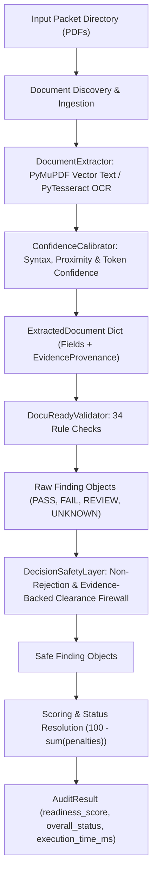

# DocuReady — T0 Code Audit: Characterising Current Behaviour

**Author:** Akriti (Platform & Baseline Delivery) with Susmita (Rules & Citations) & Deeptiman (Architecture Coordination)
**Date:** 14 November 2026 (Updated post-PR #5 Merge & Main CI Run 43601998227)
**Status:** Canonical T0.1 Audit Deliverable (Review / Pending Acceptance / Blocked)
**Repository:** `Algoryxz/DocuReady`
**Base Commit:** `7b55bf829cfba21ee7d277c9b3c933b702f92671` (incorporating merged PRs #1, #2, #3, #4, and #5)
**Task Branch:** `docs/post-merge-g0-state-correction`

---

## Executive Summary

Task **T0.1** establishes the baseline characterisation of DocuReady before modifying application behavior or beginning V2 structural migrations. This audit is grounded strictly in the verified source code and completed execution evidence across supported matrix environments.

Key findings of this baseline audit:
1. **Cross-Platform Test Execution & Dependency Reproducibility:**
   - In GitHub Actions CI on `main` (run `43601998227` with `fail-fast: false`), all three supported matrix jobs ran to completion and failed:
     - **Python 3.10 (70 passed, 8 failed):** PyPI package metadata for `PyMuPDF 2.1` explicitly declares `Requires-Python: >=3.11`. Under Python 3.10, `pip` resolves `pymupdf>=1.23.0` to `PyMuPDF 1.28.2`. Version 1.28.2 exhibits different text search rect geometry and bounding-box rounding compared to PyMuPDF 2.1, causing bounding-box coordinate mismatches across all 8 golden baseline packets.
     - **Python 3.11 (77 passed, 1 failed):** Installed `pymupdf==2.1`. All 7 native vector packets passed bit-for-bit. The single failing test was `PKT_07_UNREADABLE_DOC`.
     - **Python 3.12 (77 passed, 1 failed):** Installed `pymupdf==2.1`. All 7 native vector packets passed bit-for-bit. The single failing test was `PKT_07_UNREADABLE_DOC`.
   - **Historical Tesseract Presence Status (UNVERIFIED):** In the original baseline commit (`9a0d00c8c9e02b2697d52589aa04ca211ffaf441`), `ENVIRONMENT_MANIFEST.md` and `T0.2.1_DEPENDENCY_AUDIT.md` were session scratch artifacts outside Git and were never committed to the canonical repository. The capture host's Tesseract binary presence must remain **UNVERIFIED** in tracked Git history.
   - **Actual Exception Handling in `_ocr_page`:** In `src/docuready/ingest/extractor.py` (lines 427–442), `_ocr_page` wraps `pytesseract.image_to_data` in a broad `try...except Exception: pass`. When Tesseract is missing from `PATH` or fails, `TesseractNotFoundError` is silently swallowed without logging, leaving OCR output empty (`raw_text = ""` and `mean_ocr_confidence = 0.0`). This explains why a host lacking Tesseract produces an empty extraction rather than an explicit error. When Linux CI ran with Tesseract 5.5.0 installed (`tesseract-ocr-eng`), OCR lines were extracted from the corrupted scan (`raw_text = "[ZO ALITWNOD HOO - NVOS GALdNYHO"`, `mean_ocr_confidence = 0.502`). Per the golden canonicalization contract, non-path OCR values cannot be normalized, causing an explicit regression failure in `PKT_07_UNREADABLE_DOC`.
   - **Test Suite Reconciliation (74 vs 78 Tests):** Prior to PR #5, the core test suite contained 74 test items across 12 test files. In PR #5, 4 comparison helper unit tests were added to `tests/test_golden_baseline.py` to verify path-only canonicalization invariance and recursive mismatch detection, expanding the suite to **78 test items**. All 78 tests pass locally on Windows 10/11 x64 under Python 3.14.7 without Tesseract, but 70/77 pass in Linux CI. The README badge stating "50 Passing" is an obsolete legacy badge from v0.
2. **Current Calibration vs Target V2 Architecture:** The codebase currently runs `ConfidenceCalibrator` with 3 core feature weights (`w_token=0.55`, `w_label=0.20`, `w_format=0.25`) and heuristic thresholds (`tau_high=0.70`, `tau_abstain=0.45`). The 9-feature logistic sigmoid model in `docs/02-ARCHITECTURE/` is an architectural target to be realized in Gate G2 (tasks T1.2/T2.1).
3. **Statutory Rules & Citations:** 34 unique rule IDs are evaluated across 36 literal `Finding` assignments in `src/docuready/rules/validator.py`. Citations have not yet been legally verified against official Odisha State Scholarship Portal (OSSP) gazettes (scheduled for task T1.5).
4. **Zero Runtime Network Calls in Engine:** The core package contains zero runtime network requests (`requests`, `httpx`, `urllib`, `socket` absent; UI remote CDN calls removed in PR #3).
5. **Telemetry Configuration Status:** `.streamlit/config.toml` exists in local workspace but is **NOT TRACKED** in the GitHub repository due to `.gitignore` ignoring `.streamlit/`. Telemetry status is therefore `UNVERIFIED` in tracked repository environments (mapped to T1.2).

---

## Section A: Source Structure and Runtime Flow

### 1. Package Inventory (`src/docuready/`)

The core package lives under `src/docuready/` structured as follows:

| File / Subpackage | Module Purpose | Public Classes & Functions | External Dependencies | Key Data Structures |
|---|---|---|---|---|
| `__init__.py` | Package root & version declaration | `__version__ = "0.1.0"`, `AuditPipeline` | None | None |
| `pipeline.py` | Top-level facade orchestrating document loading, extraction, validation, and safety auditing | `AuditPipeline` (`load_and_audit_packet`, `audit_packet`, `replace_document_and_reaudit`) | `time`, `pathlib`, `os` | `ExtractedDocument`, `AuditResult` |
| `generator.py` | Synthetic PDF packet generator for testing, regression benchmarking, and demonstrations | `generate_income_certificate`, `generate_caste_certificate`, `generate_residence_certificate`, `generate_marksheet`, `generate_bank_passbook`, `generate_application_form` | `reportlab`, `os` | `SimpleDocTemplate`, Flowables |
| `domain/__init__.py` | Domain model exports | Re-exports all domain models | None | Domain model aliases |
| `domain/models.py` | Pydantic V2 data contracts defining document hierarchy, epistemic states, and findings | `DocumentType`, `EvidenceProvenance`, `EvidenceState`, `ExtractionMethod`, `ExtractedField`, `ExtractedDocument`, `Severity`, `FindingStatus`, `Finding`, `AuditResult` | `pydantic` (v2), `typing`, `enum` | Immutable validation schemas |
| `ingest/__init__.py` | Extraction engine exports | Re-exports extractor and OCR capability flags | None | None |
| `ingest/extractor.py` | Hybrid PDF text extraction engine using PyMuPDF vector stream parsing with fallback to local PyTesseract OCR | `DocumentExtractor` (`extract_document`), `_find_field_in_page_vector`, `_ocr_page` | `pymupdf`, `pytesseract`, `PIL.Image` | Bounding box coordinates `[x0, y0, x1, y1]`, `PageOCRData` |
| `normalize/__init__.py` | Normalization utility exports | Re-exports normalization routines | None | None |
| `normalize/normalizer.py` | Deterministic text, name, date, currency, and IFSC normalizers | `normalize_whitespace`, `normalize_name`, `parse_and_normalize_date`, `normalize_income`, `validate_ifsc_code`, `are_names_consistent`, `are_dates_consistent` | `re`, `datetime`, `unicodedata` | Canonical date tuples, token sets |
| `evidence/__init__.py` | Evidence calibration exports | Re-exports calibrator | None | None |
| `evidence/calibrator.py` | Confidence calibration engine mapping token confidence, label proximity, and layout syntax into calibrated probabilities | `ConfidenceCalibrator` (`calibrate`), `validate_field_syntax` | `re`, `typing` | Epistemic states (`EvidenceState`) |
| `rules/__init__.py` | Statutory validation exports | Re-exports validator and scheme configuration | None | None |
| `rules/validator.py` | Deterministic scholarship scheme rule evaluation engine | `DocuReadyValidator` (`validate_packet`), `SchemeConfig` | `re`, `datetime`, `typing` | `Finding`, `AuditResult` |
| `outcome/__init__.py` | Outcome safety exports | Re-exports decision safety layer | None | None |
| `outcome/safety_layer.py` | Independent safety firewall enforcing non-rejection axioms and evidence-backed PASS verification | `DecisionSafetyLayer` (`audit_findings`, `_audit_fail_finding`, `_audit_pass_finding`) | `typing`, `re` | Adjusted `Finding` lists |
| `report/__init__.py` | Report generation exports | Re-exports exporters | None | None |
| `report/exporter.py` | Privacy-conscious audit report exporter producing redacted JSON and formatted Markdown summaries | `export_audit_report_json`, `generate_readiness_summary_markdown`, `redact_audit_result_dict` | `json`, `re`, `os` | Redacted dictionaries, Markdown reports |
| `interfaces/__init__.py` | Interface exports | Re-exports CLI entrypoint | None | None |
| `interfaces/cli.py` | Command-line interface for batch auditing, benchmarking, and report generation | `main`, `_resolve_synthetic_manifest` | `argparse`, `sys`, `pathlib` | CLI arguments, exit codes (0/1) |
| `interfaces/ui/__init__.py` | UI package marker | None | None | None |
| `interfaces/ui/app.py` | Local Streamlit web application providing interactive audit triage, evidence preview, and synthetic document replacement | `main`, `_find_synthetic_data_dir`, UI view renderers | `streamlit`, `tempfile`, `shutil`, `html` | Streamlit session state |

---

### 2. Runtime Execution Flow

The end-to-end execution of `AuditPipeline.load_and_audit_packet(packet_dir, packet_id=None, scheme=None)` proceeds through the following deterministic pipeline:



#### Step-by-Step Trace:
1. **Document Discovery & Identification (`load_and_audit_packet`):**
   - Discovers all PDF files inside `packet_dir`.
   - Maps each file to a canonical `DocumentType` (e.g., `APPLICATION_FORM`, `INCOME_CERT`, `CASTE_CERT`, `RESIDENCE_CERT`, `MARKSHEET`, `BANK_PASSBOOK`, `AADHAAR`) using deterministic filename mapping with fallback to header heuristics.
2. **Extraction & Provenance Capture (`DocumentExtractor`):**
   - Inspects native text across pages using PyMuPDF (`pymupdf.open(file_path)`).
   - If native text is dense ($\ge 30$ chars) and does not contain `"ILLEGIBLE"`, extracts text and bounding boxes `[x0, y0, x1, y1]` via PyMuPDF vector search.
   - If native text is absent (scanned bitmap) or explicitly marked `"ILLEGIBLE"`, falls back to local PyTesseract OCR rendered at 200 DPI via PIL.
   - Captures bounding boxes, page numbers, raw text snippets, and raw token confidences.
3. **Confidence Calibration (`ConfidenceCalibrator`):**
   - Evaluates syntactic validity (`validate_field_syntax`) for each expected field type.
   - Computes calibrated probability from token confidence, label proximity, and format validity.
   - Assigns epistemic `EvidenceState` (`VERIFIED_TEXT`, `OCR_EXTRACTED`, `AMBIGUOUS`, `LOW_CONFIDENCE`, `NOT_FOUND`).
   - Produces `Dict[DocumentType, ExtractedDocument]`.
4. **Rule Evaluation (`DocuReadyValidator.validate_packet`):**
   - Normalizes applicant names, dates of birth, certificate validity dates, bank IFSC codes, and financial amounts.
   - Evaluates mandatory document completeness, legibility, cross-document demographic consistency, income ceiling compliance, certificate expiry, and academic merit cutoffs.
   - Emits raw `Finding` items with associated severity (`INFO`, `REVIEW`, `CRITICAL`, `FATAL`) and score penalty deductions.
5. **Safety Firewall Interception (`DecisionSafetyLayer.audit_findings`):**
   - Intercepts all findings before applicant presentation.
   - **Non-Rejection Axiom:** Any `FAIL` finding relying on ambiguous, unreadable, or low-confidence evidence is downgraded to `REVIEW` (or `UNKNOWN`), preventing wrongful statutory rejection on degraded scan quality.
   - **Evidence-Backed Clearance Axiom:** Any `PASS` finding lacking verified multi-source corroboration, or relying on uncertain fields, is downgraded to `REVIEW`.
6. **Score & Status Determination:**
   - Computes readiness score: $\text{score} = \max(0, \min(100, 100 - \sum \text{penalties}))$.
   - Resolves top-level status hierarchically:
     - `UNREADABLE_PACKET` if any finding has status `UNKNOWN`.
     - `REJECT_PRECHECK` if any finding has status `FAIL` with severity `FATAL`.
     - `ACTION_REQUIRED` if any finding has status `FAIL` with severity `CRITICAL`.
     - `REVIEW_RECOMMENDED` if any finding has status `REVIEW`.
     - `READY_TO_SUBMIT` if all checks have status `PASS`.
7. **Performance & Provenance Sealing:**
   - Calculates latency using `time.perf_counter()`.
   - Stamps ISO 8601 UTC/local time using `datetime.now().isoformat()`.
   - Returns the sealed `AuditResult` and document dictionary.

---

## Section B: Rule Base and Citations

The statutory validation engine in `src/docuready/rules/validator.py` evaluates **34 unique rule IDs** instantiated across **36 literal Finding constructor calls**.

> [!NOTE]
> **Duplicate Rule ID Call Sites in Source:**
> - `RULE-MRK-01`: Assigned twice in `validator.py`:
>   1. Line 731: `rule_name="Academic Cutoff Compliance (SC/ST Relaxed)"` (evaluating SC/ST reservation cutoff threshold of 50%).
>   2. Line 748: `rule_name="Academic Cutoff Compliance"` (evaluating general academic cutoff threshold of 60%).
> - `RULE-MRK-RELAX-PASS`: Assigned twice in `validator.py`:
>   1. Line 701: `rule_name="Academic Eligibility Compliance (SC/ST Qualifying Pass)"` (evaluating qualifying pass marks for SC/ST).
>   2. Line 717: `rule_name="Academic Cutoff Compliance (SC/ST Relaxed Cutoff)"` (evaluating relaxed 50% cutoff for SC/ST).

> [!IMPORTANT]
> **Statutory Citation Notice:** The statutory references and citations listed below were formulated during initial prototype development. **They have NOT yet been legally verified against official Odisha State Scholarship Portal (OSSP) gazettes or Department of Higher Education (DHE) notifications.** Legal and administrative verification is formally assigned to task **T1.5** (`docs/STATUS.md`).

### Verbatim Rule Inventory (36 Finding Instantiations / 34 Unique IDs)

| # | Rule ID | Rule Name | Conditions Evaluated | Statutory Reference Citation | Remediation Text |
|---|---|---|---|---|---|
| 1 | `RULE-DOC-01` | Mandatory Document Completeness | Required document type missing from packet | OSSP Guidelines 2024-25, Section 3.1 & NSP Common Framework | `f"Obtain and upload a valid {req_doc.value} before portal submission."` |
| 2 | `RULE-DOC-02` | Document Legibility & Evidence Integrity | Extracted document marked UNREADABLE or low confidence | NSP Upload Guidelines & IT Act 2000 Section 6A | `Re-scan the document with at least 300 DPI flatbed scanner and ensure good lighting.` |
| 3 | `RULE-FLD-01` | Mandatory Field Completeness | Essential field missing from document | NSP Common Application Standards 2024 | `f"Ensure that {mf} is clearly visible and legible on {doc_type.value}."` |
| 4 | `RULE-NAME-UNCERTAIN` | Cross-Document Name Verification (Uncertain OCR) | Name field marked AMBIGUOUS or LOW_CONFIDENCE | MeitY Demographic Verification Standards 2023, Clause 4.2 | `Inspect physical scan to verify whether apparent name variance is due to scanning noise or an actual discrepancy.` |
| 5 | `RULE-NAME-01` | Cross-Document Applicant Name Consistency | Conflicting name tokens across documents | MeitY Demographic Verification Standards 2023, Clause 4.2 | `Ensure the exact legal name is used across all documents or attach Gazette notification/affidavit.` |
| 6 | `RULE-NAME-02` | Cross-Document Applicant Name Variation | Minor name variation (initials / expansion) | UIDAI Name Matching Standard Guidelines | `Verify if this abbreviation/transliteration is acceptable under local portal rules or upload self-declaration.` |
| 7 | `RULE-NAME-PASS` | Cross-Document Applicant Name Consistency | Exact or compatible name tokens corroborated | MeitY Demographic Verification Standards 2023 | `No action required.` |
| 8 | `RULE-DOB-03` | Date of Birth Format Validity | Unparseable date of birth string | HSC Examination Board Verification Manual | `Enter Date of Birth in standardized DD/MM/YYYY format.` |
| 9 | `RULE-DOB-02` | Date of Birth Ambiguity | Date of birth with ambiguous DD/MM ordering | ISO 8601 Date Standard & NSP Portal Format Requirement | `Confirm whether day precedes month before final submission.` |
| 10 | `RULE-DOB-UNCERTAIN` | Cross-Document Date of Birth (Uncertain OCR) | Date of birth extraction uncertain | UIDAI Demographic Guidelines 2023 | `Inspect original certificates to verify exact date of birth digits.` |
| 11 | `RULE-DOB-01` | Cross-Document Date of Birth Consistency | Incompatible calendar dates of birth across documents | UIDAI & Board of Secondary Education Regulation Clause 7 | `Update Date of Birth on portal application to strictly match the Class 10 High School Certificate.` |
| 12 | `RULE-DOB-PASS` | Date of Birth Consistency | Exact matching dates across application and certificate | HSC Board Verification Guidelines | `No action required.` |
| 13 | `RULE-INC-03` | Income Extraction | Income field unparseable or obscured | Odisha Misc Cert Rules 2019 | `Verify income figure on certificate is not smudged or obscured.` |
| 14 | `RULE-INC-CEIL-UNCERTAIN` | Statutory Income Ceiling Compliance (Uncertain OCR) | Income near ceiling with low OCR confidence | Post-Matric Scholarship Scheme Guidelines 2021-2026, Clause 5.2 | `Inspect certificate scan manually to confirm the exact income digits.` |
| 15 | `RULE-INC-01` | Statutory Income Ceiling Compliance | Certified annual income exceeds statutory ceiling | Post-Matric Scholarship Scheme Guidelines 2021-2026, Clause 5.2 | `f"Applicant exceeds statutory economic threshold of ₹{self.scheme.income_ceiling:,}. Application will be rejected under economic criteria."` |
| 16 | `RULE-INC-CEIL-PASS` | Statutory Income Ceiling Compliance | Certified annual income within ceiling | Post-Matric Scholarship Guidelines Clause 5.2 | `No action required.` |
| 17 | `RULE-INC-MISMATCH-UNCERTAIN` | Income Consistency (Uncertain OCR) | Declared vs certified income discrepancy with low OCR confidence | NSP Guidelines on Income Declaration Verification | `Check application form and income certificate to confirm values.` |
| 18 | `RULE-INC-02` | Income Consistency (Declared vs Certified) | Declared income differs from certified certificate income | NSP Guidelines on Income Declaration Verification | `Correct declared income in application form to exactly equal the certified income.` |
| 19 | `RULE-INC-MATCH-PASS` | Income Consistency (Declared vs Certified) | Declared income matches certified income exactly | NSP Guidelines | `No action required.` |
| 20 | `RULE-EXP-02` | Certificate Date Parseability | Certificate issuance date cannot be parsed | Odisha Misc Cert Rules 2019 | `Ensure the certificate date stamp is crisp and legible.` |
| 21 | `RULE-EXP-01` | Income Certificate Statutory Validity Period | Income certificate issued > 3 years before application | Odisha Misc Cert Rules 2019, Rule 8(2) | `Apply for a renewed Income Certificate at the nearest Tahsil Office or e-District portal.` |
| 22 | `RULE-EXP-PASS` | Income Certificate Statutory Validity Period | Income certificate issued within 3 years | Odisha Misc Cert Rules 2019, Rule 8(2) | `No action required.` |
| 23 | `RULE-REF-01` | Income Certificate Number Reference Match | Application form reference number != certificate number | OSSP e-District Integration Guideline | `Update certificate reference number in portal application to match uploaded certificate.` |
| 24 | `RULE-REF-INC-PASS` | Income Certificate Number Reference Match | Income certificate reference numbers match | OSSP e-District Guidelines | `No action required.` |
| 25 | `RULE-REF-02` | Caste Certificate Number Reference Match | Application form caste certificate number != certificate | OSSP Guidelines Section 4.3 | `Update caste certificate reference number on the portal.` |
| 26 | `RULE-REF-CST-PASS` | Caste Certificate Number Reference Match | Caste certificate reference numbers match | OSSP Guidelines | `No action required.` |
| 27 | `RULE-BNK-01` | Bank IFSC Code Standard Format | Bank IFSC fails 11-character alphanumeric structure | RBI Master Direction - Core Banking IFSC Standards | `Check the passbook or contact branch for the official 11-character RBI IFSC code.` |
| 28 | `RULE-BNK-IFSC-PASS` | Bank IFSC Code Format | Bank IFSC satisfies RBI 11-character structure | RBI Master Direction | `No action required.` |
| 29 | `RULE-BNK-02` | Bank Account Number Consistency | Passbook account number != Application declared account | DBT Mission Guidelines for Direct Benefit Transfer | `Ensure the exact DBT bank account number is typed into the scholarship portal.` |
| 30 | `RULE-DOM-01` | State Domicile Requirement | Residence certificate state is not Odisha | State Scholarship Rules (Govt of Odisha) Clause 2(a) | `f"Submit a valid Resident Certificate issued by Revenue Authority of {self.scheme.target_state}."` |
| 31 | `RULE-DOM-PASS` | State Domicile Requirement | Residence certificate confirms Odisha state domicile | State Scholarship Rules Clause 2(a) | `No action required.` |
| 32 | `RULE-MRK-RELAX-PASS` | Academic Eligibility Compliance (SC/ST Qualifying Pass) | SC/ST applicant with qualifying pass marks | Centrally Sponsored Post-Matric Scholarship Scheme Guidelines (MoSJE/MoTA) Clause 5.2 | `No action required.` |
| 33 | `RULE-MRK-RELAX-PASS` | Academic Cutoff Compliance (SC/ST Relaxed Cutoff) | SC/ST applicant meeting relaxed cutoff | Medhabruti Guidelines 2024-25, Clause 4.1 | `No action required.` |
| 34 | `RULE-MRK-01` | Academic Cutoff Compliance (SC/ST Relaxed) | SC/ST applicant below relaxed cutoff | Medhabruti Guidelines 2024-25, Clause 4.1 | `Ensure candidate meets the relaxed 50% reservation threshold.` |
| 35 | `RULE-MRK-01` | Academic Cutoff Compliance | Applicant marks below general academic cutoff | Scheme Academic Criteria Notification 2024 | `Check scheme reservation categories or alternative scholarship tiers.` |
| 36 | `RULE-MRK-PASS` | Academic Cutoff Compliance | Applicant marks meet or exceed scheme cutoff | Scheme Academic Criteria Notification | `No action required.` |

---

## Section C: Calibrator and Score Dynamics

### 1. Code Reality vs Target Architecture

- **Target Architecture (`docs/02-ARCHITECTURE/DATA_FLOW.md` & `EVIDENCE_PROVENANCE.md`):** A 9-feature logistic regression calibrator passing linear combinations through a logistic sigmoid function with thresholds $\text{VERIFIED} \ge 0.85$, $0.60 \le \text{PROVISIONAL} < 0.85$, and $\text{UNCERTAIN} < 0.60$.
- **Current Code Reality (`src/docuready/evidence/calibrator.py`):** The class implemented is `ConfidenceCalibrator`. It evaluates 3 core weighted features, 2 subtractive penalties, and 1 ambiguity flag using a linear combination with clamping.

### 2. Implemented Features & Weights in `ConfidenceCalibrator`

| Feature Name | Description | Scoring / Value Function | Assigned Weight |
|---|---|---|---|
| `token_confidence` ($s_\text{tok}$) | OCR engine character/token confidence | Clamped to $[0.0, 1.0]$; defaults to $0.50$ if missing | $w_\text{token} = 0.55$ |
| `label_proximity` ($s_\text{lbl}$) | Spatial distance in points from field label to value | $\le 25\text{pt} \to 1.00$<br>$\le 60\text{pt} \to 0.75$<br>$\le 150\text{pt} \to 0.50$<br>$> 150\text{pt} \to 0.30$<br>No label detected $\to 0.20$ | $w_\text{label} = 0.20$ |
| `format_valid` ($s_\text{fmt}$) | Regex/syntax check via `validate_field_syntax` | $1.00$ if valid syntax; $0.10$ if syntax error | $w_\text{format} = 0.25$ |
| `candidate_count` | Number of distinct candidate matches on page | Penalty: $0.15 \times \min(3, \text{candidates} - 1)$ if $> 1$ | Subtractive penalty |
| `supporting_tokens_count` | Word count for composite name fields | Penalty: $0.20$ if name field has $< 2$ tokens | Subtractive penalty |
| `page_has_date_ambiguity` | Ambiguity flag (e.g. DD/MM vs MM/DD) | Overrides state to `EvidenceState.AMBIGUOUS` | State override |

### 3. Mathematical Formula & Thresholds

For native vector PDF text:
$$\text{calibrated\_prob} = \begin{cases} 0.98 & \text{if syntax is valid} \\ 0.75 & \text{if syntax error} \end{cases}$$

For OCR-extracted text:
$$\text{raw\_prob} = (0.55 \cdot s_\text{tok}) + (0.20 \cdot s_\text{lbl}) + (0.25 \cdot s_\text{fmt}) - \text{penalties}$$
$$\text{calibrated\_prob} = \text{round}(\max(0.05, \min(0.99, \text{raw\_prob})), 3)$$

**Evidence State Assignment:**
1. If $\neg \text{format\_valid} \implies \text{EvidenceState.LOW\_CONFIDENCE}$
2. Else if $\text{candidate\_count} > 1 \implies \text{EvidenceState.AMBIGUOUS}$
3. Else if $\text{page\_has\_date\_ambiguity} \land \text{is\_date\_field} \implies \text{EvidenceState.AMBIGUOUS}$
4. Else if $\text{calibrated\_prob} < \tau_\text{high} (0.70) \implies \text{EvidenceState.LOW\_CONFIDENCE}$
5. Else $\implies \text{EvidenceState.OCR\_EXTRACTED}$

*Abstention Threshold:* $\tau_\text{abstain} = 0.45$. Extractions falling below $\tau_\text{abstain}$ are treated as unreadable/not-found by extractor routines.

### 4. Readiness Score Dynamics & Status Resolution

$$\text{score} = \max\left(0, \min\left(100, 100 - \sum_{f \in \text{findings}} f.\text{penalty}\right)\right)$$

**Edge Case Behavior:**
- **Empty Findings:** Returns score $100$ and status `READY_TO_SUBMIT`.
- **Single Minor Defect (e.g. Name variation):** Penalty $10 \implies$ score $90$, status `REVIEW_RECOMMENDED`.
- **Cumulative Penalties Exceeding 100:** Clamped strictly to $0$ via `max(0, ...)`. No negative scores are possible.
- **NaN / Inf Handling:** Token confidence and distances are coerced to `float` and clamped within explicit min/max boundaries; no division operations occur, preventing `ZeroDivisionError` or `NaN`.

---

## Section D: Network, Filesystem, and Clock Call Sites

### 1. Network Boundary Audit

A comprehensive regular-expression audit across all source files in `src/docuready/` confirmed **zero runtime network calls**:
- `requests`: 0 imports, 0 call sites.
- `httpx`: 0 imports, 0 call sites.
- `urllib`: 0 imports, 0 call sites.
- `socket`: 0 imports, 0 call sites.
- Remote HTTP/HTTPS asset URLs: The only match in `src/docuready/interfaces/ui/app.py` is an architectural comment at line 154 explicitly noting: `"# Navigation Sidebar (No external image requests)"`. All external Icons8 CDN requests were removed in PR #3.
- **Telemetry Configuration Tracking:** `.streamlit/config.toml` exists locally on the developer machine with `gatherUsageStats = false`. However, `.gitignore` line 58 ignores `.streamlit/`. Consequently, `.streamlit/config.toml` is **NOT TRACKED in git**. Its status in CI or fresh clones is **UNVERIFIED**. Task **T1.2** is designated to track or inject this configuration.

### 2. Filesystem Write & Directory Creation Audit

Every filesystem write and directory creation call site in `src/docuready/` was audited:

| File | Line | Call Site | Context & Lifespan |
|---|---|---|---|
| `generator.py` | 42, 168, 285, 403, 503, 592 | `os.makedirs(os.path.dirname(os.path.abspath(pdf_path)), exist_ok=True)` | Ensures parent output directory exists before generating synthetic PDFs. |
| `generator.py` | 18 | `SimpleDocTemplate(pdf_path, ...)` / `doc.build(story)` | Writes generated synthetic PDF files to disk. |
| `interfaces/cli.py` | 80 | `open(export_path, "w", encoding="utf-8")` | Writes Markdown readiness report when `--output` flag is explicitly passed by user. |
| `interfaces/ui/app.py` | 339 | `tempfile.mkdtemp(prefix="docuready_upload_")` | Ephemeral directory created for user-uploaded packet files; guaranteed deleted in `finally:` via `shutil.rmtree(temp_dir, ignore_errors=True)`. |
| `interfaces/ui/app.py` | 346 | `open(dest, "wb")` | Writes uploaded bytes into the ephemeral `temp_dir`. |
| `interfaces/ui/app.py` | 609 | `tempfile.mkdtemp(prefix="docuready_remed_")` | Ephemeral directory created during synthetic remediation document generation; cleaned up in `finally:`. |
| `interfaces/ui/app.py` | 658 | `tempfile.mkdtemp(prefix="docuready_remed_")` | Ephemeral directory for single-document replacement audit rerun; cleaned up in `finally:`. |
| `interfaces/ui/app.py` | 664 | `open(replacement_path, "wb")` | Writes uploaded replacement PDF into the ephemeral remediation directory. |
| `report/exporter.py` | 54 | `open(output_path, "w", encoding="utf-8")` | Writes JSON audit report when `export_audit_report_json` is invoked. |

### 3. System Clock Call Sites

| File | Line | Call Site | Purpose |
|---|---|---|---|
| `rules/validator.py` | 815 | `timestamp=datetime.now().isoformat()` | Records the audit timestamp in `AuditResult`. (Normalized to `[NORMALIZED_AUDIT_TIMESTAMP]` during golden regression tests). |
| `pipeline.py` | 29, 55 | `time.perf_counter()` | Measures elapsed audit latency in `load_and_audit_packet`. (Normalized to `0.0` during golden regression tests). |
| `pipeline.py` | 70, 76 | `time.perf_counter()` | Measures elapsed audit latency in `audit_packet`. |
| `normalize/normalizer.py` | 195 | `datetime.strptime(s, fmt).date()` | Deterministically parses candidate date strings; does not read the current system clock. |

---

## Section E: Test Suite Inventory vs README Claims

| Claimed in `README.md` | Actual Repository Reality | Status / Discrepancy Note |
|---|---|---|
| Badge: `Tests: 50 Passing` | **78 Total Test Items** (74 core suite + 4 helper tests) | Outdated badge count. |
| Flat test path list (10 files) | **12 Test Files + Golden Directory** | README describes an obsolete flat structure. |
| `tests/test_models.py` | Not present as a standalone file | Model validation is exercised across all test files. |
| `tests/test_calibrator.py` | Present as `tests/test_evidence_calibration.py` | File renamed during Loop 3 development. |
| `tests/test_replacement.py` | Present as `tests/test_replacement_rerun.py` | File renamed during Loop 3 development. |
| `tests/test_pipeline.py` | Not present as a standalone file | Pipeline behavior is validated by `test_golden_baseline.py` and integration tests. |
| `tests/test_cli.py` | Not present | CLI execution testing is currently manual or scheduled for package verification. |
| *Not mentioned in README* | `tests/test_adversarial.py` (13 tests) | Tests extreme edge cases, injection attempts, and boundary inputs. |
| *Not mentioned in README* | `tests/test_dataset_ground_truth.py` (8 tests) | Validates ground-truth expectations for all 8 synthetic packets. |
| *Not mentioned in README* | `tests/test_decision_safety.py` (10 tests) | Added in Track B (PR #2) to enforce non-rejection and evidence-backed PASS. |
| *Not mentioned in README* | `tests/test_golden_baseline.py` (12 tests) | 8-packet bit-for-bit regression harness + 4 comparison contract invariance tests. |
| *Not mentioned in README* | `tests/test_ui_privacy.py` (6 tests) | Added in Track A (PR #3) to verify zero network requests and ephemeral cleanup. |
| *Not mentioned in README* | `tests/test_uncertainty_safety.py` (5 tests) | Verifies epistemic uncertainty propagation. |
| *Not mentioned in README* | `tests/golden/legacy_v0/` | Directory containing immutable `GOLDEN_BASELINE.json`, hashes, and canonicalization contract. |

---

## Section F: Track A and Track B Integration Status

| PR # | Branch Name | Merge Commit | Description |
|---|---|---|---|
| **PR #1** | `feature/g1-package-migration` | `94ef68a` | Migrated project to installable package architecture with `pyproject.toml` and `src/docuready/`. |
| **PR #2** | `feature/prototype-decision-safety` | `1994f66` | Track B: Implemented `DecisionSafetyLayer`, non-rejection axioms, evidence-backed PASS verification, and 10 dedicated safety tests. |
| **PR #3** | `feature/prototype-ui-privacy` | `6d1ea77` | Track A: Implemented ephemeral upload sandbox, report redaction, safe HTML escaping, demo runbook, and 6 dedicated privacy tests. |
| **PR #4** | `docs/v2-architecture-team-ownership` | `a93ace2` | Integrated DocuReady V2 architecture documents, team responsibilities, and claims qualifications. |
| **PR #5** | `task/T0.1-characterise-current-behaviour` | `7b55bf8` | Merged into `main`. Delivered path-only test harness canonicalization, recursive diff diagnostics, 4 comparison invariant unit tests, and environment diagnostics step (`fail-fast: false`). |

---

## Section G: Code vs Architecture Gaps & Follow-up Risks

### 1. Ephemeral Upload Lifecycle Test Fidelity
- **Current Reality:** `tests/test_ui_privacy.py::test_temporary_upload_lifecycle_guarantees_cleanup` validates `tempfile.mkdtemp` and `shutil.rmtree` using a mock directory context rather than driving the full Streamlit file-uploader runtime flow.
- **Remediation Task:** **T1.4** (Redaction / Safe Logging) and **T1.2** (No-Network / Lifecycle Testing).

### 2. HTML Injection Sanitization Testing
- **Current Reality:** `test_dynamic_html_script_injection_escaped` tests direct calls to Python's standard `html.escape`, rather than evaluating Streamlit's native DOM rendering pipeline.
- **Remediation Task:** **T1.4** (Redaction / Safe Logging & UI Security).

### 3. Heuristic Regex Report Redaction
- **Current Reality:** `_sanitize_message` in `src/docuready/report/exporter.py` uses heuristic regular expressions matching single-quoted substrings and rupee symbols (`₹[\d,]+`). Unquoted PII could escape masking.
- **Remediation Task:** **T1.4** (Structured PII Redaction Pipeline).

### 4. Raw Snippet Exposure in UI Inspection
- **Current Reality:** In `src/docuready/interfaces/ui/app.py` lines 420-435, the "View Raw Evidence & Bounding Boxes" expander displays `fval.provenance.raw_snippet` directly in `st.caption`.
- **Remediation Task:** **T1.4** (Assisted-Service Privacy Controls).

### 5. Local File Paths in Extracted Document Metadata
- **Current Reality:** `ExtractedDocument.file_path` contains local filesystem paths, exposing machine directory structure in serialized metadata.
- **Remediation Task:** **T1.4** (Metadata Path Sanitization).

### 6. UI Session Reset Does Not Zero Memory Buffers
- **Current Reality:** In `src/docuready/interfaces/ui/app.py` lines 185-190, the "Clear Session Data" button individually assigns:
  ```python
  st.session_state.audit_result = None
  st.session_state.extracted_docs = {}
  st.session_state.current_packet_id = "CLEARED"
  ```
  It does not call `st.session_state.clear()` or perform explicit memory zeroization/buffer wiping. Objects remain in process memory until garbage collection.
- **Remediation Task:** **T1.4** (Memory Buffer Sanitization).

### 7. Telemetry Configuration Is Untracked in Git
- **Current Reality:** `.streamlit/` is ignored by `.gitignore` (line 58). While a `.streamlit/config.toml` file exists on the developer host with `gatherUsageStats = false`, it is not tracked in the GitHub repository and is absent in CI runners and fresh clones.
- **Remediation Task:** **T1.2** (Telemetry Off / No-Network Automated CI Check & Git Tracking).

### 8. Demo Runbook Target Scope vs Production Guarantees
- **Current Reality:** `docs/demo-runbook.md` provides an operational guide for prototype demonstrations, but describes prototype-level capabilities rather than production-grade SLAs.
- **Remediation Task:** **T1.1** (Honest Claims Register & Prototype Boundary Statements).

### 9. Outdated README Metrics & Forward-Looking Claims
- **Current Reality:** `README.md` retains references to "50 Passing Tests", old flat test structures, and forward-looking claims that have not completed formal verification under Gate G1.
- **Remediation Task:** **T1.1** (README Realignment & Claims Register).

---

## Conclusion & Gate G0 Status

Task **T0.1** deliverable implementation is complete, but task acceptance and Gate G0 remain **BLOCKED**:
- On Windows 10/11 x64 under Python 3.14.7 without Tesseract, all 78 tests pass locally.
- In Linux CI across the supported matrix on `main` (run `43601998227`):
  - Python 3.10: 70 passed, 8 failed (PyMuPDF version conflict: `Requires-Python: >=3.11` on 2.1 forces Python 3.10 onto 1.28.2, which has different bounding-box geometry).
  - Python 3.11: 77 passed, 1 failed (`PKT_07_UNREADABLE_DOC` failure due to Tesseract 5.5.0 OCR output vs snapshot empty values).
  - Python 3.12: 77 passed, 1 failed (`PKT_07_UNREADABLE_DOC` failure due to Tesseract 5.5.0 OCR output vs snapshot empty values).
- Exact cross-platform parity requires formal adoption of the G0 baseline decision proposal documented in `docs/history/G0_BASELINE_DECISION.md` (`PENDING_DEEPTIMAN_DECISION`).
