# PHASE 3 — BRANCH DEPENDENCY GRAPH & CLASSIFICATION

**Project:** `Algoryxz/DocuReady`  
**Date:** 2026-11-27

---

## 1. Directed Dependency Graph

The repository contains **two disconnected root histories**:

```mermaid
flowchart TD
    subgraph Legacy_Orphan["Orphan HackNation MVP Root (22377d5, 2026-11-13)"]
        M_ORPHAN["main (22377d5) - Loop 1 MVP"] --> L2["loop-2-robustness (caec706)"]
        L2 --> L3["loop-3-evidence-calibration (73b4051)"]
    end

    subgraph Active_Mainline["Active Package & Desktop Root (ba09593, 2026-11-14)"]
        ROOT["ba09593 - Initial V2/Package Repo"] --> OMAIN["origin/main (392ce9a, PRs #1-#84)"]
        OMAIN --> FIX_FINAL["fix/final-desktop-release-stabilization (acd991e, +2)"]
        FIX_FINAL --> L01["loop-01..loop-10 (bdc403a, +10) [FROZEN RELEASE]"]
        L01 --> L11["loop-11..loop-12 (756062b) - Benchmark & Audit"]
        L11 --> L13["loop-13..loop-17 (69addb5) - Spatial, Script, Region, Adaptive OCR"]
        L13 --> L18["loop-18..loop-26 (9509017) - Table Association & Row-Label Recovery"]
        L18 --> L27["loop-27..loop-29 (e5fafd5) - Identifier & Cross-Doc Verification"]
        L27 --> L30["loop-30..loop-37 (ea09c79) - Audits, Defect Fixes, E2E & Windows"]
        L30 --> L38["loop-38..loop-47 (23a3e09) - Probe Reuse & Mixed-Script Recovery"]
    end
```

### Key Dependency Findings
1. **Linear Ancestral Chain (`origin/main` -> `loop-47`):** `fix/final-desktop-release-stabilization` and `loop-01` through `loop-47` form a strict linear chain of 50 commits on top of `origin/main` (`392ce9a`). Every later loop (`loop-N`) already contains all commits from `loop-(N-1)` down to `origin/main`.
2. **Code vs Research Separation:**
   - **Desktop & Packaging fixes:** `fix/final-desktop-release-stabilization` (`4d89721`, `acd991e`), `loop-08` (`bea7856`), `loop-09` (`9c2fb6d`), `loop-32` (`3806d76` `workspace.ts`).
   - **OCR & Layout Pipeline:** `loop-01`..`loop-05`, `loop-13`..`loop-17`, `loop-38`..`loop-44`, `loop-46` (`extractor.py`, `deskew.py`, `spatial_layout.py`, `script_router.py`, `region_ocr.py`, `adaptive_ocr.py`, `tesseract_discovery.py`).
   - **Table & Evidence Association:** `loop-19`..`loop-27` (`table_association.py`, `identifier_validation.py`).
   - **Cross-Document & Decision Engine:** `loop-05`..`loop-07`, `loop-28`..`loop-29`, `loop-32` (`normalizer.py`, `engine.py`, `validator.py`, `cross_document.py`).
   - **Research-Only Loops (no `src/` or `apps/` edits):** `loop-10` (freeze/demo tests), `loop-11`, `loop-12`, `loop-30`, `loop-31`, `loop-33`, `loop-34`, `loop-35`, `loop-36`, `loop-37`, `loop-45`, `loop-47`.
3. **Orphan Legacy Branches (`main`, `loop-2-robustness`, `loop-3-evidence-calibration`):** Built on `docuready-mvp/` (pre-package V1 prototype). Superseded by `ba09593` and `origin/main`.
4. **Remote-Tracking `origin/*` Branches:**
   - 61 non-PR refs are already ancestors of `origin/main` (`392ce9a`).
   - 16 non-PR refs are non-ancestors of `origin/main` (Nov 14–21) whose changes were squash-merged or superseded by later PRs in `origin/main` (`392ce9a`) and `fix/final-desktop-release-stabilization` (`4d89721`).

---

## 2. Branch Classification (Categories A–H)

| Category | Description | Branches |
|---|---|---|
| **A. Ready for integration** | Clean, linear, verified baseline/chain | `origin/main` (`392ce9a`) as integration base; `fix/final-desktop-release-stabilization` (`acd991e`); `loop-01`..`loop-47` (`23a3e09`) **pending full regression verification in Phase 6** (specifically production code & tests in `src/`, `apps/`, `tests/`, `scripts/`). |
| **B. Requires another branch first** | Linearly dependent on predecessor | Each `loop-N` (`N=02..47`) depends on `loop-(N-1)` and `fix/final-desktop-release-stabilization` (`acd991e`), which depends on `origin/main` (`392ce9a`). |
| **C. Requires selective cherry-picking** | Research-heavy chain where production code + tests can be cleanly integrated without polluting `main` or by fast-forwarding cleanly | Evaluated in Phase 4: because `origin/main..loop-47` is a single linear chain with zero conflicts against `origin/main`, fast-forward/merge of `loop-47` (or selective squashed/grouped commits per subsystem if keeping `research/` clean) is possible; see Phase 4. |
| **D. Requires conflict resolution or redesign** | Diverged root | Local `main` (`22377d5`) has an unrelated root history from `origin/main` (`392ce9a`). Cannot be fast-forwarded from `origin/main` without explicit user approval in Phase 10. |
| **E. Superseded by a later implementation** | Already merged/replaced | `feat/electron-desktop-foundation`, `feat/loop5-independent-validation-and-demo`, `feat/loop6-release-integrity-and-reproducibility`, `loop-2-robustness`, `loop-3-evidence-calibration`, and all 77 remote non-PR `origin/*` refs + 82 `origin/pr/*` refs. |
| **F. Experimental or research-only** | No production code changes (docs/benchmarks/tests only) | `loop-10` (frozen release scope), `loop-11`, `loop-12`, `loop-30`, `loop-31`, `loop-33`, `loop-34`, `loop-35`, `loop-36`, `loop-37`, `loop-45`, `loop-47` (as individual deltas; their predecessors carry the code). |
| **G. Incomplete or failing** | None identified yet | Pending Phase 6 full test suite execution. |
| **H. Protected active teammate work** | Immutable / protected | `loop-10-competition-demo-reliability-and-final-readiness` (`bdc403a`) — **frozen release**; local `main` (`22377d5`), `loop-2-robustness`, `loop-3-evidence-calibration`, `stash@{0}`, and all untracked working-tree files. |
